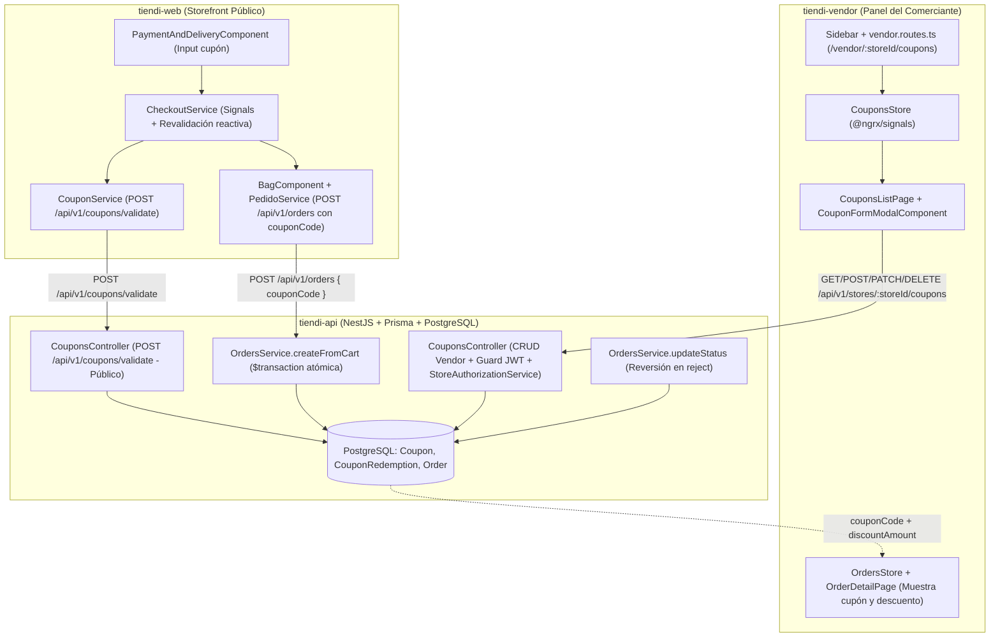
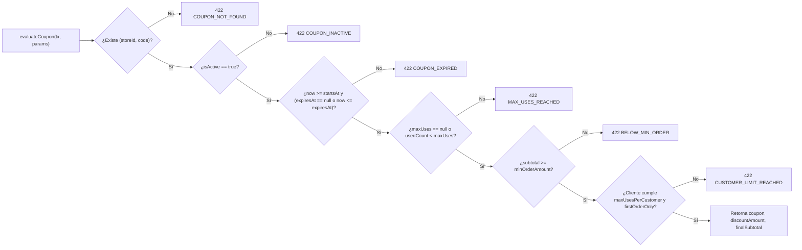

# Guía de Implementación Ejecutable por Agente IA: Sistema de Cupones y Descuentos (M10 End-to-End)

Especificación técnica **LLM-First** diseñada para que un agente de IA implemente de principio a fin el módulo de **Cupones y Descuentos (M10)** en `tiendi-web`, `tiendi-api` y `tiendi-vendor` sin ambigüedades, respetando los patrones reales del monorepo (`ZodValidationPipe`, `StoreAuthorizationService`, `@ngrx/signals`, `StoreContextService` y transacciones Prisma).

> [!IMPORTANT]
> **Contexto del bug actual en producción/test (`web-test.tiendi.pe`):**  
> `tiendi-web` ya tiene implementada la UI y lógica de cupones en checkout (commit `afc2af68`), que invoca `POST /api/v1/coupons/validate` y envía `couponCode` en `POST /api/v1/orders`. Como `tiendi-api` aún no tiene `CouponsModule`, NestJS responde `404 Not Found` (`{"statusCode":404,"message":"Cannot POST /api/v1/coupons/validate"}`) y `CouponService` expone `error.error.message` crudo en la pantalla del comprador.

---

## 0. Instrucciones Operativas para el Agente IA (Guardrails)

Antes de modificar cualquier archivo, el agente ejecutor **DEBE** cumplir estas reglas invariantes:

1. **Rutas de los repositorios:**
   - Backend API: `F:\PROYECTOS\ecommcerce-saas-sonet\FUENTES\tiendi-api`
   - Storefront Público: `F:\PROYECTOS\ecommcerce-saas-sonet\FUENTES\tiendi-web`
   - Panel del Vendedor: `F:\PROYECTOS\ecommcerce-saas-sonet\FUENTES\tiendi-vendor`
2. **Convenciones obligatorias del código existente:**
   - **`tiendi-api` usa Zod + `ZodValidationPipe`** (`src/common/pipes/zod-validation.pipe.ts`), **NO** `class-validator` en los módulos modernos como `orders`.
   - **`tiendi-api` autoriza tiendas con `StoreAuthorizationService`** (`this.authz.assertPermission(actor, storeId, permission)`) y la matriz en `src/common/authorization/store-permissions.ts`.
   - **`tiendi-vendor` usa `@ngrx/signals` (`signalStore`)**, `StoreContextService` (`storeId`) y el catálogo de capacidades en `src/app/vendor/core/auth/capabilities.ts`.
   - **Idioma de artefactos de código:** Identificadores en inglés; textos de UI y mensajes de error de negocio en español neutro profesional (sin voseo ni modismos regionales).
3. **Ejecución secuencial por Unidades de Trabajo (Work Units):**
   - Ejecutar en orden estricto: **WU-1 (`tiendi-web`) → WU-2 (Prisma + `CouponsModule` en `tiendi-api`) → WU-3 (`OrdersService` en `tiendi-api`) → WU-4 (`tiendi-vendor` M10) → WU-5 (`tiendi-vendor` Trazabilidad en Pedidos)**.
   - No avanzar a la siguiente unidad hasta que el comando de verificación de la unidad actual pase en verde.

---

## 1. Arquitectura End-to-End y Contratos

### 1.1 Mapa del Circuito Completo (`tiendi-vendor` → `tiendi-api` → `tiendi-web`)



### 1.2 Inventario Exacto de Archivos por Unidad de Trabajo

| Unidad | Repo | Acción | Ruta del Archivo |
|--------|------|--------|------------------|
| **WU-1** | `tiendi-web` | `MODIFY` | `src/app/core/services/coupon.service.ts` |
| **WU-1** | `tiendi-web` | `MODIFY` | `src/app/core/services/coupon.service.spec.ts` |
| **WU-2** | `tiendi-api` | `MODIFY` | `prisma/schema.prisma` |
| **WU-2** | `tiendi-api` | `MODIFY` | `src/common/authorization/store-permissions.ts` |
| **WU-2** | `tiendi-api` | `MODIFY` | `src/common/authorization/store-authorization.service.spec.ts` |
| **WU-2** | `tiendi-api` | `CREATE` | `src/modules/coupons/dto/coupon.dto.ts` |
| **WU-2** | `tiendi-api` | `CREATE` | `src/modules/coupons/coupons.service.ts` |
| **WU-2** | `tiendi-api` | `CREATE` | `src/modules/coupons/coupons.controller.ts` |
| **WU-2** | `tiendi-api` | `CREATE` | `src/modules/coupons/coupons.module.ts` |
| **WU-2** | `tiendi-api` | `CREATE` | `src/modules/coupons/coupons.service.spec.ts` |
| **WU-2** | `tiendi-api` | `MODIFY` | `src/app.module.ts` |
| **WU-3** | `tiendi-api` | `MODIFY` | `src/modules/orders/dto/create-order.dto.ts` |
| **WU-3** | `tiendi-api` | `MODIFY` | `src/modules/orders/orders.module.ts` |
| **WU-3** | `tiendi-api` | `MODIFY` | `src/modules/orders/orders.service.ts` |
| **WU-3** | `tiendi-api` | `MODIFY` | `src/modules/orders/orders.service.spec.ts` |
| **WU-4** | `tiendi-vendor` | `MODIFY` | `src/app/vendor/core/auth/capabilities.ts` |
| **WU-4** | `tiendi-vendor` | `MODIFY` | `src/app/vendor/shared/layout/sidebar.component.ts` |
| **WU-4** | `tiendi-vendor` | `MODIFY` | `src/app/vendor/vendor.routes.ts` |
| **WU-4** | `tiendi-vendor` | `CREATE` | `src/app/vendor/features/coupons/coupons.store.ts` |
| **WU-4** | `tiendi-vendor` | `CREATE` | `src/app/vendor/features/coupons/coupons.store.spec.ts` |
| **WU-4** | `tiendi-vendor` | `CREATE` | `src/app/vendor/features/coupons/pages/coupons-list.page.ts` |
| **WU-4** | `tiendi-vendor` | `CREATE` | `src/app/vendor/features/coupons/pages/coupons-list.page.html` |
| **WU-4** | `tiendi-vendor` | `CREATE` | `src/app/vendor/features/coupons/pages/coupons-list.page.scss` |
| **WU-4** | `tiendi-vendor` | `CREATE` | `src/app/vendor/features/coupons/components/coupon-form-modal.component.ts` |
| **WU-5** | `tiendi-vendor` | `MODIFY` | `src/app/vendor/features/orders/orders.store.ts` |
| **WU-5** | `tiendi-vendor` | `MODIFY` | `src/app/vendor/features/orders/pages/order-detail.page.html` |

---

## 2. WU-1: Blindaje de Errores en `tiendi-web`

### Objetivo
Evitar que `CouponService` muestre mensajes crudos de NestJS (`Cannot POST /api/v1/coupons/validate`) ante respuestas HTTP `404`, `5xx` o fallos de red, y normalizar los mensajes en español neutro.

### 2.1 Modificar `FUENTES/tiendi-web/src/app/core/services/coupon.service.ts`

Reemplazar el mensaje en línea 31 (`'Ingresa un código de cupón válido.'`) y el bloque `catch` (líneas 60-91) por:

```typescript
    } catch (error: unknown) {
      let message = 'El cupón no es válido.';
      let errorCode: string | undefined;

      if (error instanceof HttpErrorResponse) {
        if (error.status === 404) {
          message = 'El cupón ingresado no existe o no está disponible.';
          errorCode = 'COUPON_NOT_FOUND';
        } else if (error.status === 0 || error.status >= 500) {
          message = 'No pudimos validar el cupón en este momento. Intenta nuevamente.';
          errorCode = 'SERVICE_UNAVAILABLE';
        } else if (error.error?.message) {
          const rawMsg = Array.isArray(error.error.message)
            ? error.error.message.join(', ')
            : typeof error.error.message === 'string'
              ? error.error.message
              : 'El cupón no es válido.';
          message = rawMsg.startsWith('Cannot ')
            ? 'El cupón ingresado no existe o no está disponible.'
            : rawMsg;
        }

        if (!errorCode) {
          if (error.error?.reason) {
            errorCode = error.error.reason;
          } else if (error.error?.code) {
            errorCode = error.error.code;
          }
        }
      } else if (error instanceof Error) {
        message = error.message;
      }

      return {
        isValid: false,
        code: normalizedCode,
        discountType: 'FIXED_AMOUNT',
        discountValue: 0,
        discountAmount: 0,
        newTotal: params.subtotal,
        message,
        errorCode,
      };
    }
```

### 2.2 Modificar `FUENTES/tiendi-web/src/app/core/services/coupon.service.spec.ts`

Agregar el siguiente caso de prueba al final del bloque `describe('CouponService', ...)`:

```typescript
  it('should sanitize 404 Cannot POST errors and return friendly COUPON_NOT_FOUND message', async () => {
    const promise = service.validateCoupon({
      storeId: 'store-123',
      code: 'MALCODIGO',
      subtotal: 100,
    });

    const req = httpTesting.expectOne(`${apiUrl}/coupons/validate`);
    req.flush(
      {
        statusCode: 404,
        message: 'Cannot POST /api/v1/coupons/validate',
        error: 'Not Found',
      },
      { status: 404, statusText: 'Not Found' }
    );

    const result = await promise;
    expect(result.isValid).toBeFalse();
    expect(result.errorCode).toBe('COUPON_NOT_FOUND');
    expect(result.message).toBe('El cupón ingresado no existe o no está disponible.');
  });
```

### 2.3 Verificación de WU-1
```powershell
cd "F:\PROYECTOS\ecommcerce-saas-sonet\FUENTES\tiendi-web"
npx ng test --include="src/app/core/services/coupon.service.spec.ts" --watch=false
```

---

## 3. WU-2: Esquema Prisma, Permisos y `CouponsModule` en `tiendi-api`

### 3.1 Modificar `FUENTES/tiendi-api/prisma/schema.prisma`

1. En `model User`, agregar la relación inversa:
   ```prisma
   couponRedemptions CouponRedemption[]
   ```
2. En `model Store`, agregar la relación inversa:
   ```prisma
   coupons Coupon[]
   ```
3. En `model Order` (alrededor de la línea 340), reemplazar el bloque de importes por:
   ```prisma
   subtotal       Decimal @db.Decimal(10, 2)
   discountAmount Decimal @default(0) @db.Decimal(10, 2)
   couponId       String?
   coupon         Coupon? @relation(fields: [couponId], references: [id])
   couponCode     String?
   igv            Decimal @default(0) @db.Decimal(10, 2)
   deliveryFee    Decimal @default(0) @db.Decimal(10, 2)
   total          Decimal @db.Decimal(10, 2)

   couponRedemption CouponRedemption?
   ```
4. Agregar al final de `prisma/schema.prisma`:
   ```prisma
   enum DiscountType {
     PERCENTAGE
     FIXED_AMOUNT
   }

   model Coupon {
     id                 String       @id @default(uuid())
     storeId            String
     store              Store        @relation(fields: [storeId], references: [id], onDelete: Cascade)
     code               String
     description        String?
     discountType       DiscountType
     discountValue      Decimal      @db.Decimal(10, 2)
     minOrderAmount     Decimal      @default(0) @db.Decimal(10, 2)
     maxDiscountAmount  Decimal?     @db.Decimal(10, 2)
     maxUses            Int?
     maxUsesPerCustomer Int?         @default(1)
     usedCount          Int          @default(0)
     firstOrderOnly     Boolean      @default(false)
     startsAt           DateTime     @default(now())
     expiresAt          DateTime?
     isActive           Boolean      @default(true)
     createdAt          DateTime     @default(now())
     updatedAt          DateTime     @updatedAt

     orders      Order[]
     redemptions CouponRedemption[]

     @@unique([storeId, code])
     @@index([storeId, isActive])
   }

   model CouponRedemption {
     id             String   @id @default(uuid())
     couponId       String
     coupon         Coupon   @relation(fields: [couponId], references: [id], onDelete: Restrict)
     orderId        String   @unique
     order          Order    @relation(fields: [orderId], references: [id], onDelete: Cascade)
     customerId     String
     customer       User     @relation(fields: [customerId], references: [id], onDelete: Restrict)
     discountAmount Decimal  @db.Decimal(10, 2)
     redeemedAt     DateTime @default(now())

     @@index([couponId, customerId])
   }
   ```
5. Regenerar el cliente de Prisma:
   ```powershell
   cd "F:\PROYECTOS\ecommcerce-saas-sonet\FUENTES\tiendi-api"
   npx prisma generate
   ```

### 3.2 Modificar `FUENTES/tiendi-api/src/common/authorization/store-permissions.ts`

Agregar `'coupons.read'` y `'coupons.write'` en:
1. El type `StorePermission`
2. El arreglo `ALL`
3. `STORE_CAPABILITY_MATRIX.OWNER`
4. `STORE_CAPABILITY_MATRIX.MANAGER`

> [!NOTE]
> Actualizar también `src/common/authorization/store-authorization.service.spec.ts` si la prueba de matriz enumera los permisos de `OWNER` y `MANAGER`.

### 3.3 Crear `FUENTES/tiendi-api/src/modules/coupons/dto/coupon.dto.ts`

```typescript
import { z } from 'zod';

export const ValidateCouponSchema = z.object({
  storeId: z.string().min(1),
  code: z.string().trim().min(1).max(50),
  subtotal: z.number().nonnegative(),
  customerId: z.string().uuid().optional(),
});

export type ValidateCouponDto = z.infer<typeof ValidateCouponSchema>;

export const CreateCouponSchema = z
  .object({
    code: z
      .string()
      .trim()
      .min(3)
      .max(30)
      .regex(/^[A-Za-z0-9_-]+$/, 'El código solo puede contener letras, números, guiones y guiones bajos'),
    description: z.string().trim().max(200).nullish(),
    discountType: z.enum(['PERCENTAGE', 'FIXED_AMOUNT']),
    discountValue: z.number().positive(),
    minOrderAmount: z.number().nonnegative().default(0),
    maxDiscountAmount: z.number().positive().nullish(),
    maxUses: z.number().int().positive().nullish(),
    maxUsesPerCustomer: z.number().int().positive().nullish().default(1),
    firstOrderOnly: z.boolean().default(false),
    startsAt: z.coerce.date().optional(),
    expiresAt: z.coerce.date().nullish(),
    isActive: z.boolean().default(true),
  })
  .refine(
    (data) => data.discountType !== 'PERCENTAGE' || data.discountValue <= 100,
    { message: 'El porcentaje de descuento no puede superar el 100%', path: ['discountValue'] }
  );

export type CreateCouponDto = z.infer<typeof CreateCouponSchema>;

export const UpdateCouponSchema = z.object({
  description: z.string().trim().max(200).nullish(),
  minOrderAmount: z.number().nonnegative().optional(),
  maxDiscountAmount: z.number().positive().nullish(),
  maxUses: z.number().int().positive().nullish(),
  maxUsesPerCustomer: z.number().int().positive().nullish(),
  firstOrderOnly: z.boolean().optional(),
  startsAt: z.coerce.date().optional(),
  expiresAt: z.coerce.date().nullish(),
  isActive: z.boolean().optional(),
});

export type UpdateCouponDto = z.infer<typeof UpdateCouponSchema>;
```

### 3.4 Crear `FUENTES/tiendi-api/src/modules/coupons/coupons.service.ts`

El servicio debe implementar:



**Reglas exactas de implementación para `CouponsService`:**
- Para lanzar errores de validación usar `new UnprocessableEntityException({ message, reason })` de `@nestjs/common`.
- **Soporte de `storeId` por UUID o slug:** Si `params.storeId` no es UUID, buscar primero `store.findFirst({ where: { OR: [{ id: params.storeId }, { slug: params.storeId }] } })` para resolver `store.id`.
- **Mensajes y `reason` obligatorios (validados por `coupon.service.spec.ts` en `tiendi-web`):**
  - No existe: `{ message: 'El cupón no existe', reason: 'COUPON_NOT_FOUND' }`
  - Inactivo: `{ message: 'El cupón no está disponible', reason: 'COUPON_INACTIVE' }`
  - Fuera de fecha (`now < startsAt` o `expiresAt && now > expiresAt`): `{ message: 'El cupón ha expirado', reason: 'COUPON_EXPIRED' }`
  - Límite global alcanzado (`maxUses != null && usedCount >= maxUses`): `{ message: 'El cupón alcanzó el límite máximo de usos', reason: 'MAX_USES_REACHED' }`
  - Monto mínimo (`subtotal < Number(coupon.minOrderAmount)`): `{ message: 'El pedido mínimo para aplicar este cupón es de S/ ' + Number(coupon.minOrderAmount).toFixed(2), reason: 'BELOW_MIN_ORDER' }`
  - Límite por cliente (`customerId` provisto y `redemptionsCount >= maxUsesPerCustomer` o `firstOrderOnly` con pedidos previos no rechazados): `{ message: 'Ya utilizaste este cupón el máximo de veces permitido', reason: 'CUSTOMER_LIMIT_REACHED' }`
- **Cálculo de `discountAmount`:**
  - Si `discountType === 'PERCENTAGE'`:
    `raw = Math.round(subtotal * (Number(coupon.discountValue) / 100) * 100) / 100`
    `capped = coupon.maxDiscountAmount != null ? Math.min(raw, Number(coupon.maxDiscountAmount)) : raw`
    `discountAmount = Math.min(capped, subtotal)`
  - Si `discountType === 'FIXED_AMOUNT'`:
    `discountAmount = Math.min(Number(coupon.discountValue), subtotal)`
  - `finalSubtotal = Math.max(0, Math.round((subtotal - discountAmount) * 100) / 100)`
- **Método `redeemInTransaction(tx: Prisma.TransactionClient, params: { storeId: string; code: string; subtotal: number; customerId: string; orderId: string })`:**
  1. Llama a la evaluación sobre `tx`.
  2. Ejecuta actualización condicional atómica:
     ```typescript
     const updated = await tx.coupon.updateMany({
       where: {
         id: coupon.id,
         isActive: true,
         ...(coupon.maxUses != null ? { usedCount: { lt: coupon.maxUses } } : {}),
       },
       data: { usedCount: { increment: 1 } },
     });
     if (updated.count === 0) {
       throw new UnprocessableEntityException({
         message: 'El cupón alcanzó el límite máximo de usos',
         reason: 'MAX_USES_REACHED',
       });
     }
     ```
  3. Crea el registro `tx.couponRedemption.create({ data: { couponId: coupon.id, orderId: params.orderId, customerId: params.customerId, discountAmount } })`.
  4. Retorna `{ couponId: coupon.id, couponCode: coupon.code, discountAmount, finalSubtotal }`.
- **Método `releaseRedemptionInTransaction(tx: Prisma.TransactionClient, orderId: string)`:**
  1. Busca `redemption = await tx.couponRedemption.findUnique({ where: { orderId } })`.
  2. Si existe, elimina `tx.couponRedemption.delete({ where: { id: redemption.id } })` y decrementa `tx.coupon.updateMany({ where: { id: redemption.couponId, usedCount: { gt: 0 } }, data: { usedCount: { decrement: 1 } } })`.
- **Métodos CRUD Vendor (`listByStore`, `createForStore`, `updateForStore`, `removeForStore`):**
  - Verifican autorización con `await this.authz.assertPermission(actor, storeId, 'coupons.read' | 'coupons.write')`.
  - En `createForStore`: normaliza `code = dto.code.trim().toUpperCase()`. Si ya existe `(storeId, code)`, lanza `ConflictException('Ya existe un cupón con ese código en la tienda')`.
  - En `removeForStore`: si `coupon.usedCount > 0`, desactiva (`isActive: false`) en lugar de borrar físicamente para no romper la FK de `Order` y `CouponRedemption`.

### 3.5 Crear `FUENTES/tiendi-api/src/modules/coupons/coupons.controller.ts`

Exponer dos controladores o rutas dentro del mismo archivo:
1. `@Controller('coupons')`:
   - `@Post('validate')` (sin guard de autenticación — endpoint público para checkout): recibe `@Body(new ZodValidationPipe(ValidateCouponSchema)) dto: ValidateCouponDto` y llama a `this.couponsService.validatePublic(dto)`.
2. `@Controller('stores/:storeId/coupons')` con `@UseGuards(JwtAuthGuard)`:
   - `@Get()` → `listByStore(storeId, actor)`
   - `@Post()` → `createForStore(storeId, dto, actor)`
   - `@Patch(':id')` → `updateForStore(storeId, id, dto, actor)`
   - `@Delete(':id')` → `removeForStore(storeId, id, actor)`

### 3.6 Registrar `CouponsModule` en `src/app.module.ts`
Exportar `CouponsService` desde `CouponsModule` e importar `CouponsModule` en `AppModule`.

### 3.7 Verificación de WU-2
```powershell
cd "F:\PROYECTOS\ecommcerce-saas-sonet\FUENTES\tiendi-api"
npx jest src/modules/coupons/coupons.service.spec.ts src/common/authorization/store-authorization.service.spec.ts
```

---

## 4. WU-3: Integración Transaccional con Pedidos en `tiendi-api`

### 4.1 Modificar `FUENTES/tiendi-api/src/modules/orders/dto/create-order.dto.ts`

Agregar `couponCode` opcional al `CreateOrderSchema`:

```typescript
export const CreateOrderSchema = z.object({
  storeId: z.string().uuid(),
  paymentMethod: z.enum(['CASH', 'YAPE', 'PLIN', 'TRANSFER', 'CARD']),
  deliveryType: z.enum(['PICKUP', 'DELIVERY']),
  couponCode: z.string().trim().min(1).max(50).optional(),
  deliveryAddress: z
    .object({
      street: z.string(),
      city: z.string().optional(),
      references: z.string().optional(),
    })
    .optional(),
});
```

### 4.2 Modificar `FUENTES/tiendi-api/src/modules/orders/orders.module.ts` y `orders.service.ts`

1. Importar `CouponsModule` en `OrdersModule` e inyectar `@Optional() private readonly couponsService?: CouponsService` al final del constructor de `OrdersService` (para no romper specs existentes que instancian `OrdersService` manualmente).
2. En `OrdersService.createFromCart`:
   - Dentro de `this.prisma.$transaction(async (tx) => { ... })`, después de descontar el stock de los productos y antes de `tx.order.create`:
     - Crear primero el ID de la orden (`const orderId = randomUUID()`) o crear el pedido y luego registrar el `CouponRedemption`.
     - Si `dto.couponCode && this.couponsService`:
       - Invocar `await this.couponsService.evaluateCouponInTx(tx, { storeId: dto.storeId, code: dto.couponCode, subtotal, customerId })`.
       - Calcular `discountAmount`, `finalSubtotal = Math.max(0, subtotal - discountAmount)`, `igv` sobre `finalSubtotal` y `total = finalSubtotal + deliveryFee`.
       - Guardar en `tx.order.create`: `subtotal`, `discountAmount`, `couponId`, `couponCode`, `igv`, `deliveryFee`, `total`.
       - Ejecutar `await this.couponsService.commitRedemptionInTx(tx, { couponId, maxUses, orderId: created.id, customerId, discountAmount })`.
3. En `OrdersService.updateStatus`:
   - Cuando `action === 'reject'` y el pedido tiene `couponId`, dentro de la transacción de rechazo llamar a `await this.couponsService?.releaseRedemptionInTransaction(tx, order.id)`.

### 4.3 Verificación de WU-3
```powershell
cd "F:\PROYECTOS\ecommcerce-saas-sonet\FUENTES\tiendi-api"
npx jest src/modules/orders/orders.service.spec.ts
```

---

## 5. WU-4: Módulo de Gestión de Cupones en `tiendi-vendor` (M10)

### 5.1 Permisos, Menú y Rutas en `tiendi-vendor`

1. **Modificar `FUENTES/tiendi-vendor/src/app/vendor/core/auth/capabilities.ts`:**
   - Agregar `| 'coupons.manage'` al type `VendorCapability`.
   - Agregar `'coupons.manage'` a los arreglos `OWNER`, `MANAGER` y `SUPER_ADMIN`.
2. **Modificar `FUENTES/tiendi-vendor/src/app/vendor/shared/layout/sidebar.component.ts`:**
   - En `NAV_ITEMS`, insertar debajo de `Productos` o `Clientes`:
     ```typescript
     { label: 'Cupones', icon: 'local_offer', route: '/vendor/coupons', capability: 'coupons.manage' },
     ```
3. **Modificar `FUENTES/tiendi-vendor/src/app/vendor/vendor.routes.ts`:**
   - En `SHELL_CHILDREN`, agregar:
     ```typescript
     {
       path: 'coupons',
       canActivate: [capabilityGuard('coupons.manage')],
       loadComponent: () =>
         import('./features/coupons/pages/coupons-list.page').then((c) => c.CouponsListPage),
     },
     ```

### 5.2 Crear `FUENTES/tiendi-vendor/src/app/vendor/features/coupons/coupons.store.ts`

Implementar un `@ngrx/signals` `signalStore({ providedIn: 'root' })` siguiendo el mismo patrón de `customers.store.ts` / `products.store.ts`:
- Inyectar `HttpClient` y `StoreContextService`.
- Estado: `coupons: VendorCoupon[]`, `loading: boolean`, `saving: boolean`, `error: string | null`.
- Computed signals:
  - `activeCouponsCount`: cantidad de cupones con `isActive && !isExpired`.
  - `totalRedemptions`: suma de `usedCount` de todos los cupones.
- Métodos asíncronos:
  - `loadCoupons()`: `GET ${environment.apiUrl}/stores/${storeId}/coupons`
  - `createCoupon(payload: CreateVendorCouponDto)`: `POST ${environment.apiUrl}/stores/${storeId}/coupons`
  - `updateCoupon(id: string, payload: UpdateVendorCouponDto)`: `PATCH ${environment.apiUrl}/stores/${storeId}/coupons/${id}`
  - `toggleActive(coupon: VendorCoupon)`: llama a `updateCoupon(coupon.id, { isActive: !coupon.isActive })`
  - `deleteCoupon(id: string)`: `DELETE ${environment.apiUrl}/stores/${storeId}/coupons/${id}`

### 5.3 Crear `CouponsListPage` y `CouponFormModalComponent`

- **`coupons-list.page.ts` / `.html` / `.scss`:**
  - Cabecera con título **"Cupones y Descuentos"**, contador de activos y botón primario **"Crear cupón"**.
  - Barra de búsqueda por código y filtro de estado (`Todos`, `Activos`, `Inactivos`, `Expirados`).
  - Tabla responsiva / tarjetas con columnas:
    - **Código** (badge monoespaciado con botón de copiar al portapapeles)
    - **Descuento** (`15% OFF` o `S/ 10.00 OFF` + mínimo de compra `Mín. S/ XX.XX`)
    - **Usos** (`usedCount / maxUses ?? '∞'`)
    - **Vigencia** (`startsAt` - `expiresAt ?? 'Sin vencimiento'`)
    - **Estado** (switch o toggle rápido `isActive`)
    - **Acciones** (Editar, Eliminar/Desactivar)
- **`coupon-form-modal.component.ts`:**
  - Formulario reactivo (`ReactiveFormsModule`) con:
    - `code` (input en mayúsculas automáticas + botón **"Generar código"** que crea un código alfanumérico de 8 caracteres)
    - `description` (opcional)
    - `discountType` (`PERCENTAGE` | `FIXED_AMOUNT`)
    - `discountValue` (con validación `max(100)` cuando es `PERCENTAGE`)
    - `minOrderAmount` (monto mínimo de pedido en `S/`)
    - `maxDiscountAmount` (tope de descuento en `S/`, visible cuando `discountType === 'PERCENTAGE'`)
    - `maxUses` (límite global opcional) y `maxUsesPerCustomer` (por defecto `1`)
    - `firstOrderOnly` (checkbox "Solo para primera compra en la tienda")
    - `expiresAt` (fecha de vencimiento opcional)

### 5.4 Verificación de WU-4
```powershell
cd "F:\PROYECTOS\ecommcerce-saas-sonet\FUENTES\tiendi-vendor"
npx ng test --include="src/app/vendor/features/coupons/coupons.store.spec.ts" --watch=false
```

---

## 6. WU-5: Trazabilidad del Descuento en Pedidos de `tiendi-vendor`

### Objetivo
Cuando un comprador canjea un cupón en `tiendi-web`, el vendedor debe ver en el detalle del pedido (`/vendor/:storeId/orders/:id`) qué código aplicó y cuánto se descontó.

### 6.1 Modificar `FUENTES/tiendi-vendor/src/app/vendor/features/orders/orders.store.ts`

1. En la interfaz `VendorOrder`, agregar:
   ```typescript
   couponCode: string | null;
   discountAmount: number;
   ```
2. En la función `mapOrder(raw: Record<string, unknown>): VendorOrder`, mapear:
   ```typescript
   couponCode: typeof raw['couponCode'] === 'string' ? raw['couponCode'] : null,
   discountAmount: raw['discountAmount'] != null ? Number(raw['discountAmount']) : 0,
   ```

### 6.2 Modificar `FUENTES/tiendi-vendor/src/app/vendor/features/orders/pages/order-detail.page.html`

En el resumen de importes del pedido (debajo de `Subtotal` y antes de `Total`), mostrar condicionalmente el descuento del cupón:

```html
@if (order.discountAmount > 0 || order.couponCode) {
  <div class="summary-row summary-row--discount">
    <span>Descuento {{ order.couponCode ? '(' + order.couponCode + ')' : '' }}</span>
    <span>- S/ {{ order.discountAmount | number:'1.2-2' }}</span>
  </div>
}
```

### 6.3 Verificación de WU-5
```powershell
cd "F:\PROYECTOS\ecommcerce-saas-sonet\FUENTES\tiendi-vendor"
npx ng build --configuration=development
```

---

## 7. Checklist Final de Aceptación (Gatekeeper para el Agente)

- [ ] **WU-1 (`tiendi-web`):** `coupon.service.spec.ts` pasa en verde y cualquier respuesta `404` / `5xx` devuelve un mensaje limpio sin exponer `"Cannot POST /api/v1/coupons/validate"`.
- [ ] **WU-2 (`tiendi-api`):** `npx prisma generate` sin errores y `coupons.service.spec.ts` valida los 6 casos (`200 OK`, `COUPON_NOT_FOUND`, `COUPON_INACTIVE`, `COUPON_EXPIRED`, `MAX_USES_REACHED`, `BELOW_MIN_ORDER`, `CUSTOMER_LIMIT_REACHED`).
- [ ] **WU-3 (`tiendi-api`):** `orders.service.spec.ts` pasa en verde; crear un pedido con `couponCode` persiste `discountAmount`, `couponId` y `couponCode`, e incrementa `Coupon.usedCount` dentro de `$transaction`.
- [ ] **WU-4 (`tiendi-vendor`):** El ítem **"Cupones"** aparece en el sidebar para `STORE_OWNER` y `MANAGER`, y `/vendor/:storeId/coupons` permite listar, crear, activar/desactivar y eliminar cupones.
- [ ] **WU-5 (`tiendi-vendor`):** El detalle de pedido muestra el código de cupón aplicado y el monto descontado.
