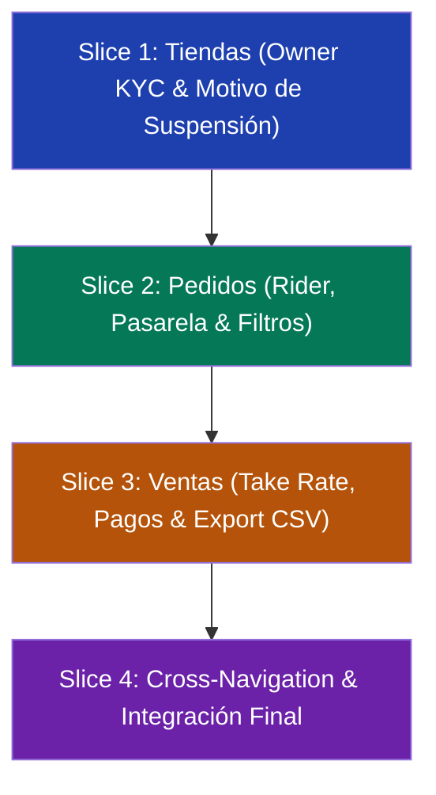

# Guía de Implementación Paso a Paso: Mejoras Core en tiendi-admin (Tiendas, Ventas y Pedidos)

Esta guía define el plan técnico exacto para que un agente de IA o desarrollador implemente las mejoras de los módulos de **Tiendas**, **Ventas** y **Pedidos** en `tiendi-admin` y su API correspondiente en `tiendi-api`.

> [!NOTE]
> Cada slice de trabajo está diseñado para ser atómico, testeable y desplegable de forma independiente. No mezclar cambios de backend de diferentes slices en un mismo commit.

---

## 1. Quick Path de Ejecución



### Reglas para el Agente Implementador
1. **Commits convencionales únicamente:** Formato `feat(scope): descripción`, `test(scope): ...`, `fix(scope): ...`. Sin atribución a IA.
2. **Backend primero, Frontend después:** Asegurar que los contratos de API y tipos compartidos estén validados antes de tocar la UI.
3. **No romper SignalStores:** En `tiendi-admin`, respetar la reactividad con `@ngrx/signals` (`patchState`, `signalStore`, `computed`).
4. **Verificación estricta:** Ejecutar los comandos de test y build al finalizar cada slice.

---

## 2. Slice 1: Tiendas — Owner KYC y Gobernanza de Suspensión

### 2.1 Backend (`FUENTES/tiendi-api`)

#### Paso 1: Extender consulta de detalle y listado de tiendas
* **Archivo:** `src/modules/stores/stores.service.ts`
* **Cambio en `findByIdForVendor` / `findById`:**
  Incluir la relación `owner` en la consulta Prisma:
  ```typescript
  include: {
    owner: {
      select: {
        id: true,
        name: true,
        lastName: true,
        email: true,
        phone: true,
        documentType: true,
        documentNumber: true,
      },
    },
  }
  ```
* **Cambio en `updateStatus`:**
  Aceptar un parámetro opcional `reason?: string` y auditarlo si el estado cambia a `SUSPENDED`.
* **Archivo:** `src/modules/stores/dto/update-store-status.dto.ts` (o en `stores.controller.ts`)
  Asegurar que el body acepte `{ status: 'ACTIVE' | 'PENDING' | 'SUSPENDED', reason?: string }`.

### 2.2 Frontend (`FUENTES/tiendi-admin`)

#### Paso 2: Actualizar el modelo e interfaz
* **Archivo:** `src/app/admin/features/stores/stores.page.ts`
* **Extender `Store` interface:**
  ```typescript
  interface StoreOwner {
    id: string;
    name: string;
    lastName?: string;
    email: string;
    phone?: string;
    documentType?: string;
    documentNumber?: string;
  }
  // Agregar en interface Store:
  owner?: StoreOwner;
  suspensionReason?: string;
  ```

#### Paso 3: Actualizar el modal de revisión y confirmación
* **Archivo:** `src/app/admin/features/stores/stores.page.html`
* En el `<dl>` del detalle (`#reviewDialog`), agregar la sección **Datos del Propietario (KYC)**:
  ```html
  <dt>Titular / Propietario</dt>
  <dd>{{ store.owner ? (store.owner.name + ' ' + (store.owner.lastName || '')) : 'No disponible' }}</dd>
  <dt>Documento</dt>
  <dd>{{ store.owner?.documentType }}: {{ store.owner?.documentNumber || 'No registrado' }}</dd>
  <dt>Correo del Propietario</dt>
  <dd>{{ store.owner?.email || 'No registrado' }}</dd>
  ```
* En la caja de confirmación de suspensión, agregar un campo de texto obligatorio `suspensionReason` antes de llamar a `confirmStatus()`.

#### Paso 4: Verificación del Slice 1
```bash
# En FUENTES/tiendi-api
npm run test -- src/modules/stores

# En FUENTES/tiendi-admin
npm run test -- stores.page.spec.ts
npm run build
```

---

## 3. Slice 2: Pedidos — Datos de Repartidor, Pasarela y Filtros Operativos

### 3.1 Backend (`FUENTES/tiendi-api`)

#### Paso 1: Enriquecer consulta de pedidos admin con Delivery y Rider
* **Archivo:** `src/modules/orders/orders.service.ts`
* En `listOrdersForAdmin` y `findOne`, asegurar que el `include` de Prisma traiga la relación con `delivery` y el rider asociado:
  ```typescript
  delivery: {
    include: {
      rider: {
        include: {
          user: {
            select: { name: true, lastName: true, phone: true }
          },
          vehicles: {
            where: { active: true },
            take: 1
          }
        }
      }
    }
  }
  ```
* En `listOrdersForAdmin`, admitir en el DTO de consulta los filtros:
  * `paymentStatus?: PaymentStatus`
  * `storeId?: string`
  * `from?: string`
  * `to?: string`

### 3.2 Frontend (`FUENTES/tiendi-admin`)

#### Paso 2: Actualizar Tipos en el Admin
* **Archivo:** `src/app/admin/core/types/order-tracking.types.ts`
* Extender `AdminOrderDetailDto` para mapear los datos del rider:
  ```typescript
  export interface AssignedRiderDto {
    id: string;
    fullName: string;
    phone?: string;
    vehiclePlate?: string;
    vehicleType?: string;
  }
  ```

#### Paso 3: Actualizar Vista de Detalle de Pedido
* **Archivo:** `src/app/admin/features/orders/order-detail.page.html`
* En la tarjeta de entrega, si `order.deliveryType === 'DELIVERY'`, mostrar bloque del repartidor:
  * Nombre del repartidor y botón para llamar (`tel:{{ rider.phone }}`).
  * Placa y tipo de vehículo.
  * Identificador de pasarela `gatewayChargeId` en la tarjeta de pago con link a Ledger (`/admin/finance/ledger`).

#### Paso 4: Filtros en Listado de Pedidos
* **Archivo:** `src/app/admin/features/orders/orders-list.page.html` y `.ts`:
  * Agregar dropdown de estado de pago (`PAID`, `PENDING`, `FAILED`, `REFUNDED`).
  * Conectar el store `orders.store.ts` con los nuevos parámetros de consulta.

#### Paso 5: Verificación del Slice 2
```bash
# En FUENTES/tiendi-api
npm run test -- src/modules/orders

# En FUENTES/tiendi-admin
npm run test -- orders-list.page.spec.ts order-detail.page.spec.ts
npm run build
```

---

## 4. Slice 3: Ventas — Take Rate de Plataforma, Métodos de Pago y Exportación

### 4.1 Backend (`FUENTES/tiendi-api`)

#### Paso 1: Extender Métricas en Analytics
* **Archivo:** `src/modules/analytics/analytics.service.ts`
* En el método `getPlatformAnalytics`, calcular y añadir en el retorno:
  ```typescript
  platformEarnings: {
    netCommission: number;    // Suma de comisiones de plataforma cobradas
    gatewayFeesEstimated: number; // Costo estimado de pasarela
  },
  paymentMethodsBreakdown: {
    method: string;
    count: number;
    amount: number;
  }[]
  ```

### 4.2 Frontend (`FUENTES/tiendi-admin`)

#### Paso 2: Actualizar Tipos y Store de Ventas
* **Archivo:** `src/app/admin/features/sales/types/sales.types.ts`:
  Agregar `platformEarnings` y `paymentMethodsBreakdown` a `PlatformAnalytics`.
* **Archivo:** `src/app/admin/features/sales/sales.page.html`:
  * Añadir tarjeta KPI: **"Comisión Plataforma (Take Rate)"**.
  * Añadir gráfico o tabla de **"Distribución por Medio de Pago"**.
  * Agregar botón **"Exportar CSV"** en la barra de herramientas de pedidos de ventas que genere un archivo descargable con: `N° Pedido, Fecha, Tienda, Total, Comisión, Estado, Pago`.

#### Paso 3: Utilidad de exportación CSV
* **Archivo:** `src/app/admin/features/sales/utils/sales-export.util.ts`:
  Crear función pura para convertir la lista activa de `AdminOrder[]` a string CSV y disparar descarga mediante `Blob`.

#### Paso 4: Verificación del Slice 3
```bash
# En FUENTES/tiendi-admin
npm run test -- sales.page.spec.ts sales.stores.spec.ts
npm run build
```

---

## 5. Slice 4: Navegación Cruzada (Cross-Navigation)

### 5.1 Enlaces de Contexto
* **Desde Tiendas (`stores.page.html`):**
  * En cada fila de tienda o en el modal de detalle, agregar botones con query params:
    * `<a [routerLink]="['/admin/orders']" [queryParams]="{ storeId: store.id }">Ver pedidos</a>`
    * `<a [routerLink]="['/admin/sales']" [queryParams]="{ storeId: store.id }">Ver ventas</a>`
* **Desde Pedidos (`order-detail.page.html`):**
  * El nombre de la tienda debe ser un enlace directo a su detalle o filtro:
    * `<a [routerLink]="['/admin/stores']" [queryParams]="{ search: order.storeName }">{{ order.storeName }}</a>`

---

## 6. Checklist de Aceptación para el Agente

Antes de considerar terminada la tarea, verificar cada ítem:

- [ ] **Compilación limpia de Backend:** `npm run build` en `FUENTES/tiendi-api` termina sin errores de TypeScript.
- [ ] **Tests de Backend verdes:** `npm run test` en `FUENTES/tiendi-api` pasa sin regresiones.
- [ ] **Compilación limpia de Frontend:** `npm run build` en `FUENTES/tiendi-admin` termina con código de salida 0.
- [ ] **Tests de Frontend verdes:** `npm run test` en `FUENTES/tiendi-admin` completa exitosamente.
- [ ] **Linter sin errores:** `npm run lint` en ambas aplicaciones no arroja errores bloqueantes.
- [ ] **Responsive & Accesibilidad:** Las nuevas tablas y modales mantienen etiquetas `aria-*` y se adaptan a escritorio y resoluciones medianas.
