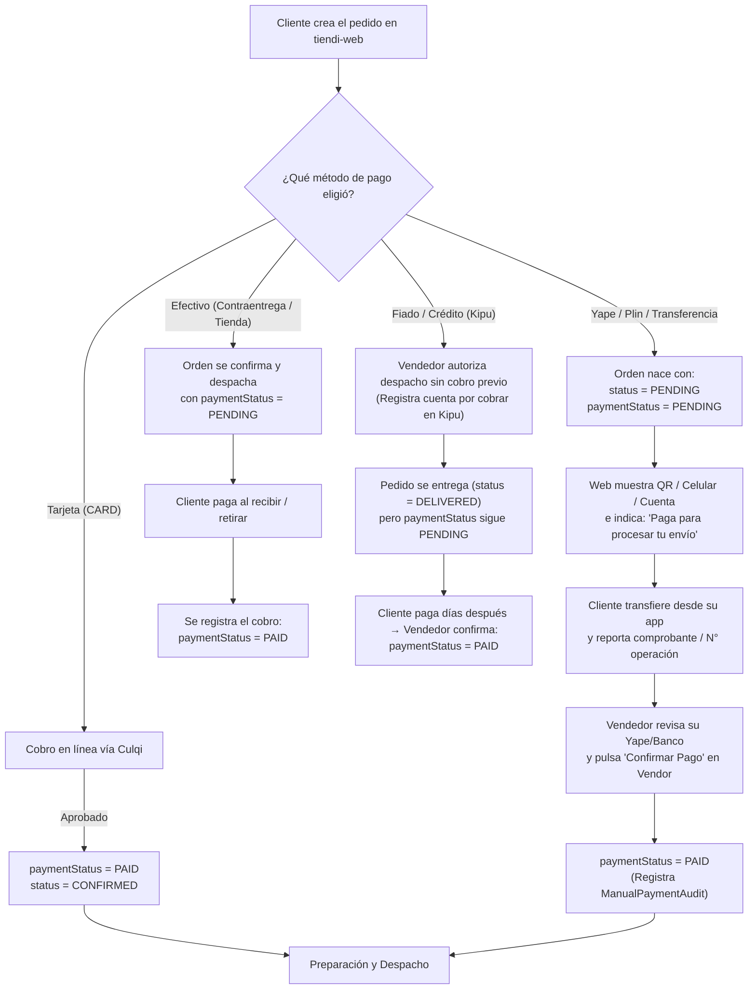
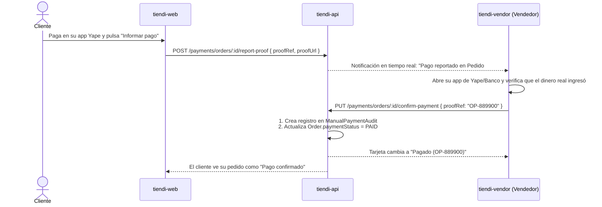
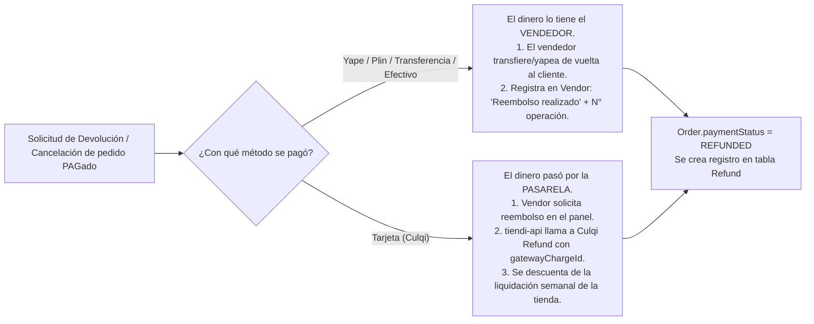

# Guía y Especificación del Flujo de Pagos de Pedidos en Tiendi

Esta guía define de punta a punta **cómo se paga un pedido en Tiendi**, cómo interactúan el cliente y el vendedor en cada etapa (creación, notificación de cobro, verificación, despacho, venta al fiado y devoluciones), y qué pantallas y endpoints intervienen en el sistema.

> [!IMPORTANT]
> **Regla de oro del modelo de negocio:** Tiendi se monetiza por **suscripción mensual** y cobra **0% de comisión por venta**. En los medios de pago directos (Yape, Plin, Transferencia y Efectivo en tienda), el **100% del dinero va directamente del cliente a la cuenta del vendedor** sin pasar por las cuentas de Tiendi.

---

## 1. Resumen Rápido: ¿Cuándo se paga y quién tiene el dinero?

| Método de Pago | Código (`PaymentMethod`) | ¿Cuándo paga el cliente? | ¿Quién recibe el dinero? | ¿Cómo se confirma el pago en el sistema? |
| :--- | :--- | :--- | :--- | :--- |
| **Yape / Plin** | `YAPE` / `PLIN` | **Al crear el pedido** (antes del despacho) | **Vendedor directo** (billetera P2P) | El cliente informa el N° de operación / voucher; el **vendedor verifica su app y confirma** en el panel. |
| **Transferencia** | `TRANSFER` | **Al crear el pedido** (antes del despacho) | **Vendedor directo** (cuenta bancaria) | El cliente envía constancia; el **vendedor verifica su banco y confirma** en el panel. |
| **Tarjeta** | `CARD` | **En el checkout** (instantáneo) | **Pasarela (Culqi)** → Liquida al vendedor | **Automático** vía token + webhook firmado de Culqi. |
| **Efectivo** | `CASH` | **Contra entrega** (o al retirar en tienda) | **Vendedor** (o Repartidor en custodia) | El **vendedor** (o repartidor vía app) marca como cobrado al entregar. |
| **Fiado / Crédito** | `CASH` / `CREDIT` (Kipu) | **Posterior a la entrega** (plazo acordado) | **Vendedor** (cuando el cliente abona) | Se entrega con pago `PENDING` (cuenta por cobrar en **Kipu**); se marca `PAID` cuando el cliente liquida la deuda. |

---

## 2. Flujo General de un Pedido según el Momento de Pago

---

## 3. Escenario A: Pago al Crear el Pedido (Yape, Plin, Transferencia)

En el comercio electrónico local, cuando el cliente elige **Yape**, **Plin** o **Transferencia bancaria**, la regla operativa estándar es **Prepago antes del despacho**: la tienda no envía el producto hasta verificar que el dinero ingresó en su cuenta.

### 3.1. ¿Cómo paga el cliente al crear el pedido?

1. **Selección en el Checkout (`tiendi-web`):**
   - El cliente elige **Yape**, **Plin** o **Transferencia**.
   - El cliente ve de antemano las instrucciones configuradas por la tienda (número de celular, titular, código QR o CCI).
2. **Creación del Pedido (`POST /orders`):**
   - El backend crea el pedido con `status = PENDING` y `paymentStatus = PENDING`.
   - Se guarda en `Order.paymentSnapshot` una copia inmutable de los datos de pago de la tienda vigentes en ese momento (celular Yape, titular, QR, cuentas).
3. **Pantalla de Instrucción de Pago Inmediata (`order-summary`):**
   - Apenas se crea el pedido, la pantalla de confirmación muestra una tarjeta destacada de **"Acción requerida: Realiza el pago para enviar tu pedido"**:
     - **Monto exacto a pagar:** `S/ XX.XX`.
     - **Datos del destinatario:** Número de celular (con botón *"Copiar número"*), nombre del titular y código QR de Yape/Plin descargable o escaneable.

### 3.2. ¿Cómo se le notifica al cliente que debe pagar para que le envíen el pedido?

El sistema utiliza tres puntos de contacto para que el cliente tenga claridad absoluta:

1. **Aviso inmediato en pantalla (Post-Checkout):**
   > *"Tu pedido #PED-XXXX ha sido reservado. Para que la tienda confirme y despache tu pedido, realiza el pago por Yape e informa tu número de operación."*
2. **Reporte del pago por parte del cliente (2 vías complementarias):**
   - **En la Web (Registro de Comprobante):** En el resumen de su pedido, el cliente tiene el botón **"Ya pagué / Informar pago"**, donde ingresa el **Número de operación** (ej. `12345678`) y opcionalmente adjunta la captura de pantalla.
   - **Vía WhatsApp (Asistido):** Un botón **"Enviar constancia por WhatsApp"** que abre el chat con la tienda con el mensaje prearmado:
     *"Hola, realicé el pago de mi pedido #PED-2026-XXXXXX por S/ 61.74 con Yape. Mi número de operación es: ____. Adjunto mi captura."*
3. **Recordatorio si no paga (`payment-reminder`):**
   - Si el pedido lleva más de 30 minutos en `status = PENDING` y `paymentStatus = PENDING` sin comprobante reportado, el sistema (o el vendedor con un clic en *"Solicitar pago"*) envía una notificación/mensaje recordándole al cliente que el pedido está en espera de pago para poder salir a reparto.

---

## 4. Escenario B: ¿Dónde y cómo el Vendedor registra y confirma el pago?

El control financiero de los pagos manuales vive en el panel **`tiendi-vendor`**, dentro de la vista **Detalle del Pedido** (`/vendor/:storeId/orders/:orderId`).

### 4.1. Tarjeta "Método de Pago" (`td-order-payment-info`)

Esta tarjeta muestra en todo momento:
1. **Medio elegido:** Yape, Plin, Transferencia, Efectivo o Tarjeta.
2. **Estado real del pago (`Order.paymentStatus`):**
   - 🟡 **Pendiente de pago (`PENDING`):** El cliente aún no ha pagado o no se ha verificado.
   - 🔵 **Pago por verificar (Con comprobante):** El cliente ya informó el N° de operación / captura desde la web; requiere que el vendedor revise su celular/banco.
   - 🟢 **Pagado (`PAID`):** El pago fue confirmado (muestra fecha, hora, quién lo confirmó y el N° de operación registrado).
   - 🔴 **Reembolsado (`REFUNDED`):** El dinero fue devuelto al cliente.

### 4.2. Proceso de confirmación del Vendedor

1. **Botón "Registrar / Confirmar pago":**
   - Visible en la tarjeta **Método de pago** para cualquier pedido cuyo método sea `YAPE`, `PLIN`, `TRANSFER` o `CASH` y su `paymentStatus` sea `PENDING`.
2. **Formulario inline / Modal de confirmación:**
   - Campo: **N° de operación o referencia (`proofRef`)** (prellenado si el cliente ya lo informó, o editable por el vendedor).
   - Advertencia de seguridad: *"Verifica en tu aplicación bancaria o billetera móvil que el dinero haya ingresado efectivamente antes de confirmar."*
3. **Auditoría inmutable (`ManualPaymentAudit`):**
   - Al confirmar, `tiendi-api` ejecuta `confirmManualPayment(orderId, vendorId, proofRef)`:
     - Guarda en la tabla `ManualPaymentAudit` el `orderId` (único, evita doble clic), `storeId`, `vendorId`, `method`, `proofRef` y `confirmedAt`.
     - Actualiza `Order.paymentStatus = 'PAID'`.

### 4.3. Guardia antes de Despachar

- Si un pedido es de tipo `YAPE`, `PLIN` o `TRANSFER` y el vendedor pulsa **"Confirmar pedido"** o **"Marcar como despachado"** cuando `paymentStatus` sigue en `PENDING`:
  - El sistema muestra un aviso preventivo:
    > ⚠️ **El pago de este pedido aún figura como Pendiente.**
    > - **[Confirmar pago ahora y continuar]** (abre el registro de N° de operación)
    > - **[Continuar sin pago (Enviar por cobrar / Fiado)]**

---

## 5. Escenario C: Pago Contra Entrega (Efectivo) y Venta al Fiado (Crédito)

### 5.1. ¿Generalmente pagan antes de entregarlo o contra entrega?

Depende directamente del medio de pago seleccionado:
- **Yape / Plin / Transferencia / Tarjeta:** Se pagan **antes de despachar** (o en el mismo checkout en el caso de tarjeta).
- **Efectivo (`CASH`):** Se paga **al momento de la entrega** (Contraentrega / COD) o **al recoger en el local** (`PICKUP`).
  - En este caso, el pedido avanza por `CONFIRMED` → `DISPATCHED` → `DELIVERED` con `paymentStatus = PENDING`.
  - Cuando el producto se entrega y se recibe el billete, el vendedor (o el repartidor) confirma el cobro y pasa a `paymentStatus = PAID`.

### 5.2. ¿Qué pasa si el pedido es "Fiado" (Venta a Crédito)?

En negocios de barrio, bodegas y comercios recurrentes es común entregar mercadería **"al fiado"** a clientes de confianza para cobrarla a fin de semana o quincena.

**Cómo opera el flujo de Fiado en Tiendi:**
1. **Despacho autorizado sin pago previo:**
   - El pedido se crea y el vendedor lo **confirma, despacha y marca como Entregado (`status = DELIVERED`)** manteniendo `paymentStatus = PENDING`.
   - Por diseño, Tiendi **desacopla el estado logístico (`Order.status`) del estado financiero (`Order.paymentStatus`)**: un pedido puede estar `DELIVERED` (ya en manos del cliente) y a la vez `PENDING` de pago (deuda activa).
2. **Registro en Kipu (Gestión de Cuentas por Cobrar / Préstamos):**
   - Si la tienda tiene activa la **Integración con Kipu**, el saldo pendiente del pedido entregado se registra como una cuenta por cobrar asociada al cliente (con fecha de vencimiento acordada).
3. **Cobranza posterior:**
   - En la lista de pedidos de `tiendi-vendor`, el vendedor puede filtrar por **"Entregados con pago pendiente (Fiados)"**.
   - El día que el cliente paga (en efectivo o por Yape), el vendedor entra al pedido (o a Kipu), pulsa **"Registrar pago"**, ingresa la referencia, y el `paymentStatus` pasa finalmente a `PAID`.

---

## 6. Escenario D: Devoluciones, Cancelaciones y Reembolsos

Cuando un pedido que **ya fue pagado (`paymentStatus = PAID`)** se cancela, se rechaza o el cliente devuelve los productos, se activa el flujo de **Devolución (`Refund`)**.

> [!CAUTION]
> **Principio de inmutabilidad contable:** Nunca se borra el registro de pago original. Toda devolución crea un registro en la tabla `Refund` asociado al `orderId` indicando el monto devuelto, el motivo y la fecha.

### 6.1. ¿Cómo se devuelve el dinero según el método con el que se pagó?

#### Caso 1: Pagos P2P o Efectivo (`YAPE`, `PLIN`, `TRANSFER`, `CASH`)
- **¿Quién devuelve la plata?** El **vendedor directamente**, porque Tiendi nunca custodió ese dinero.
- **Paso a paso:**
  1. El vendedor acuerda la devolución o rechaza el pedido pagado.
  2. Desde su app de Yape o banco, el vendedor devuelve el monto al cliente.
  3. En el panel `tiendi-vendor` (dentro de la tarjeta **Método de Pago**), el vendedor pulsa **"Registrar devolución / reembolso"**, ingresa el motivo (ej. *"Sin stock"*, *"Producto devuelto"*) y el N° de operación del yapeo de vuelta.
  4. El sistema crea el registro en `Refund` (`status = COMPLETED`) y cambia el estado visual a **Reembolsado**.

#### Caso 2: Pagos con Tarjeta (`CARD` vía Culqi)
- **¿Quién devuelve la plata?** La **plataforma a través de Culqi**, usando el `gatewayChargeId` guardado en el pedido.
- **Paso a paso:**
  1. Al cancelar/reembolsar en el panel, `tiendi-api` ejecuta el reembolso contra la API de Culqi y crea el asiento contable `REFUND` en el Ledger.
  2. El banco del cliente le devuelve el saldo en su tarjeta (entre 3 y 10 días hábiles según el banco emisor).
  3. Si el monto aún no había sido liquidado al vendedor, se descuenta de su `STORE_PAYABLE`; si ya había sido liquidado, se descuenta de su siguiente liquidación semanal.

### 6.2. Reglas de negocio según el momento de la cancelación

| Momento de la cancelación | ¿Cuánto se devuelve al cliente? | ¿Qué pasa con el costo de envío (Delivery)? |
| :--- | :--- | :--- |
| **Antes de preparar (`PENDING`)** | **100%** del total pagado | Se devuelve íntegro (el repartidor no salió). |
| **Pedido rechazado por la tienda** | **100%** del total pagado | Se devuelve íntegro. |
| **En ruta (`DISPATCHED`) por culpa del cliente** (cliente ausente / dirección falsa) | **Subtotal de productos** (menos el envío) | **No se devuelve el delivery**: el repartidor ya realizó el viaje y cobra su comisión completa. |
| **Post-entrega por producto defectuoso** | **100%** (o reposición del producto) | El vendedor asume el costo del producto y envío. |

---

## 7. Especificación Técnica de Implementación (Backlog de Producto)

Para que todo este flujo opere sin fricciones en las tres aplicaciones del ecosistema, se detallan los componentes exactos:

### 7.1. Backend (`tiendi-api`)
| Componente | Estado actual | Acción requerida |
| :--- | :--- | :--- |
| `PUT /payments/orders/:orderId/confirm-payment` | ✅ Implementado | Soportar también que empleados con permiso `orders.confirm` de la tienda puedan confirmar pagos, no solo el `ownerId`. |
| `POST /payments/orders/:orderId/report-proof` | ⏳ Pendiente | Nuevo endpoint para que el cliente desde `tiendi-web` registre el `proofRef` (N° de operación) y notifique al vendedor por WebSocket. |
| `POST /payments/orders/:orderId/refund` | ⏳ Parcial | Exponer endpoint para que el vendedor registre devoluciones manuales (Yape/Efectivo) o dispare reembolso Culqi. |
| `GET /orders` y `GET /orders/:id` | ✅ Implementado | Asegurar que devuelvan `paymentStatus`, `paymentSnapshot` y `manualPaymentAudit` al panel Vendor y Web. |

### 7.2. Tienda Web Cliente (`tiendi-web`)
| Pantalla / Componente | Acción requerida |
| :--- | :--- |
| **Checkout (`payment-and-delivery`)** | Habilitar explícitamente las opciones configuradas por la tienda (`Yape`, `Plin`, `Transferencia`, `Efectivo`, `Tarjeta`) mostrando las instrucciones de la tienda. |
| **Confirmación de Pedido (`order-summary` / `payment-order`)** | Si `paymentMethod` es `YAPE`, `PLIN` o `TRANSFER` y `paymentStatus === 'PENDING'`: 1. Mostrar bloque con el monto, número/QR de la tienda. 2. Input para ingresar **N° de operación** y botón **"Informar pago"**. 3. Botón **"Enviar comprobante por WhatsApp"** con texto prellenado. |

### 7.3. Panel del Vendedor (`tiendi-vendor`)
| Pantalla / Componente | Acción requerida |
| :--- | :--- |
| **Store (`orders.store.ts`)** | Mapear `paymentStatus` (`PENDING` \| `PAID` \| `FAILED` \| `REFUNDED`) y `manualPaymentAudit` (`proofRef`, `confirmedAt`) en la interfaz `Order`. |
| **Tarjeta de Pago (`order-payment-info.component`)** | 1. Corregir el badge para que lea `order().paymentStatus` en lugar de `order().status === 'DELIVERED'`. 2. Agregar botón **"Confirmar pago"** con input para `proofRef` (N° de operación) que llame a `PUT /payments/orders/:id/confirm-payment`. 3. Si ya está `PAID`, mostrar el N° de operación y botón secundario **"Registrar devolución"** si corresponde. |
| **Acciones del Pedido (`order-actions.component`)** | Mostrar aviso de confirmación si el vendedor intenta despachar un pedido con Yape/Transferencia cuyo `paymentStatus` sigue en `PENDING`. |

---

## 8. Checklist de Verificación del Flujo

- [ ] **Independencia de estados:** Un pedido puede estar `PENDING` de entrega y `PAID` (prepago Yape), o `DELIVERED` y `PENDING` de pago (venta al fiado).
- [ ] **Transparencia al comprador:** Al terminar un pedido con Yape, el comprador sabe exactamente a qué número yapear, qué monto transferir y cómo avisar que ya pagó.
- [ ] **Verificación con trazabilidad:** El vendedor puede registrar el N° de operación en `tiendi-vendor` y queda guardado en `ManualPaymentAudit`.
- [ ] **Prevención de errores de despacho:** El vendedor distingue visualmente en un segundo si un pedido de Yape ya fue pagado o si sigue pendiente antes de entregárselo al motorizado.
- [ ] **Reembolsos claros:** Toda devolución deja registro en `Refund` diferenciando si el dinero lo devuelve el comercio directamente (Yape/Efectivo) o la pasarela (Tarjeta).
