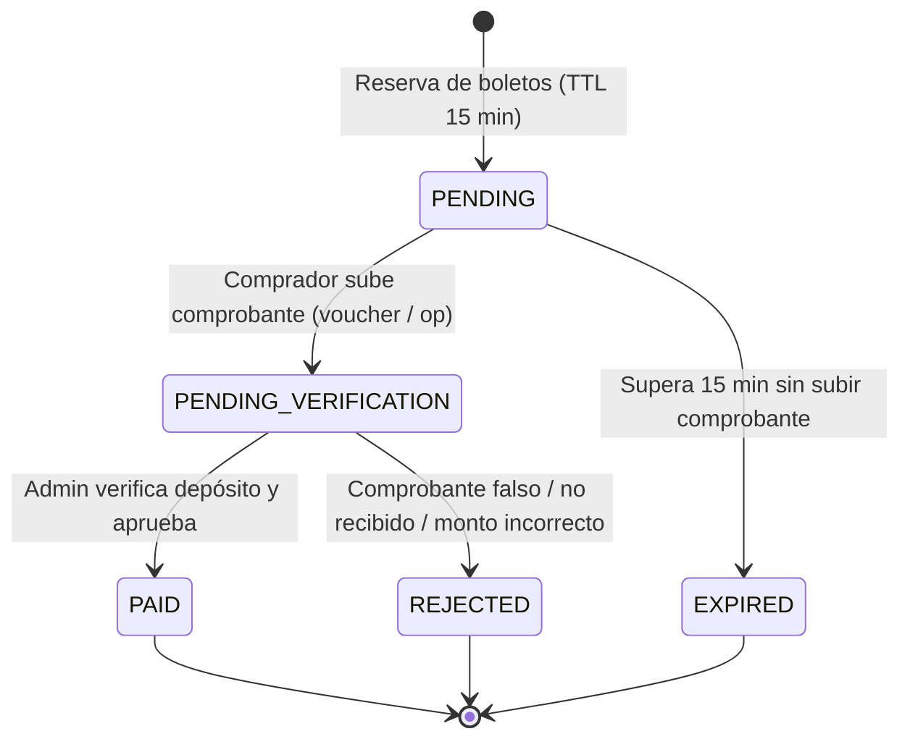

# Decisiones Técnicas — Plataforma de Rifas

> Documento de registro de decisiones de arquitectura y diseño técnico.
> Referencia: [GUIA-IMPLEMENTACION-RIFAS.md](GUIA-IMPLEMENTACION-RIFAS.md)

---

## DT-01: Selección de red de drand y verificación de aleatoriedad (Spike Fase 1)

**Fecha:** 2026-10-29  
**Estado:** Aprobada / Verificada  
**Fase:** Fase 1 (`packages/raffle-draw`)

### Contexto
El sistema requiere una fuente pública de aleatoriedad verificable no manipulable para el sorteo commit-reveal + drand. Drand ofrece dos redes públicas operadas por League of Entropy:
1. Red principal histórica (`default`): periodo de 30 segundos, esquema BLS encadenado (chained).
2. Red rápida (`quicknet`): periodo de 3 segundos, esquema BLS no encadenado (unchained `bls-unchained-g1-rfc9380`).

### Decisión
Se elige **`quicknet`** como la red oficial para todos los sorteos de la plataforma.

### Parámetros oficiales de la cadena Quicknet
- **Chain Hash:** `52db9ba70e0cc0f6eaf7803dd07447a1f5477735fd3f661792ba94600c84e971`
- **Periodo (`period`):** 3 segundos
- **Tiempo génesis (`genesis_time`):** `1692803367` (2023-08-23T15:09:27Z)
- **Esquema criptográfico (`schemeID`):** `bls-unchained-g1-rfc9380`
- **Clave pública (`public_key`):**  
  `83cf0f2896adee7eb8b5f01fcad3912212c437e0073e911fb90022d3e760183c8c4b450b6a0a6c3ac6a5776a2d1064510d1fec758c921cc22b0e17e63aaf4bcb5ed66304de9cf809bd274ca73bab4af5a6e9c76a4bc09e76eae8991ef5ece45a`

### Justificación
1. **Experiencia de usuario en el Sorteo en Vivo:** un periodo de 3 segundos permite que la cuenta regresiva en vivo alcance la ronda casi en tiempo real (espera máxima de 3s vs hasta 30s de la red clásica).
2. **Verificabilidad unchained:** Cada ronda de `quicknet` contiene su firma y puede verificarse de manera aislada con la clave pública de la red, sin necesidad de descargar ni validar rondas previas.

### Validación de Relays HTTP y CORS
Se verificaron mediante peticiones con header `Origin: http://localhost:4200`:
- `https://api.drand.sh`: Activo (`HTTP 200 OK`, `Access-Control-Allow-Origin: *`)
- `https://api2.drand.sh`: Activo (`HTTP 200 OK`, `Access-Control-Allow-Origin: *`)
- `https://drand.cloudflare.com`: Activo (`HTTP 200 OK`, `Access-Control-Allow-Origin: *`)

Todos los relays permiten consumo directo vía `fetch()` desde el navegador sin intermediación de servidores de la plataforma (cumpliendo la regla V-01 de la especificación).

### Librería cliente oficial
- Nombre en npm: `drand-client` (v1.4.2 vigencia confirmada).
- Compatible con Node.js y navegadores para verificación BLS con `@noble/curves`.

---

## DT-02: Cobro manual directo (Yape, Plin y Transferencia) con verificación de comprobante

**Fecha:** 2026-10-29  
**Estado:** Aprobada por el usuario  
**Fase:** Fase 4 (Pagos y Conciliación)

### Contexto
La especificación original contemplaba Culqi como pasarela de pago para cobro con tarjeta y Yape automatizado. Sin embargo, el esquema tarifario de pasarelas de pago (~3.99% + $0.30 USD + IGV por transacción exitosa) impone un costo fijo desproporcionado sobre boletos de bajo valor (S/ 5.00 a S/ 10.00), afectando la rentabilidad y adopción de la plataforma.

### Decisión
Se reemplaza la integración con Culqi por un flujo de **cobro manual directo** a cuentas bancarias y billeteras móviles del operador (Yape, Plin, BCP, BBVA, Interbank) con **subida de comprobante y validación administrativa**.

### Flujo Operativo y de Estados

1. **Reserva inicial (15 minutos):** El comprador selecciona sus números. La orden se crea en estado `PENDING`. Si no sube comprobante en 15 minutos, el job de expiración libera los números automáticamente.
2. **Carga de comprobante:** El comprador adjunta imagen/PDF del voucher o ingresa número de operación bancaria. La orden pasa a `PENDING_VERIFICATION`.
3. **Protección de números:** Una vez subido el comprobante, los boletos quedan bloqueados para evitar que otro usuario tome los números mientras el operador valida en su banca móvil. El operador tiene 12 horas o hasta el cierre de ventas para revisarlo; vencer ese plazo no libera los boletos (DT-06).
4. **Validación administrativa:**
   - **Aprobar:** Cambia orden a `PAID`, boletos a `SOLD`, registra evento de auditoría con `operatorId` y datos de la operación. Se emite el correo con los boletos al comprador.
   - **Rechazar:** Cambia orden a `REJECTED`, libera inmediatamente los boletos a `AVAILABLE` con motivo de rechazo visible para el comprador.

### Invariantes y Auditoría
- La aprobación manual queda sellada en `AuditEvent` con ID del operador, timestamp y número de operación para garantizar trazabilidad.
- La base de datos sigue impidiendo ventas dobles mediante la restricción única `(raffleId, number)` en `Ticket`.

> **Nota (2026-11-01):** esta decisión ya está incorporada en [ESPECIFICACIONES-RIFAS.md](ESPECIFICACIONES-RIFAS.md) v0.4. Las decisiones D7, D8 y D9 de la [guía](GUIA-IMPLEMENTACION-RIFAS.md) quedaron resueltas en DT-03, DT-04 y DT-05. DT-06 reemplaza el vencimiento de 12 horas descrito originalmente en el paso 3.

---

## DT-03: Almacenamiento de comprobantes en disco privado del servidor

**Fecha:** 2026-11-01  
**Estado:** Aprobada por el usuario  
**Fase:** Fase 4 (decisión D7 de la guía)

### Decisión
Por ahora, los comprobantes de pago (imagen o PDF) se guardan en un **disco privado del servidor**, fuera de cualquier ruta servida públicamente.

### Requisitos
- El acceso pasa siempre por la API: solo el comprador dueño de la orden y los administradores pueden ver un comprobante.
- La persistencia se implementa detrás de un puerto, para poder migrar a un almacenamiento externo sin tocar los casos de uso.

### Consecuencias
- El directorio de comprobantes debe incluirse en los respaldos y sobrevivir a los redespliegues del servidor. Un volumen efímero perdería evidencia de pago.
- Los comprobantes contienen datos personales (Ley N.° 29733).

---

## DT-04: Reembolso manual con seguimiento

**Fecha:** 2026-11-01  
**Estado:** Aprobada por el usuario  
**Fase:** Fase 4 (decisión D8 de la guía)

### Decisión
Sin pasarela, el operador devuelve el dinero a mano por Yape, Plin o banco, y el sistema lo registra. El reembolso queda **pendiente** hasta que un administrador registra operador, destino y número de operación. Recién entonces la orden pasa a `REFUNDED`.

### Aplica a
- Un pago verificado de una rifa cancelada.
- Un pago recibido con la reserva vencida, o sin verificar al terminar las ventas, una vez que un operador lo confirma (DT-07, DT-10).
- Un pago rechazado cuyo dinero sí llegó (DT-08).

### Consecuencias
- Una devolución fallida sigue visible como pendiente y nunca figura como completada.
- Reemplaza el comportamiento actual del código, que marca `REFUNDED` antes de devolver el dinero mediante `PaymentGateway`.
- La confirmación del reembolso queda registrada en `AuditEvent`.

---

## DT-05: Órdenes sin resolver al cierre o la cancelación

**Fecha:** 2026-11-01  
**Estado:** Aprobada por el usuario  
**Fase:** Fase 4 (decisión D9 de la guía)

### Contexto
La lista de vendidos se congela al cierre y su hash se publica. Una aprobación posterior cambiaría esa lista y rompería la verificabilidad del sorteo.

### Decisión
1. Al llegar `salesCloseAt`, solo los boletos `SOLD` entran en la lista congelada.
2. Desde el cierre, ninguna orden puede aprobarse. Una orden con pago declarado entra en la cola de revisión de DT-10; una orden sin pago se libera.
3. Los comprobantes se aceptan hasta **2 horas antes** de `salesCloseAt`. El margen es configurable, para dar tiempo a validarlos.
4. Las reservas cierran una duración de reserva antes del plazo de comprobantes, para que toda reserva tenga su tiempo completo para subir el comprobante. Por ejemplo, si el cierre es a las 18:00, los comprobantes se aceptan hasta las 16:00 y, con una reserva de 15 minutos, las reservas se aceptan hasta las 15:45. La duración es la misma que fija el vencimiento de la reserva. Desde ese corte, y también después de `salesCloseAt` aunque el job de cierre no haya corrido, la reserva se rechaza sin retener ningún número. Una rifa sin `salesCloseAt` no acepta reservas. El corte se calcula con los datos de la rifa leídos dentro de la misma transacción que la reserva. Con un margen de comprobantes de 0, toda reserva vence a más tardar en `salesCloseAt`.
5. Al cancelar la rifa aplica lo mismo: no hay más aprobaciones. Un pago verificado recibe reembolso según DT-04, y uno sin verificar sigue DT-10.

---

## DT-06: El plazo de revisión vencido alerta y no libera

**Fecha:** 2026-11-01
**Estado:** Aprobada por el usuario
**Fase:** Fase 4

### Contexto
Al vencer las 12 horas en `PENDING_VERIFICATION`, el sistema liberaba los números y abría un reembolso. Eso castigaba al comprador por una demora del operador, y abría un reembolso sin confirmar que el dinero hubiera llegado.

### Decisión
1. Vencer el plazo de revisión no libera los números ni abre un reembolso. La orden sigue en `PENDING_VERIFICATION`.
2. El operador recibe una alerta por orden. La entrega es al menos una vez. Desde DT-13, la orden se marca y el correo se encola en la misma transacción, y los reintentos son de la bandeja de correos.
3. El operador puede aprobar o rechazar hasta `salesCloseAt`. Desde ahí aplica DT-05.
4. `PROOF_VERIFICATION_TTL_HOURS` pasa a ser el plazo de revisión del operador, limitado por `salesCloseAt`.

### Consecuencias
- **Costo aceptado:** un comprobante falso retiene sus números hasta que alguien lo revise o hasta el cierre de ventas.
- Los números retenidos siguen contando para el límite por comprador, aunque el plazo haya vencido.
- Solo el operador, el cierre de ventas o la cancelación resuelven una orden en verificación.

---

## DT-07: Los pagos tardíos pasan por revisión del operador

**Fecha:** 2026-11-01
**Estado:** Aprobada por el usuario
**Fase:** Fase 4

### Contexto
Declarar un pago sobre una orden vencida abría un reembolso directo, por el monto que escribía el comprador. Un reclamo falso de cualquier monto quedaba pendiente, y un reembolso abierto no se puede descartar.

### Decisión
1. `ClaimLatePayment` no abre un reembolso. Guarda la declaración y pasa la orden de `EXPIRED` a `LATE_PAYMENT_REVIEW`. Cada orden admite un solo reclamo.
2. Al confirmar, el operador indica el monto recibido y los datos de la operación. Recién ahí se abre el reembolso, por ese monto y nunca por el declarado. La operación se registra como `Payment`, así que no puede respaldar dos reembolsos.
3. Al descartar, el operador indica un motivo auditado y no se abre ningún reembolso. La orden pasa a `LATE_PAYMENT_DISMISSED`. La decisión es final: el comprador no puede reclamar de nuevo esa orden.
4. Cada reclamo se decide una sola vez, incluso con decisiones simultáneas.
5. El cierre de ventas, la cancelación y el sorteo no resuelven estos reclamos. Nunca tocan boletos ni la lista congelada.
6. Cada reclamo genera una alerta para los operadores en el panel de administración (DT-09).

### Consecuencias
- **Costo aceptado:** el operador suma un paso manual, y el comprador espera más para recibir su dinero.
- Un descarte equivocado no tiene vuelta atrás en el sistema: se corrige fuera de la plataforma.
- `REFUND_PENDING` ya no viene de un reclamo sin revisar. Los reembolsos pendientes creados por la regla anterior no se migran: conservan el monto declarado, y el evento `LATE_PAYMENT_CLAIMED` los identifica para revisarlos antes de pagar.
- El cierre o la cancelación tampoco abren un reembolso sobre un comprobante sin verificar: esas órdenes entran en esta cola y se pueden descartar (DT-10).

---

## DT-08: Rechazar un pago exige indicar si llegó dinero

**Fecha:** 2026-11-01
**Estado:** Aprobada por el usuario
**Fase:** Fase 4

### Contexto
Un pago se rechaza también cuando el dinero llegó pero no sirve, por ejemplo con un monto incorrecto. La orden pasaba a `REJECTED`, los números se liberaban y no se abría ningún reembolso: el comprador se quedaba sin números y sin dinero, y nada en el sistema registraba esa deuda.

### Decisión
1. `RejectPayment` exige que el operador indique si recibió dinero. No hay valor por defecto: omitirlo se rechaza.
2. Si no recibió dinero, el rechazo no cambia: la orden pasa a `REJECTED`, los números se liberan y el comprador ve el motivo.
3. Si recibió dinero, el operador indica el monto recibido y los datos de la operación, igual que en DT-07. Los números se liberan, la operación se registra como `Payment` con estado `REJECTED_RECEIVED` y se abre el reembolso por ese monto, nunca por el declarado. La orden pasa a `REFUND_PENDING`, conserva el motivo y termina con `CompleteRefund`.
4. Todo ocurre en una sola transacción. Una operación ya registrada revierte el rechazo completo: la orden sigue en verificación y sus números siguen retenidos.
5. El comprador recibe un solo aviso, el de reembolso pendiente, con el motivo del rechazo y el monto.
6. Repetir el mismo rechazo no cambia nada. Indicar dinero recibido sobre una orden que terminó de otra forma, como `PAID` o `REJECTED`, da error en lugar de ignorarse, para que la deuda no se pierda en silencio.
7. La repetición se decide con el `Payment` `REJECTED_RECEIVED` de la orden, no con su estado. Con el mismo número de operación ya normalizado, el mismo monto en céntimos y el mismo banco, no cambia nada, ni siquiera si el pago se guardó como `NUMERO#BANCO` (DT-12). Si difiere alguno de los tres, se rechaza con `ConflictingRejectionError`: la orden, el pago y el reembolso no cambian, y el evento `PAYMENT_REJECTION_REFUSED` guarda el operador y lo que intentó registrar. Una orden en `REFUND_PENDING` o `REFUNDED` sin ese pago también da error.

### Consecuencias
- **Costo aceptado:** la pantalla de rechazo suma un campo, y el reembolso depende de que el operador cargue bien los datos.
- **Segunda transferencia:** el rechazo registra un solo pago con dinero recibido. Repetirlo con otro dinero se rechaza; una segunda transferencia real se registra aparte, con su propio reembolso (DT-16).
- Un monto recibido mayor que el total de la orden solo abre un reembolso si el operador lo confirma con un motivo (DT-14).
- Si el operador rechaza sin dinero y después descubre que sí llegó, el sistema no lo corrige: la orden queda en `REJECTED` y se resuelve fuera de la plataforma.

---

## DT-09: Alerta en el panel cuando llega un reclamo de pago tardío

**Fecha:** 2026-11-01
**Estado:** Aprobada por el usuario
**Fase:** Fase 4

### Contexto
Un reclamo de pago tardío quedaba en la cola sin avisar a nadie: el operador debía entrar a revisarla. El usuario pidió una alerta en el panel, no un correo.

### Decisión
1. Cada reclamo crea una alerta en la tabla `OperatorAlert`, en la misma transacción que el reclamo. Un reclamo nunca existe sin su alerta, y un reclamo fallido no deja ninguna.
2. La alerta no pasa por `Notifier` y no envía correo.
3. Guarda el tipo, la rifa y su título, la orden, el monto declarado y la fecha. No guarda datos del comprador ni el número de operación.
4. Se apaga cuando un operador la marca como leída, o al confirmar o descartar el reclamo, en la misma transacción de esa decisión. Una alerta ya leída conserva a su primer lector.
5. Todos los operadores comparten un solo estado de lectura.
6. La base de datos admite una sola alerta por tipo y orden. El campo `type` permite reutilizar la tabla, pero por ahora solo existe `LATE_PAYMENT_CLAIM`.

### Consecuencias
- **Hasta que el panel exista, las alertas se guardan pero nadie las ve.** Las rutas de lectura se construyen en F6 y el contador visible en F9.
- La alerta solo avisa mientras el operador tenga el panel abierto o vuelva a entrar: no llega al teléfono ni a una bandeja de correo.
- La alerta de DT-06 por plazo de revisión vencido sigue siendo un correo, ahora encolado en la bandeja de DT-13, así que hoy hay dos canales hacia el operador.
- La migración crea la alerta de los reclamos que ya estaban en `LATE_PAYMENT_REVIEW`.

---

## DT-10: Los comprobantes sin verificar al terminar las ventas pasan por revisión

**Fecha:** 2026-11-01
**Estado:** Aprobada por el usuario
**Fase:** Fase 4

### Contexto
Al cerrar o cancelar una rifa, una orden en `PENDING_VERIFICATION` abría un reembolso directo por el monto declarado. Con un comprobante falso, ese reembolso quedaba abierto para siempre, porque un reembolso no se puede descartar.

### Decisión
1. `CloseSales` y `CancelRaffle` no abren un reembolso para una orden en `PENDING_VERIFICATION`. La orden pasa a `LATE_PAYMENT_REVIEW`, conserva lo que declaró el comprador y sus boletos se liberan. Nunca entran en la lista congelada.
2. Entra en la misma cola que un pago tardío, con la misma alerta, y se resuelve igual: `ConfirmLatePayment` abre el reembolso por el monto del operador y `DismissLatePayment` la descarta con un motivo auditado.
3. Las órdenes `PAID` de una rifa cancelada siguen yendo directo a reembolso, porque ese pago ya fue verificado. Las órdenes `PENDING` se liberan sin reembolso.
4. El comprador recibe un aviso de pago en revisión, nunca de reembolso pendiente.
5. Ya no existe ningún reembolso sin dinero verificado por un operador.

### Consecuencias
- **Costo aceptado:** más trabajo manual al cierre, y el comprador espera más para saber qué pasa con su dinero.
- Una orden sin decidir no impide el sorteo ni cambia la lista congelada.
- El evento de auditoría del cierre o la cancelación lista las órdenes enviadas a revisión en `ordersInReview`.
- Los reembolsos pendientes creados por la regla anterior no se migran: conservan el monto declarado. F4 todavía no se publicó.
- El estado `LATE_PAYMENT_REVIEW` y la alerta `LATE_PAYMENT_CLAIM` conservan su nombre, aunque ahora también cubren órdenes que nadie reclamó.

---

## DT-11: El sorteo comprueba la lista congelada

**Fecha:** 2026-11-01
**Estado:** Aprobada por el usuario
**Fase:** Arreglo previo a cobrar dinero real

### Contexto
`ExecuteDraw` y `GetVerificationData` leían los boletos `SOLD` actuales y nunca los comparaban con `soldListHash`, publicado al cierre. Además, el trigger de boletos permitía pasar de `SOLD` a `REFUNDED` en una rifa `CLOSED`. Un cambio posterior al cierre habría producido un ganador que no corresponde a la lista publicada, sin que nada lo detectara.

### Decisión
1. Antes de pedir la aleatoriedad, `ExecuteDraw` recalcula el hash con la misma función y el mismo orden del cierre, y lo compara con `soldListHash`. La comprobación y el ganador usan la misma lectura de la lista.
2. Si no coinciden, no hay sorteo: la rifa sigue en `CLOSED`, no se guarda `Draw` y se lanza `SoldListMismatchError`. El intento queda en un evento `DRAW_REFUSED`, en una transacción propia, apartada de la del sorteo, para que sobreviva al rechazo. En esa misma transacción se crea una alerta `DRAW_BLOCKED` de la rifa en el panel (DT-15).
3. Una rifa `CLOSED` sin `soldListHash` tampoco se sortea.
4. `GetVerificationData` devuelve `soldListVerified`. Si es `false`, la verificación falló.
5. El trigger `check_ticket_transition` impide cambiar estado, orden, número o rifa de un boleto `SOLD` cuando la rifa está `CLOSED` o `DRAWN`. Toma un bloqueo compartido sobre la rifa, así que espera a un cierre en curso.

### Flujos que mueven boletos vendidos
Solo `CompleteRefund` pasa un boleto de `SOLD` a `REFUNDED`, y solo encuentra boletos vendidos en órdenes reembolsadas por la cancelación, con la rifa en `CANCELLED`. Los reembolsos de pagos tardíos y de pagos rechazados no tocan boletos vendidos, porque sus números ya estaban liberados. Ningún flujo legítimo necesita la transición que se cerró.

### Consecuencias
- Solo se guarda el hash de la lista, no la lista. La lista publicada se obtiene de los boletos `SOLD`, que el trigger protege desde el cierre. Alcanza para la verificación pública y la descarga de la lista, pero si la base de datos se alterara, el sistema detecta el cambio y no puede reconstruir la lista original.
- El trigger no cubre `INSERT` ni `DELETE` de boletos. La comparación del hash detecta esos cambios antes del sorteo.
- Una rifa con la lista alterada queda en `CLOSED` hasta que el operador la cancela con reembolso total: es su única salida (DT-15).

---

## DT-12: Aprobar exige el monto exacto y el número de operación es único

**Fecha:** 2026-11-02
**Estado:** Aprobada por el usuario
**Fase:** Fase 4 (arreglos previos al cobro real)

### Contexto
Se podía aprobar una orden pagada de menos, porque nada comparaba el dinero con el total. Además, la restricción `(proveedor, id_externo)` dejaba usar un mismo número de operación dos veces, una como Yape y otra como Plin, y un espacio, un guion o un carácter invisible pegado desde otra aplicación lo hacían pasar por otro número.

### Decisión
1. `ApprovePayment` exige el monto recibido, que el operador lee del banco, y lo compara con `totalAmount` por valor exacto, en céntimos y bajo el bloqueo de la orden. Si difiere, también por exceso, lanza `PaymentAmountMismatchError`: la orden sigue en `PENDING_VERIFICATION` y sus números siguen retenidos. Decide la cifra del banco, no la del comprador: si `declaredAmount` difiere o falta y el monto recibido coincide, se aprueba y la auditoría guarda ambas cifras. El monto recibido queda en el `Payment`.
2. El operador resuelve esa orden con `RejectPayment` indicando el dinero recibido (DT-08).
3. El número de operación es único entre todos los métodos de pago: `Payment.externalId` tiene una restricción única propia.
4. `normalizeOperationNumber` es el único lugar que normaliza. Aplica NFKC, quita espacios, todo tipo de guiones y caracteres invisibles, y solo acepta `A-Z` y `0-9`, en mayúsculas. Cualquier otro carácter se rechaza con `InvalidOperationNumberError`, igual que un resultado vacío: una letra cirílica parecida no se convierte, porque no se distingue de un error. La usan aprobar, confirmar un pago tardío y rechazar con dinero. El número que escribe el comprador en su declaración se guarda tal como lo escribió.
5. **Salida para una colisión real entre dos bancos:** aprobar, rechazar con dinero y confirmar un pago tardío aceptan una declaración opcional con un motivo y el banco. Solo vale si ya existe un `Payment` con ese número en **otro** proveedor; si no, se rechaza con `InvalidOperationCollisionError`, así que no se puede usar por adelantado ni para el mismo banco. El pago se guarda como número más banco (por ejemplo, `OP123#BCP`), que nunca coincide con un número normal porque `#` se rechaza. El banco declarado debe ser el de la orden al aprobar y el del dinero leído al rechazar o confirmar, y el motivo admite hasta 500 caracteres. Un segundo uso con el mismo número y banco lo frena la restricción única, así que un número respalda como máximo una orden por banco. Cada uso escribe un evento `OPERATION_COLLISION_DECLARED` con el operador, el motivo, el banco, el número y el pago y la orden existentes, y `ListOperationCollisions` los lista todos. El camino normal no cambia.
6. El monto recibido admite hasta dos decimales y no puede superar `99 999 999,99`, lo que cabe en `Decimal(10,2)`. Otro valor se rechaza en los tres caminos.
7. Aprobar otra vez una orden ya resuelta no hace nada, aunque el reintento traiga otros datos: el primer registro manda y no se avisa de la diferencia. Los datos con formato inválido se rechazan igual, antes de leer la orden.

### Migración
`20261102000000_global_operation_number` normaliza los pagos existentes y el número de sus órdenes `PAID`, con la misma regla en SQL e independiente del locale de la base. Si dos pagos coinciden una vez normalizados, o si un número no cumple la regla o queda vacío, la migración se detiene con un mensaje que los lista y no cambia nada: elegir uno alteraría lo registrado sin que nadie lo decida. Ante un carácter que la base no reconozca igual que la aplicación, la migración debe detenerse y no aceptarlo distinto.

Se verificó a mano en bases descartables: filas válidas, colisiones, números no conformes, resultado vacío y la comparación con la aplicación en los caracteres del plano básico de Unicode. **No tiene prueba automatizada**, así que un cambio en `normalizeOperationNumber` no avisa si la regla en SQL queda distinta.

### Consecuencias
- La salida para colisiones abre una excepción al bloqueo de duplicados: un operador podría usarla mal para vender dos órdenes con una sola operación. Por eso exige un motivo, solo vale para otro banco, y cada uso queda auditado y visible en el panel. No lo impide: lo deja a la vista. El límite real es una orden por banco, no una sola salida por número.
- Con una colisión, `TicketOrder.operationNumber` guarda el número simple y `Payment.externalId` guarda `NUMERO#BANCO`. Ninguna consulta debe unir orden y pago comparando esos dos campos: el vínculo es `Payment.orderId`.
- El monto recibido lo escribe el operador. Si escribe el total sin mirar el banco, la aprobación pasa; la validación frena un error de monto, no a un operador que no revisa.
- Un comprador que paga de más ya no puede aprobarse aunque el dinero exista: su orden pasa por rechazo y reembolso, y el operador confirma el exceso con un motivo (DT-14).
- Los eventos de auditoría ya escritos conservan el número como se escribió entonces.

---

## DT-13: Los correos salen por una bandeja transaccional

**Fecha:** 2026-11-02
**Estado:** Aprobada por el usuario
**Fase:** Arreglo previo a cobrar dinero real

### Contexto
Cada caso de uso enviaba su correo con el `Notifier` después de confirmar la transacción. Si el envío fallaba, la orden ya estaba aprobada, rechazada o reembolsada y el comprador no se enteraba: nada guardaba el correo pendiente ni lo reintentaba. Además, `ExecuteDraw` mandaba el aviso del ganador al id de la orden, o al de la rifa si faltaba, en lugar de al comprador.

### Decisión
1. Ningún caso de uso llama al `Notifier`. Cada uno escribe una fila en `NotificationOutbox` dentro de la misma `LedgerTransaction` que el cambio que avisa: si la transacción se revierte, no queda correo; si se confirma, el correo queda guardado. Cubre la confirmación de boletos, el rechazo, la orden en revisión, el reembolso pendiente, el reembolso completado, el aviso al operador de una revisión vencida y el aviso al ganador.
2. La fila guarda el tipo, el destinatario (el `userId`, o nada para los operadores), el contenido que recibirá el `Notifier`, la orden y la rifa. `dedupeKey` es único y se forma con el tipo, la orden y la versión del evento. La versión identifica ese evento y no el estado de la orden: el `Payment` aprobado, el `Payment` del dinero recibido, el reembolso, la alerta de revisión, el sorteo, la fecha límite de la revisión vencida o, en un rechazo sin dinero y en un descarte, la hora del evento. Así, si una orden volviera a un mismo estado, su nuevo correo no se descarta. Repetir el mismo evento no agrega un segundo correo, el duplicado no aborta la transacción y queda en el registro con nivel de depuración.
3. `DispatchNotifications` toma por lotes las filas `PENDING` vencidas que aún tienen intentos, con `FOR UPDATE SKIP LOCKED`, en una sola sentencia que cuenta el intento, las reserva por `NOTIFICATION_LEASE_SECONDS` y devuelve las filas completas. Justo antes de cada envío renueva la reserva de esa fila, siempre que siga en el intento que tomó; si otro despachador ya la tomó, no la envía. Envía fuera de cualquier transacción, con un límite de `NOTIFICATION_SEND_TIMEOUT_SECONDS` por envío, así que un servidor de correo lento no retiene bloqueos. Si el envío funciona, marca la fila `SENT`. La aplicación no arranca si la reserva no es mayor que ese límite.
4. Cada fila se procesa aislada: un error de la base de datos en una fila se registra con su id, su tipo y su intento, sin el mensaje, y no detiene el resto del lote. Si la fila cambió entre medio porque otro despachador la tomó, se registra como una carrera perdida y no se cuenta como enviada, reintentada ni fallida.
5. Si el envío falla o vence el límite, se guarda el error y se programa otro intento con espera exponencial: `NOTIFICATION_RETRY_BASE_SECONDS` por 2 elevado al número de intentos previos, con un tope de `NOTIFICATION_RETRY_MAX_SECONDS`. El error se guarda como su clase o código y un mensaje sin direcciones de correo, URLs ni cadenas largas que parezcan claves, recortado a 500 caracteres. El mismo texto va al registro y a la auditoría; nunca el contenido ni el destinatario.
6. Con los valores por defecto (base de 300 segundos, tope de 6 horas y 11 intentos), los reintentos cubren unas 28,6 horas desde el primer intento: 300 + 600 + 1200 + 2400 + 4800 + 9600 + 19 200 segundos, y luego tres esperas de 6 horas. Una caída del servicio de correo de un día no pierde correos.
7. Al agotar `NOTIFICATION_MAX_ATTEMPTS` intentos, la fila pasa a `FAILED` y, en la misma transacción, se crea una alerta `NOTIFICATION_FAILED` en el panel y un evento `NOTIFICATION_FAILED` de auditoría. Si la orden ya tenía esa alerta, vuelve a quedar sin leer. Lo mismo ocurre, sin reintentar, con un error que ningún reintento corrige: un tipo desconocido, un contenido ausente o un correo al comprador sin destinatario.
8. Una fila `PENDING` que ya usó todos sus intentos, porque el proceso cayó durante el último envío, no se vuelve a tomar: el despachador la pasa a `FAILED` con su alerta, sin enviarla. Así, un correo que tumba el proceso no se repite sin fin.
9. La entrega es **al menos una vez**: si el proceso cae después de enviar y antes de marcar, la reserva vence y el correo se envía de nuevo. Un envío cortado por el límite de tiempo puede llegar igual, y se reintenta. Se prefiere un correo repetido a uno perdido.
10. Después de cada lote, el despachador registra cuántos correos envió, reintentó, dio por fallidos y saltó, y la antigüedad del correo pendiente más viejo.
11. `RequeueFailedNotification` permite a un operador volver a encolar un correo `FAILED`, por ejemplo tras una caída larga: la fila vuelve a `PENDING`, vence en ese momento y recupera todos sus intentos. La alerta de la orden se marca leída, salvo que la orden tenga otro correo todavía fallido, y queda un evento `NOTIFICATION_REQUEUED`. Pedirlo dos veces encola una sola vez.
12. `PurgeSentNotifications` borra el contenido y el destinatario de los correos `SENT` enviados hace más de `NOTIFICATION_RETENTION_DAYS` días. La fila se conserva, así que su `dedupeKey` sigue frenando un evento repetido. Como las filas no se borran, la clave foránea a la orden con `ON DELETE RESTRICT` no estorba; las órdenes tampoco se borran.
13. El índice de la toma es parcial, solo sobre las filas `PENDING`, para que las filas enviadas acumuladas no lo agranden. La toma y el barrido de filas agotadas escriben `'PENDING'` como literal en el SQL: con el estado como parámetro, un plan genérico no puede usar un índice parcial y recorre la tabla entera. Prisma no puede declarar el índice, que está solo en la migración. Prisma 5.22 tampoco lo borra: `migrate diff` y `migrate dev` no muestran diferencias con él. Aun así, una prueba de integración falla si el índice falta o si la toma deja de usarlo.
14. El aviso de revisión vencida (DT-06) marca la orden y encola el correo en la misma transacción. Ya no queda sin marcar cuando el correo falla: los reintentos son de la bandeja.
15. `ExecuteDraw` guarda el sorteo, pasa la rifa a `DRAWN`, encola el aviso y audita en una sola transacción. Bajo el bloqueo de la rifa vuelve a leer los boletos vendidos y a comparar su hash con `soldListHash`: si la lista cambió desde la primera lectura, el sorteo no se guarda y queda un `DRAW_REFUSED` con `detectedUnderLock`. El aviso va al comprador de la orden del boleto ganador. Si el boleto no tiene orden, no se puede avisar a nadie: el sorteo no se guarda, se lanza `WinningTicketWithoutOrderError` y, en una transacción que sí confirma, quedan un `DRAW_REFUSED` con el motivo `WINNING_TICKET_WITHOUT_ORDER` y una alerta `DRAW_BLOCKED` en el panel. Es una alerta de la rifa, sin orden ni monto: hay una sola por rifa y tipo, y un nuevo intento del sorteo la vuelve a mostrar. Cada sorteo tiene un UUID como id.

### Consecuencias
- Un correo sale unos segundos después del cambio, cuando corre el trabajo, y no en el mismo pedido.
- `DispatchNotifications` y `PurgeSentNotifications` corren como trabajos programados (F5), y `RequeueFailedNotification` se expone en `POST /api/admin/notificaciones/:id/reencolar` (F6). Los correos salen por `tiendi-notifications` (D5); sin ese servicio configurado, producción no arranca.
- El aviso de reembolso pendiente de una cancelación informa el monto del reembolso, `totalAmount`. Antes informaba el monto declarado.
- Hay una sola alerta `NOTIFICATION_FAILED` por orden: un segundo correo fallido de la misma orden la vuelve a mostrar, no agrega otra.
- El límite de tiempo no cancela el envío en curso: solo deja de esperarlo.
- Un boleto `SOLD` siempre tiene orden: lo exige la restricción `Ticket_sold_has_order`, y el trigger de transiciones ya impedía quitarle la orden o borrarla. La migración se detiene si encuentra boletos vendidos sin orden, para resolverlos a mano. El rechazo del sorteo sin orden queda como defensa: si la regla se rompiera, el operador se entera.
- `OperatorAlert.orderId` y `amount` admiten nulos para las alertas de la rifa. Un índice único parcial mantiene una sola por rifa y tipo cuando no hay orden.

---

## DT-14: Un monto recibido mayor que el total exige confirmación

**Fecha:** 2026-11-02
**Estado:** Aprobada por el usuario
**Fase:** Arreglo previo a cobrar dinero real

### Contexto
Al rechazar con dinero recibido (DT-08) y al confirmar un pago tardío (DT-07), el reembolso se abría por el monto que escribía el operador, sin ningún límite. Un error de tipeo, como escribir 5000 en vez de 50, abría un reembolso cien veces mayor que la venta. Un tope duro en el total tampoco sirve: un comprador puede transferir de más, y ese dinero sigue siendo suyo.

### Decisión
1. Aplica a todo camino que abre un reembolso con un monto del operador: `RejectPayment` con dinero recibido y `ConfirmLatePayment`. Los dos pasan por `refundReceivedMoney`, que hace la comprobación antes de escribir nada.
2. El monto recibido se compara con `totalAmount` en céntimos, bajo el bloqueo de la orden.
3. Un monto igual o menor que el total no necesita confirmación. Si la trae igual, se rechaza con `InvalidPaymentProofError`, para que el registro no diga que hubo un exceso que no existe.
4. Un monto mayor que el total exige una confirmación explícita: `overpayment` con `confirmed: true` y un motivo. Sin ella, con `confirmed` distinto de `true` o con un motivo vacío tras quitar espacios, se rechaza con `OverpaymentNotConfirmedError` y no se escribe nada: la orden, sus números, el pago, el reembolso y la auditoría quedan como estaban. El motivo admite hasta 500 caracteres.
5. Con la confirmación, el reembolso se abre por el monto recibido completo. El `Payment` guarda el motivo y la diferencia en `overpayment`, y en la misma transacción queda un evento `OVERPAYMENT_CONFIRMED` con la orden, el pago, el total, el monto recibido, la diferencia, el operador y el motivo.
6. **Repetición (DT-08, punto 7):** un rechazo repetido es el mismo pedido, así que también debe ser válido por sí mismo. La comprobación del exceso va primero, antes de compararlo con el pago registrado:
   - Un monto mayor que el total sin confirmación se rechaza con `OverpaymentNotConfirmedError`, aunque difiera del registrado.
   - Una confirmación con un monto igual o menor que el total se rechaza con `InvalidPaymentProofError`, aunque difiera del registrado.
   - Solo un pedido válido por sí mismo llega a la comparación. Ahí decide, como antes, el número de operación, el banco y el monto: el motivo del exceso no cuenta, así que otra redacción no cambia nada y se conserva el motivo guardado. Otro monto se rechaza con `ConflictingRejectionError`.
   - La comprobación también va antes que el estado de la orden: rechazar una orden que ya no admite el rechazo con un exceso sin confirmar responde `OverpaymentNotConfirmedError`, no el error de estado.
7. `ApprovePayment` no cambia: exige el total exacto (DT-12). Un monto mayor se rechaza con `PaymentAmountMismatchError`, y el operador lo resuelve rechazando con dinero recibido y confirmando el exceso.

### Consecuencias
- **Costo aceptado:** la pantalla de rechazo y la de pago tardío suman una confirmación y un motivo cuando el monto supera el total.
- La confirmación frena un error de tipeo, no a un operador que confirma sin mirar. Por eso cada exceso queda auditado con su motivo.
- Un rechazo con exceso registrado antes de DT-14, sin confirmación, ya no se repite tal cual: reintentarlo sin la confirmación responde `OverpaymentNotConfirmedError` en vez de tratarlo como repetición. Para repetirlo hay que enviar la confirmación con un motivo; como el motivo no cuenta en la comparación, no cambia nada de lo registrado.
- Un monto menor que el total sigue sin límite inferior más allá de ser positivo: un reembolso menor que la venta no pone en riesgo dinero de la plataforma.

---

## DT-15: Una rifa con la lista alterada solo se cancela con reembolso total

**Fecha:** 2026-11-02
**Estado:** Aprobada por el usuario
**Fase:** Arreglo previo a cobrar dinero real

### Contexto
Con DT-11, una rifa `CLOSED` cuya lista de vendidos ya no coincide con `soldListHash` no se sortea. Pero tampoco tenía salida: `CancelRaffle` solo acepta rifas `DRAFT` o `ACTIVE`, así que la rifa quedaba cerrada para siempre, con el dinero de los compradores retenido. Si la lista cambió después del cierre, no hay forma confiable de saber cuál es la verdadera, y sortear con cualquiera de las dos rompe la garantía de un sorteo verificable.

### Decisión
1. La única salida es cancelar la rifa con reembolso total. `CancelAlteredRaffle` recibe la rifa, el operador y un motivo.
2. Solo vale para una rifa `CLOSED` cuya lista está probadamente alterada. Bajo el bloqueo de la rifa, recalcula el hash de los boletos `SOLD` con la misma función del cierre y lo compara con `soldListHash`. Si coinciden, se rechaza con `SoldListIntactError` y no se escribe nada: esa rifa se sortea, no se cancela. Una rifa en otro estado se rechaza con `InvalidRaffleTransitionError`.
3. `CancelRaffle` no cambia: sigue aceptando solo rifas `DRAFT` o `ACTIVE`.
4. El motivo es obligatorio, se guarda sin espacios al inicio ni al final y admite hasta 500 caracteres, igual que en DT-14. Un motivo vacío o más largo se rechaza con `RaffleValidationError` antes de abrir la transacción.
5. Los reembolsos siguen al dinero, no a la lista alterada: cada orden `PAID` abre un reembolso por su `totalAmount`, igual que en una cancelación normal, y su correo sale por la bandeja (DT-13). Una orden con un pago declarado pasa a la cola de revisión (DT-10), una orden `PENDING` expira, y una orden que ya está en reembolso no recibe un segundo. Un boleto vendido por fuera del sistema, sin dinero verificado detrás, no abre ningún reembolso.
6. En la misma transacción quedan la rifa en `CANCELLED` con su motivo, la alerta `DRAW_BLOCKED` marcada como leída por ese operador y un evento `RAFFLE_CANCELLED_LIST_ALTERED` con el hash congelado, el hash recalculado, el operador, el motivo, la cantidad de órdenes pagadas y las órdenes enviadas a revisión. Si la transacción falla, no cambia nada.
7. Al rechazar un sorteo por la lista (DT-11), se crea una alerta `DRAW_BLOCKED` de la rifa, la misma que usa el sorteo sin orden (DT-13): una sola por rifa y tipo, y un nuevo intento la vuelve a mostrar.
8. Con la rifa en `CANCELLED`, el trigger de boletos ya no congela la lista, así que `CompleteRefund` puede pasar los boletos vendidos a `REFUNDED` como en cualquier cancelación.

### Consecuencias
- **Costo aceptado:** una alteración de la base después del cierre cancela la rifa entera. Ningún comprador gana el premio, aunque la mayoría de la lista siga intacta.
- La cancelación confía en el estado de las órdenes. Si la alteración también falsificó una orden `PAID`, esa orden recibiría un reembolso. La auditoría de la cancelación, la de la aprobación y los `Payment` permiten detectarlo antes de completar el reembolso, que es manual (DT-04).
- La ruta es `POST /api/admin/rifas/:id/cancelar-lista-alterada` (F6).

## DT-16: Una segunda transferencia real se registra y se reembolsa aparte

**Fecha:** 2026-11-02
**Estado:** Aprobada por el usuario
**Fase:** Arreglo previo a cobrar dinero real

### Contexto
Un comprador puede transferir dos veces por la misma orden, o transferir después de que la orden ya quedó resuelta. Ese dinero no tenía dónde registrarse: la aprobación, el rechazo y la revisión de pagos tardíos solo aceptan el dinero de la orden misma, y cada orden admitía un solo reembolso. El dinero quedaba fuera del sistema y nadie lo devolvía.

### Decisión
1. El operador registra la transferencia extra contra la orden con `RecordExtraTransfer`: monto recibido, banco o billetera, número de operación, un motivo y su identificador. El monto, el banco y el número siguen las mismas reglas que el resto del dinero recibido: monto estricto, número normalizado y único entre todos los pagos, con la salida controlada de colisión (DT-12).
2. El motivo es obligatorio, se guarda sin espacios al inicio ni al final y admite hasta 500 caracteres, igual que en DT-14. Un operador vacío también se rechaza. Ambos se validan antes de abrir la transacción.
3. Solo la acepta una orden cuyo dinero propio ya está resuelto: `PAID`, `REFUND_PENDING`, `REFUNDED`, `REJECTED` y `LATE_PAYMENT_DISMISSED`. Una orden `PENDING`, `PENDING_VERIFICATION`, `EXPIRED` o `LATE_PAYMENT_REVIEW` la rechaza con `ExtraTransferNotAcceptedError`, porque su propio flujo maneja el dinero que llega: la aprobación, el rechazo o el reclamo de pago tardío (DT-07). El estado de la rifa no importa: una rifa cancelada o sorteada también la acepta, porque la transferencia no toca la orden ni los boletos.
4. Se guarda un `Payment` con estado `EXTRA_RECEIVED` y se abre un reembolso por el monto recibido completo, ligado a ese `Payment`. La orden y sus boletos no cambian.
5. Un monto mayor que el total de la orden exige la confirmación de sobrepago de DT-14, porque el riesgo de un error de tipeo es el mismo.
6. En la misma transacción quedan el `Payment`, el reembolso, un evento `EXTRA_TRANSFER_RECORDED` con la orden, el pago, el reembolso, el monto, el banco, el número de operación, el operador y el motivo, y el correo de reembolso pendiente en la bandeja (DT-13), con el `Payment` como versión. Si la transacción falla, no queda nada.
7. Una orden tiene un reembolso propio como máximo, más uno por cada transferencia extra. Un índice único parcial lo garantiza en la base: un solo reembolso sin `paymentId` por orden. `findByOrderId` devuelve siempre el reembolso propio de la orden.
8. Completar el reembolso de una transferencia extra no cambia la orden ni sus boletos. Completar el reembolso propio de la orden sigue igual: pasa la orden a `REFUNDED` y sus boletos vendidos también.
9. Ninguna otra lógica toma un pago `EXTRA_RECEIVED` como el de la orden: el reintento de un rechazo (DT-08) sigue comparando contra el pago `REJECTED_RECEIVED`, así que un rechazo idéntico repetido sigue siendo un reintento. Una colisión declarada en una transferencia extra aparece en la lista de colisiones, como cualquier otra.

### Consecuencias
- La migración quita el índice único de `Refund.orderId` y crea el índice parcial `Refund_order_refund_key`. Prisma no puede declarar un índice parcial, así que una prueba de integración falla si falta. Las dos migraciones solo van hacia adelante, y el código y el esquema se despliegan juntos: la vuelta atrás manual está en la guía (§6.2) y empieza por archivar los reembolsos extra, que son dinero adeudado.
- La base comprueba que el `Payment` de un reembolso pertenezca a la misma orden, con triggers: un reembolso ligado al pago de otra orden se rechaza, y un pago que respalda un reembolso no puede pasar a otra orden (`Refund_payment_order_mismatch`). Se eligió un trigger y no una clave foránea compuesta porque Prisma no puede modelar `(paymentId, orderId)` junto a la relación obligatoria de `orderId` sin deriva, y los demás invariantes también son triggers.
- Los correos y el reembolso muestran al comprador un texto fijo; el motivo del operador queda solo en la auditoría. Lo mismo vale para la cancelación de una rifa, normal o por lista alterada: el comprador lee "la rifa fue cancelada", y el motivo del operador queda en la rifa y en la auditoría. El motivo de un rechazo sí llega al comprador, porque la especificación lo hace visible (DT-08).
- **Riesgo para el operador:** la misma transferencia real podría cargarse dos veces con números de operación distintos, una al rechazar con dinero recibido y otra como transferencia extra, por ejemplo con un número mal copiado. La unicidad del número no lo detecta. Antes de registrar una transferencia extra, revisa los pagos de la orden: el `Payment` `REJECTED_RECEIVED` o `LATE_CONFIRMED`, su monto, banco y fecha, y compáralos con el estado de cuenta. Dos pagos con el mismo monto, banco y fecha en una orden son la señal de alerta.
- Una orden `EXPIRED` cuyo comprador nunca reclamó no tiene una salida iniciada por el operador: el dinero de esa orden no es una segunda transferencia y sigue esperando el reclamo (DT-07).
- La ruta es `POST /api/admin/ordenes/:id/transferencia-extra` (F6).

## DT-17: Quien devuelve el dinero no es quien lo registró

**Fecha:** 2026-11-02
**Estado:** Aprobada por el usuario
**Fase:** Arreglo previo a cobrar dinero real

### Contexto
Un reembolso se completa a mano: un operador devuelve el dinero y registra el destino y el número de operación (DT-04). Si el mismo operador que registró el dinero recibido también completa su reembolso, puede inventar un pago y devolvérselo a una cuenta propia sin que nadie más lo vea.

### Decisión
1. Control de cuatro ojos: el operador que completa un reembolso debe ser distinto del que registró el dinero que ese reembolso devuelve.
2. Quién registró el dinero se toma del `Payment`, de su `verifiedBy`:
   - **Transferencia extra:** el `Payment` `EXTRA_RECEIVED` que nombra el reembolso (DT-16).
   - **Rechazo con dinero recibido:** el `Payment` `REJECTED_RECEIVED` de la orden (DT-08).
   - **Pago tardío confirmado:** el `Payment` `LATE_CONFIRMED` de la orden (DT-07).
   - **Orden pagada de una rifa cancelada, también por lista alterada:** el `Payment` `APPROVED` de la orden, es decir, el operador que aprobó el pago (DT-15).
3. Para el reembolso propio de una orden, la aplicación lee todos los pagos de la orden, igual que el trigger, y exige exactamente un pago `APPROVED`, `REJECTED_RECEIVED` o `LATE_CONFIRMED` con su operador. Si no hay ninguno, hay más de uno o no tiene operador, la completación se rechaza con `RefundRecorderUnknownError`: nunca se deja pasar, y la aplicación nunca llega a un error crudo de la base.
4. Un identificador de operador es el identificador del usuario autenticado, en forma canónica: de 1 a 128 caracteres entre letras minúsculas, dígitos y `. _ @ -` (`^[a-z0-9._@-]{1,128}$`). En lugar de perseguir equivalencias de Unicode, se restringe el juego de caracteres. Cada caso de uso que registra un operador lo valida con `parseOperatorId` antes de leer o escribir nada: le quita los espacios del inicio y del final, lo pasa a minúsculas y rechaza cualquier otra cosa con `InvalidOperatorIdError`. Lo hacen la aprobación, el rechazo, la confirmación y el descarte de un pago tardío, la transferencia extra, la completación de un reembolso, la cancelación por lista alterada, la lectura de una alerta y el reenvío de un correo. La comparación es la igualdad entre formas canónicas, en la aplicación y en la base.
5. `CompleteRefund` exige el operador, sin espacios al inicio ni al final, y lo compara bajo los bloqueos. Si coincide con quien registró el dinero, lanza `SameOperatorRefundError`. Ante cualquiera de los dos rechazos, deja un evento `REFUND_COMPLETION_REFUSED` con el reembolso, la orden, el operador y el motivo (`SAME_OPERATOR` o `RECORDER_UNKNOWN`) en una transacción que se confirma, y lanza el error después, igual que el reintento distinto de un rechazo (DT-08). El reembolso, la orden y los boletos no cambian.
6. El reembolso guarda en `operatorId` quién lo completó, y el evento `REFUND_COMPLETED` guarda tanto `operatorId` como `recordedBy`.
7. Repetir la completación de un reembolso ya completado no hace nada, la pida quien la pida.
8. Un trigger de la base sostiene la misma regla ante cualquier otra escritura: rechaza un reembolso que pasa a `COMPLETED`, o que se inserta ya completado, si su operador falta, es quien registró el dinero o ese operador no se encuentra. Se hizo porque quien registró el dinero se alcanza en SQL sin adivinar: el `Payment` que nombra el reembolso, o el único pago de la orden con uno de esos tres estados, y su `payload->>'verifiedBy'`.
9. Los datos que lee el control no se pueden reescribir después:
   - Un pago con dinero (`APPROVED`, `REJECTED_RECEIVED`, `LATE_CONFIRMED` o `EXTRA_RECEIVED`) nace como tal y no cambia su estado, su orden ni su `payload`. Ningún pago pasa a uno de esos estados después de creado. Se congela el `payload` entero y no solo `verifiedBy`, porque ningún código lo escribe después de crearlo.
   - Un pago con dinero no se borra, tampoco a través de su orden.
   - Un reembolso `COMPLETED` no cambia ninguna columna, tampoco su operador, su monto, su orden ni su pago, no vuelve a otro estado y no se borra. Un reembolso `PENDING` sí se puede borrar.
   - `Payment` y `Refund` no admiten `TRUNCATE`.
   - El `paymentId` de un reembolso solo puede nombrar un pago `EXTRA_RECEIVED` de su misma orden. El trigger de DT-16 que impedía mover de orden un pago con reembolso queda como segunda capa: todo pago que un reembolso puede nombrar es dinero y ya está congelado, así que ninguna escritura llega a él.
10. El invariante es estructural, sin una vía de excepción, porque una excepción sería justamente la forma de saltarse el control:
    - Un índice único parcial, `Payment_order_money_key`, admite un solo pago `APPROVED`, `REJECTED_RECEIVED` o `LATE_CONFIRMED` por orden. Las transferencias extra siguen siendo varias. Ningún flujo escribe dos: la aprobación, el rechazo con dinero y la confirmación tardía parten de estados que se excluyen.
    - La restricción `Payment_money_has_operator` exige que todo pago con dinero tenga un `verifiedBy` de tipo texto y en forma canónica. Un número o cualquier otro valor se rechaza.
    - La migración se detiene si los datos existentes ya violan alguna de estas reglas, si un reembolso nombra un pago que no es una transferencia extra de su orden, o si un reembolso `PENDING` no tiene a quién atribuirle el dinero.
11. Cuando una de estas reglas de la base rechaza una escritura que la aplicación sí intentó, el error se traduce a uno de dominio: un segundo pago propio de la orden da `OrderMoneyAlreadyRecordedError`, no `DuplicatePaymentError`. La completación por quien registró el dinero da `SameOperatorRefundError`, la falta de quien lo registró da `RefundRecorderUnknownError`, y cualquier otra regla da `IntegrityGuardError` con su nombre. Así nunca llega un error crudo de la base al cliente.

### Consecuencias
- Quien aprueba un pago no puede completar el reembolso de esa orden si la rifa se cancela: lo hace otro operador.
- **Un solo operador no basta, y es a propósito:** un despliegue con un único operador no puede completar ningún reembolso. No es un error: es el costo del control, y no hay una vía de excepción.
- `verifiedBy` vive dentro del `payload` JSON del `Payment`, pero la restricción y el trigger lo hacen obligatorio e inmutable.
- Los reembolsos que ya estaban `COMPLETED` antes de la migración no se revisan hacia atrás: el trigger solo mira las nuevas completaciones.
- La migración `20261102000500_refund_four_eyes` solo va hacia adelante. Revertirla quita el control: no lo hagas con dinero real en juego.
- **Alcance de los triggers:** las reglas de la base frenan errores de la aplicación y escrituras accidentales, no a un superusuario de la base, que puede quitar los triggers. Restringe las credenciales y el acceso a la base: la aplicación no debe conectarse como superusuario ni como dueña de las tablas.
- Un identificador de usuario con otros caracteres, como el `|` de algunos proveedores de autenticación, se rechaza: el adaptador de autenticación debe entregar un identificador que cumpla el patrón.
- Cada intento rechazado deja un evento, así que los reintentos del mismo operador se ven en la auditoría.
- La ruta es `POST /api/admin/reembolsos/:id/completar` (F6). El `operatorId` sale de la sesión autenticada, en el guard, nunca del cuerpo de la petición: los cuerpos son estrictos y un campo `operatorId` se rechaza. Si lo eligiera quien llama, el control no valdría nada.

---

## DT-18: El sorteo usa solo la ronda fijada; una caída de drand solo lo demora

**Fecha:** 2026-11-02
**Estado:** Aprobada por el usuario
**Fase:** Fase 5 (jobs)

### Contexto
La regla publicada para una caída de drand decía: "usar la siguiente ronda disponible". Primero se llevó a código como "la ronda más nueva que den los relays", y después como una ronda de reemplazo fija para cuando al menos dos relays respondieran `404` a la ronda fijada. Las dos se podían manejar.

Una vez revelada la semilla al cierre, cualquiera calcula el ganador de cada ronda futura apenas se publica. Quien controla la salida de red del servidor, o los relays, puede:
- con "la más nueva", soltar un bloqueo en el momento elegido y quedarse con la ronda que le convenga;
- con el reemplazo, esperar a que se publiquen la ronda fijada y la de reemplazo, ver cuál le da el ganador que quiere, y servir `404` para la fijada si le conviene la otra.

El cuórum de `404` no tiene respaldo criptográfico. Además, quicknet no es encadenada y produce todas sus rondas: una ronda "salteada" es en realidad una caída.

### Decisión
1. El sorteo usa solo la ronda fijada al publicar la rifa, pedida por su número y con la firma BLS verificada contra la clave de la cadena. No hay ronda de reemplazo.
2. Si drand o sus relays no responden, el sorteo espera. El job reintenta cada 5 s durante 60 minutos, falla y levanta la alerta `DRAW_BLOCKED`. Pasada la pausa, `reconcile-raffle-jobs` lo vuelve a agregar, así que espera esa misma ronda sin límite.
3. Cuando drand vuelve, el sorteo se completa solo y marca leída su alerta `DRAW_BLOCKED`, con `system` como lector.
4. Cada relay de `DRAND_RELAYS` debe ser una URL `https`, la lista se depura por origen y una lista vacía se rechaza al arrancar.
5. Esta regla reemplaza la publicada antes ("usar la siguiente ronda disponible"). La especificación (§10.2 y riesgos) ya dice la nueva.

### Consecuencias
- Nadie puede elegir la ronda del sorteo: quien controla la red como mucho lo demora, y la demora queda a la vista con la alerta del panel.
- La página de verificación muestra una sola ronda, `drandRound`, la fijada. Se quitaron `scheduledDrandRound`, `drandRoundFallback`, el evento `DRAW_ROUND_FALLBACK` y la variable `DRAW_FALLBACK_AFTER_MINUTES`. Ninguno llegó a producción.
- **Decisión abierta:** si drand dejara de existir para siempre, no hay salida automática. La rifa quedaría `CLOSED` con su alerta. Hará falta un camino de cancelación para ese caso, que todavía no está definido.

---

## DT-19: Las cuentas de pago viven en la base, con cuatro ojos, auditoría y alerta

**Fecha:** 2026-11-03
**Estado:** Aprobada por el usuario (cuentas en la base y regla de cuatro ojos)
**Fase:** Arreglo previo a cobrar dinero real (pantalla de pago, F7)

### Contexto
La pantalla de pago muestra las cuentas a las que el comprador transfiere. Hasta ahora estaban en la configuración de compilación de la web: cambiar una cuenta exigía un nuevo despliegue, y nada registraba quién la cambió ni cuándo. Una cuenta de destino es el lugar por donde se desvía el dinero: quien logre cambiarla, por ejemplo con una sesión de operador robada, cobra en lugar del operador. Además, el comprobante no decía a qué cuenta se pagó, así que el operador no podía comprobar el dinero contra la cuenta correcta.

### Decisión
1. Las cuentas se guardan en `PaymentAccount` y las editan los operadores: método (`YAPE`, `PLIN`, `BCP`, `BBVA`, `INTERBANK`, el mismo enumerado del comprobante), titular, número, CCI opcional, orden de presentación, estado activo, una `version` entera para el bloqueo optimista, fechas, y quién la creó y quién la cambió por última vez. El operador sale de la sesión (DT-17), nunca del cuerpo.
2. Validación por método, en el modelo de dominio, sobre los dígitos (se quitan espacios y guiones):
   - **Yape y Plin:** celular peruano de 9 dígitos que empieza con 9, sin CCI.
   - **Bancos:** número de cuenta de 10 a 20 dígitos, porque el largo cambia según el banco y el producto. CCI opcional de exactamente 20 dígitos que empieza con el código del banco: `002` BCP, `003` Interbank, `011` BBVA. Así se detecta un CCI copiado de otra cuenta.
   - Titular de 2 a 100 caracteres y orden de 0 a 999; la API valida el mismo rango de `orden` en el esquema del pedido.
   - La base repite lo esencial: método conocido y ningún CCI en una billetera (`CHECK`), y `UNIQUE (method, accountNumber)`.
3. **Cuatro ojos,** como en los reembolsos (DT-17): lo que puede mandar dinero a un lugar nuevo se propone y lo aprueba otro operador. Crear una cuenta, cambiar su método, titular, número o CCI, y volver a activarla son cambios pendientes (`PaymentAccountChange`). Hasta que otro operador los aprueba, `GET /api/cuentas-pago` no cambia: una cuenta propuesta no existe todavía. Desactivar se aplica en el acto, porque solo impide pagar ahí, y reordenar también, porque no cambia el destino.
   - Quien propone no puede aprobar ni rechazar su cambio (`SAME_OPERATOR_APPROVAL`); solo quien lo propuso puede cancelarlo (`NOT_CHANGE_PROPOSER`). Un cambio se decide una sola vez.
   - Hay un solo cambio pendiente por cuenta (`PAYMENT_ACCOUNT_CHANGE_PENDING`).
   - Al aprobar un cambio de datos, el destino de la cuenta debe seguir siendo el que había al proponerlo; si no, `STALE_STATE`.
   - Al proponer, el método y el número no pueden ser los de otra cuenta ni los de otro cambio pendiente (`PAYMENT_ACCOUNT_DUPLICATE`).
   - La base sostiene la regla: un índice único parcial admite un solo cambio `PENDING` por cuenta y otro, un solo cambio `PENDING` por destino (método y número); un `CHECK` exige que quien aprueba o rechaza no sea quien propuso, y otro, que los identificadores de operador estén en forma canónica (`^[a-z0-9._@-]{1,128}$`, DT-17), para que cambiar mayúsculas no esquive la comparación. Un trigger impide editar o borrar un cambio ya decidido.
4. Cada propuesta, aprobación, rechazo, cancelación, desactivación y reordenamiento escribe, en la misma transacción:
   - una fila en `PaymentAccountAudit` con el operador, la fecha, la acción, el cambio y el estado antes y después, o lo propuesto. La tabla es solo de inserción: un trigger rechaza `UPDATE`, `DELETE` y `TRUNCATE`;
   - una alerta en el panel (`OperatorAlert` de tipo `PAYMENT_ACCOUNT_CHANGE`, sin rifa, con `paymentAccountId`);
   - un correo `PAYMENT_ACCOUNT_CHANGED` a todos los operadores, por la bandeja transaccional (DT-13), con la clave `PAYMENT_ACCOUNT_CHANGED:<id de auditoría>`. El correo lleva solo los últimos cuatro dígitos del número y del CCI, y en una propuesta avisa que nada cambia hasta que otro operador la apruebe. Si el envío falla del todo, la fila queda `FAILED` como cualquier correo.
5. **Ninguna escritura sin auditoría ni aprobación:** un trigger revisa cada `INSERT` o `UPDATE` de `PaymentAccount` en el momento de la escritura:
   - un destino nuevo (una inserción; un cambio de método, titular, número o CCI; o pasar de inactiva a activa) exige, en la misma transacción (`txId = txid_current()`), una fila de auditoría `APPROVED` de esa cuenta que apunte a un `PaymentAccountChange` aprobado;
   - una desactivación o un reordenamiento exige su propia fila de auditoría en la misma transacción.
   - El trigger no se difiere al `COMMIT` a propósito: Prisma 5.22 da por buena una transacción interactiva cuyo `COMMIT` falla (se probó: la escritura se deshace, pero quien llama no recibe el error). Por eso el repositorio escribe el cambio y la auditoría antes que la cuenta.
   - No hay borrado: un trigger rechaza `DELETE` y `TRUNCATE`.
6. Cada escritura de una cuenta exige la `version` que leyó y la aumenta en uno; si otra escritura llegó antes, `STALE_STATE`.
7. **La cuenta a la que se pagó:** el comprobante (`POST /api/ordenes/:id/comprobante`) exige `cuenta_id`, una cuenta activa, es decir publicada por dos operadores, y `cuenta_version`, la versión que el comprador vio en `GET /api/cuentas-pago`.
   - Una cuenta desconocida o inactiva responde igual, `PAYMENT_ACCOUNT_UNAVAILABLE`. Otra versión responde `PAYMENT_ACCOUNT_CHANGED`: así la copia nunca guarda la versión 2 si el comprador pagó a la 1. La web vuelve a leer las cuentas y pide al comprador revisar a cuál transfirió.
   - Dentro de la transacción del comprobante, la cuenta se vuelve a leer con `FOR SHARE` y se comprueban otra vez el estado y la versión: una desactivación o un cambio aprobado no puede confirmarse entre la comprobación y la copia, y uno confirmado antes se ve.
   - La orden guarda el id y una copia del método, el titular, el número, el CCI y la versión. Un `CHECK` exige que el id y la copia estén los dos o ninguno, con el mismo id, y un trigger impide reemplazarlos o borrarlos después.
   - El operador la ve en `GET /api/admin/rifas/:id/comprobantes` (`cuenta_destino`) y el comprador en su orden. Un cambio posterior de la cuenta no reescribe lo declarado.
   - `banco_o_billetera` no tiene que coincidir con el método de la cuenta: es el origen del pago, y las transferencias interbancarias y la interoperabilidad entre Yape y Plin son legítimas.
8. `GET /api/cuentas-pago` es público y devuelve solo las cuentas activas, ordenadas, sin estado, fechas ni identificadores de operadores.

### Alternativas descartadas
- **Configuración de compilación de la web** (lo que había): cada cambio es un despliegue, no queda rastro de quién lo hizo y la cuenta viaja en el paquete de la web.
- **Configuración del servidor (variables de entorno):** evita recompilar la web, pero sigue exigiendo un despliegue, deja el cambio en manos de quien tenga acceso al servidor y tampoco deja auditoría ni alerta.
- **Un solo operador con alerta posterior:** la alerta avisa, pero el dinero ya pudo salir hacia la cuenta nueva antes de que alguien la lea. Por eso el cambio no se publica hasta la segunda aprobación.

### Consecuencias
- Cambiar una cuenta ya no exige desplegar, y ningún operador solo puede mandar el dinero a otra cuenta: una sesión robada solo puede proponer, y la propuesta llega a todos los operadores.
- **Un solo operador no basta, y es a propósito:** con un único operador no se puede crear ni activar ninguna cuenta. Igual que en DT-17, no hay una vía de excepción.
- La restricción de la bandeja que solo admitía filas sin orden para `MAGIC_LINK` pasa a admitir también `PAYMENT_ACCOUNT_CHANGED` (`NotificationOutbox_order_unless_orderless_type`). `OperatorAlert.raffleId` y `raffleTitle` pasan a admitir `null` solo para `PAYMENT_ACCOUNT_CHANGE` (`OperatorAlert_raffle_unless_payment_account`).
- El reclamo de pago tardío (`POST /api/ordenes/:id/pago-tardio`) todavía no pide `cuenta_id`: la cuenta pudo desactivarse desde el pago. Queda abierto.
- **Límite residual:** las reglas de la base son una defensa en profundidad, no el control principal, que son los casos de uso y los guards de la API. Quien tenga credenciales de escritura directa en la base puede fabricar un `PaymentAccountChange` aprobado y su fila de auditoría `APPROVED`, y así pasar el trigger; y un superusuario puede quitar los triggers. Esa escritura queda en la auditoría, que es solo de inserción. Por eso las credenciales de la base deben estar restringidas: la aplicación no se conecta como superusuario ni como dueña de las tablas, y nadie más tiene escritura directa en producción.
- Las escrituras de administración no tienen límite de tasa, como las demás rutas de operador.
- La pantalla para proponer y aprobar cuentas llega con el panel de administración (F9). Mientras tanto se usan las rutas de la API.
- La migración es `20261103000100_payment_accounts`.

---

## DT-20: El comprador guarda su propia copia del compromiso

**Fecha:** 2026-11-03
**Estado:** Aprobada por el usuario (sección en el correo de pago aprobado)
**Fase:** Fase 8 (verificación en el navegador)

### Contexto
La página de verificación comprueba que la semilla corresponde al compromiso, que la lista corresponde a su hash y que el ganador sale de la ronda de drand. Pero todos esos valores los entrega la misma plataforma. Si la plataforma cambiara a la vez el compromiso, la semilla, la ronda y el resultado, todas las comprobaciones pasarían: el navegador solo comprueba que los datos son coherentes entre sí, no que son los que se publicaron antes de vender.

### Decisión
1. **Ancla fuera de banda:** el correo de pago aprobado (`TICKET_CONFIRMATION`) agrega la sección "Datos para verificar tu sorteo", en texto plano: el compromiso, la ronda de drand, la fecha del sorteo y el cierre de ventas, cada fecha en hora de Lima y en ISO 8601, y el enlace a `/rifas/:id/verificacion`. La bandeja guarda en el contenido de la fila (`verification`) solo `commitmentHash`, `drandRound`, `drawAt` y `salesCloseAt`, que ya son públicos. El enlace se arma al enviar, con el origen de `MAGIC_LINK_BASE_URL`, porque la página de acceso vive en la misma web. En producción esa URL debe ser `https`, o la aplicación no arranca. Un correo encolado antes de este cambio sale sin la sección, y uno encolado antes de agregar el cierre sale sin ese dato.
2. **Valores guardados en el navegador:** la web guarda por rifa, en `localStorage`, el compromiso, la ronda, la fecha del sorteo y el cierre de ventas la primera vez que los ve, y el hash de la lista cuando ya está congelada. El detalle de la rifa guarda los valores previos a la venta. La página de verificación compara con lo guardado sin escribir nada, y guarda solo si todas sus comprobaciones pasaron: un dato rechazado nunca se vuelve el ancla de la próxima visita. Si en una visita posterior algún valor cambió, la página lo muestra como alerta y no marca al ganador como verificado.
3. **Ronda fijada:** `PublishRaffle` fija la ronda como `roundAt(drawAt)` en la cadena, y el modelo exige que sea posterior a `roundAt(salesCloseAt)`. `GET /api/rifas/:id/verificacion` devuelve `fecha_sorteo` y `cierre_ventas`, y el navegador repite las dos reglas con el paquete compartido y la cadena quicknet fijada en el código: `ronda_drand = roundAt(fecha_sorteo)` y `ronda_drand > roundAt(cierre_ventas)`. Si una falla, la comprobación falla y no se consulta drand. Sin la segunda regla, una plataforma podría servir una fecha del sorteo anterior al cierre, con una ronda ya pública mientras se vendía.
4. **Tus números:** con la sesión iniciada, la página comprueba con `GET /api/mis-boletos` que cada número de las órdenes pagadas de la rifa está en la lista descargada. Si se omite, el resultado lo dice.
5. **Comparación con el correo:** la página tiene un campo para cada valor del correo. Compara solo los que se pegan. Si uno no coincide, la comprobación "Datos de tu correo" falla y la verificación queda fallida.
6. **Estado del ancla:** la verificación está `anchored` si un valor guardado en una visita anterior coincide o si los valores del correo coinciden; `first-visit` si no había nada guardado; `no-storage` si el navegador no guarda datos o su almacenamiento falla. Solo con `anchored` la página dice "Ganador verificado". Sin ancla, un cálculo que coincide se muestra como "Coincide con drand (sin ancla previa: compara con los datos de tu correo)".

### Consecuencias
- Para cambiar el compromiso sin que nadie lo note, la plataforma tendría que cambiar también los correos ya enviados y los valores guardados en cada navegador. El correo queda en el buzón del comprador, fuera de su alcance.
- La ronda deja de ser un dato libre: queda atada a la fecha del sorteo publicada y debe ser posterior al cierre. Ninguna de las dos fechas cambia después de publicar (trigger `trg_raffle_schedule_immutable`).
- **Límite residual:** un comprador sin pago aprobado no recibe el correo, así que no tiene ancla fuera de banda. Solo cuenta con los valores guardados en su navegador, y solo si visitó la rifa antes. Quien visita por primera vez después del sorteo no tiene nada propio contra qué comparar: la página se lo dice y nunca le muestra "Ganador verificado".
- Los valores guardados dependen del navegador: se pierden al borrar los datos del sitio, en modo privado o en otro dispositivo. No se sincronizan.
- El correo agrega unos 500 caracteres; para que siga dentro del límite del servicio de correo, la lista de números se recorta antes (unos 600 caracteres) y termina en "y N más".
- La librería de curvas se carga con la página de verificación, que ya es una ruta diferida, y no al pulsar "Recalcular". Así el servidor de desarrollo la prepara al cargar la página: cargada a pedido, la preparación recargaba la página en medio de la verificación.
