# Plataforma de Rifas Online — Especificaciones

> Versión 0.4 · 2026-11-01 · Estado: borrador para MVP · Cambios: cobro manual con comprobante y verificación administrativa en lugar de pasarela de pago (DT-02); reserva de 15 minutos; nuevos estados de orden. Decisiones abiertas de esta versión: D7, D8 y D9 de la guía
>
> Guía de implementación: [GUIA-IMPLEMENTACION-RIFAS.md](GUIA-IMPLEMENTACION-RIFAS.md)

---

## 1. Contexto y objetivo

Plataforma web para organizar **rifas recurrentes** como negocio en Perú, con venta de boletos online, pago directo con comprobante verificado por un administrador y un **sorteo verificable públicamente**.

**Objetivos del MVP**

- Vender boletos numerados sin que dos compradores obtengan el mismo número.
- Confirmar cada pago mediante la verificación administrativa de su comprobante, con trazabilidad en el registro de auditoría.
- Hacer un sorteo que cualquier persona pueda recalcular y auditar.
- Cumplir los requisitos legales y tributarios peruanos.

**Fuera del alcance del MVP**

- Varios organizadores (modelo SaaS).
- App móvil nativa.
- Programa de referidos o cupones.
- Cobro automático con pasarela de pago (descartado por costo; ver DT-02 en [DECISIONES-TECNICAS-RIFAS.md](DECISIONES-TECNICAS-RIFAS.md)).

---

## 2. Requisitos legales (bloqueantes)

Estos puntos se validan **antes de cobrar dinero real**.

| # | Requisito | Responsable | Estado |
|---|---|---|---|
| L1 | Autorización del Ministerio del Interior para cada rifa o sorteo (permiso, garantías, acta del sorteo, constancia de entrega del premio) | Negocio / asesoría legal | Pendiente de confirmar |
| L2 | Términos y condiciones de cada rifa | Legal | Pendiente |
| L3 | Política de privacidad conforme a la Ley N.° 29733 (Protección de Datos Personales) | Legal | Pendiente |
| L4 | Emisión de comprobantes electrónicos (boleta/factura SUNAT) | Contabilidad | Pendiente |
| L5 | Libro de reclamaciones virtual (INDECOPI) | Negocio | Pendiente |

> ⚠️ Antes de lanzar, un asesor legal tiene que confirmar los requisitos exactos del punto L1.

---

## 3. Actores

| Actor | Descripción |
|---|---|
| **Comprador** | Persona que elige números y paga boletos. |
| **Administrador** | Crea rifas, verifica los comprobantes de pago, supervisa las ventas y ejecuta el sorteo. |
| **Fuente de aleatoriedad pública** | drand (League of Entropy): aporta un número aleatorio que nadie controla. |
| **Auditor / público** | Cualquier persona que verifica el resultado del sorteo. |

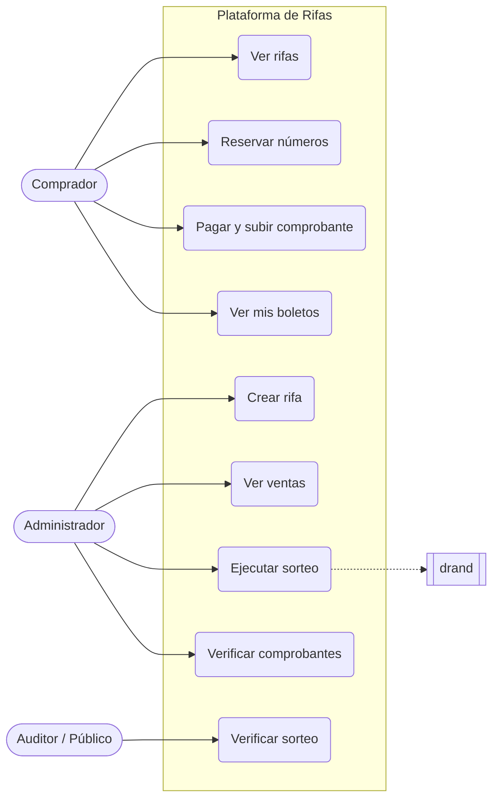

---

## 4. Requisitos funcionales

### 4.1 Comprador

| ID | Requisito | Prioridad |
|---|---|---|
| RF-01 | Ver el listado de rifas activas con premio, precio, fecha de cierre y números disponibles. | Alta |
| RF-02 | Ver la grilla de números de una rifa con su estado (disponible / reservado / vendido). | Alta |
| RF-03 | Reservar uno o más números por un tiempo limitado (**15 minutos**). | Alta |
| RF-04 | Pagar los números reservados por Yape, Plin o transferencia a las cuentas del operador y registrar el comprobante (imagen o PDF del voucher, o número de operación). | Alta |
| RF-05 | Recibir el boleto por correo electrónico al aprobarse el pago. | Alta |
| RF-06 | Consultar el historial de boletos propios. | Media |
| RF-07 | Registrarse e iniciar sesión (correo + enlace mágico o contraseña). | Alta |
| RF-08 | Consultar el estado de la orden y, si fue rechazada, el motivo. | Alta |

### 4.2 Administrador

| ID | Requisito | Prioridad |
|---|---|---|
| RF-10 | Crear una rifa: título, descripción, premio, imagen, precio por número, rango de números, fecha de cierre de ventas, fecha del sorteo y número de resolución de autorización. | Alta |
| RF-11 | Publicar el **compromiso** (hash de la semilla) y la ronda de drand **antes** de abrir las ventas. | Alta |
| RF-12 | Ver el reporte de ventas: vendidos, reservados, recaudación y comprobantes por verificar. | Alta |
| RF-13 | Ejecutar el sorteo cuando la ronda de drand ya fue publicada. | Alta |
| RF-14 | Registrar la entrega del premio (evidencia). | Media |
| RF-15 | Cancelar una rifa y marcar los boletos para reembolso (mecanismo pendiente: D8 de la guía). | Media |
| RF-16 | Revisar los comprobantes contra la banca móvil y aprobar o rechazar cada orden; el rechazo exige un motivo e indicar si llegó dinero (DT-08). Lo mismo aplica a los pagos tardíos: confirmar con el monto recibido o descartar con un motivo (DT-07). | Alta |

### 4.3 Público

| ID | Requisito | Prioridad |
|---|---|---|
| RF-20 | Ver la página de verificación del sorteo: semilla revelada, hash de compromiso, ronda y valor de drand, lista de boletos vendidos y algoritmo. | Alta |
| RF-21 | Recalcular el ganador desde el navegador con un script público. | Media |
| RF-22 | Ver el sorteo en vivo: cuenta regresiva, consulta directa a drand desde el navegador, cálculo local del ganador y comparación con el resultado oficial (sección 10.3). | Alta |

---

## 5. Requisitos no funcionales

| ID | Requisito |
|---|---|
| RNF-01 | **Concurrencia**: un número no puede quedar vendido a dos compradores, ni siquiera con peticiones simultáneas. Lo garantiza la base de datos, no la aplicación. |
| RNF-02 | **Idempotencia**: aprobar o rechazar dos veces la misma orden no duplica eventos ni cambia el resultado. Un rechazo repetido con otro dinero no se considera una repetición: se rechaza y queda auditado (DT-08). |
| RNF-03 | **Integridad**: el estado `vendido` solo se asigna mediante la aprobación de un administrador autenticado, registrada en auditoría. |
| RNF-04 | **Auditoría**: registro de eventos de solo inserción (reservas, comprobantes, aprobaciones, rechazos, sorteo), con el identificador del operador. |
| RNF-05 | **Seguridad**: autorización por rol en la API (guards de NestJS); los comprobantes son datos sensibles y su acceso se rige por la decisión D7 de la guía; HTTPS. |
| RNF-06 | **Rendimiento**: la grilla de números carga en < 1 s con 10 000 números. |
| RNF-07 | **Disponibilidad**: 99,5 % mensual. |
| RNF-08 | **Accesibilidad**: WCAG 2.1 AA en el flujo de compra. |
| RNF-09 | **Pruebas**: TDD en el dominio; cobertura ≥ 90 % en reglas de negocio. |
| RNF-10 | **Móvil primero**: todas las pantallas web, incluido el panel de administración, se diseñan desde 360 px de ancho y amplían su diseño con `min-width`. Hasta ese ancho no hay desplazamiento horizontal de la página, y los controles táctiles miden al menos 44 × 44 px. |

---

## 6. Arquitectura

### 6.1 Stack

Alineado con el monorepo existente (`FUENTES/`), para reutilizar sus patrones y servicios.

| Capa | Tecnología | Referencia en el monorepo |
|---|---|---|
| API | NestJS 11 + TypeScript (`FUENTES/tiendi-rifas-api`) | `FUENTES/tiendi-api` |
| Base de datos | PostgreSQL + Prisma 5 (base de datos propia) | `FUENTES/tiendi-api/prisma/schema.prisma` |
| Jobs programados | BullMQ + Redis (jobs repetibles) | `FUENTES/tiendi-api/src/jobs/` |
| Frontend (comprador, sorteo en vivo, verificación, admin) | Angular 21 (`FUENTES/tiendi-rifas-web`) | `FUENTES/tiendi-web` |
| Algoritmo del sorteo (compartido API + web) | Paquete TypeScript `FUENTES/packages/raffle-draw` | `FUENTES/packages/` |
| Pagos | Cobro manual directo (Yape, Plin, transferencia a BCP, BBVA o Interbank) con comprobante y verificación administrativa (DT-02) | — |
| Notificaciones (correo con boletos) | `tiendi-notifications` (M2M) | `DOCS/NOTIFICACIONES/` |
| Aleatoriedad pública | drand (API HTTP pública) | — |
| Observabilidad | `FUENTES/packages/telemetry` (OpenTelemetry) | `DOCS/OBSERVABILIDAD/` |
| Despliegue | Mismo esquema de ambientes que tiendi-api | `DOCS/INFRAESTRUCTURA/DEFINICION_AMBIENTES_TEST_Y_PRD.md` |
| Pruebas | Jest (API), Vitest (web), Playwright (E2E) | Configuración de cada repo |

### 6.2 Arquitectura hexagonal

El **dominio** no conoce ni a Prisma ni al almacenamiento de comprobantes. Si cambia cualquiera de los dos, solo se reemplaza un adaptador.

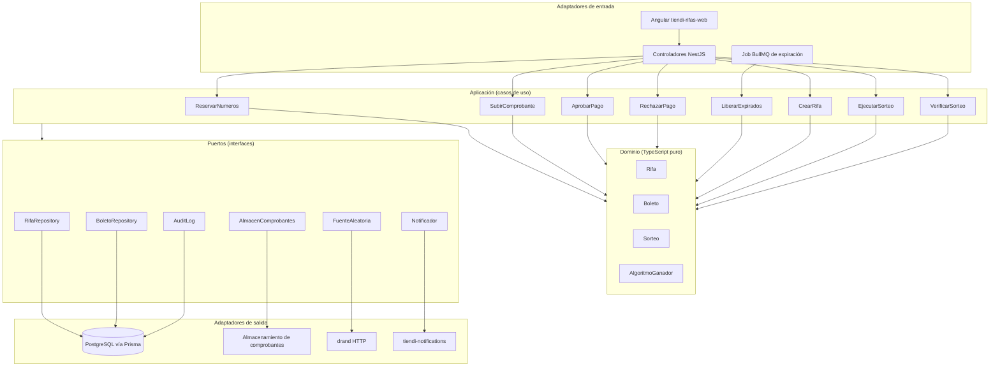

### 6.3 Estructura de carpetas

```
FUENTES/
├── packages/
│   └── raffle-draw/               # Algoritmo del ganador + verificación. Sin dependencias de framework.
├── tiendi-rifas-api/              # NestJS
│   ├── prisma/
│   │   ├── schema.prisma
│   │   └── migrations/
│   ├── src/
│   │   ├── modules/raffles/
│   │   │   ├── domain/            # Entidades, value objects, reglas. TypeScript puro.
│   │   │   ├── application/       # Casos de uso + puertos (interfaces)
│   │   │   ├── infrastructure/    # Adaptadores: prisma, comprobantes, drand, notifications
│   │   │   └── http/              # Controladores, DTOs, guards
│   │   └── jobs/                  # Jobs BullMQ (expiración de reservas, cierre de ventas)
│   └── test/                      # Integración y e2e (Jest)
└── tiendi-rifas-web/              # Angular 21
    ├── src/app/
    │   ├── features/catalogo/     # Rifas activas
    │   ├── features/compra/       # Elegir números + pago
    │   ├── features/en-vivo/      # Sorteo en vivo
    │   ├── features/verificacion/
    │   └── features/admin/
    └── e2e/                       # Playwright
```

---

## 7. Modelo de datos

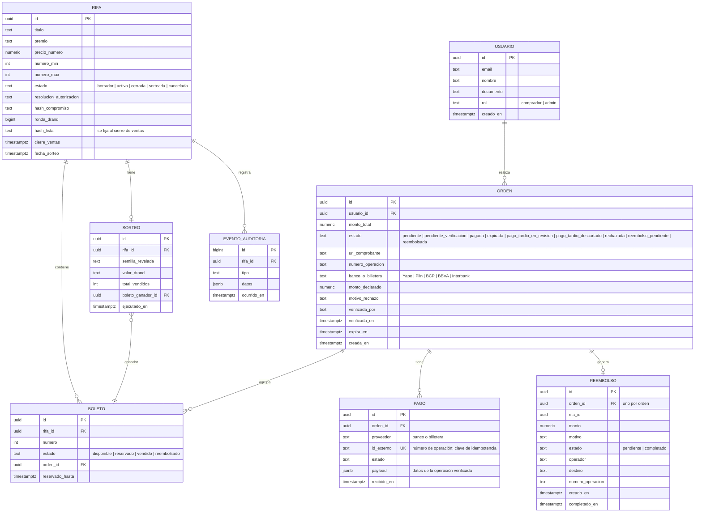

**Restricciones clave**

- `UNIQUE (rifa_id, numero)` en `BOLETO`: un número existe una sola vez por rifa.
- `UNIQUE (id_externo)` en `PAGO`: un número de operación se registra una sola vez, sea cual sea el método de pago (DT-12). Se guarda normalizado: solo letras `A-Z` y dígitos `0-9`, sin espacios, guiones ni caracteres invisibles; cualquier otro carácter se rechaza. Si dos bancos emitieron de verdad el mismo número, el segundo pago se guarda como número más banco (por ejemplo, `OP123#BCP`) mediante una colisión declarada. El comprobante puede llegar solo como imagen, pero el número de operación es obligatorio al aprobar: el operador lo lee de su banca móvil.
- `UNIQUE (orden_id)` en `REEMBOLSO`: una orden tiene como máximo un reembolso.
- Un boleto solo pasa a `vendido` si la rifa está `activa` (trigger): la lista congelada al cierre no cambia ni escribiendo directo en la base.
- `EVENTO_AUDITORIA`: sin permisos de `UPDATE` ni `DELETE` (solo inserción).
- `hash_compromiso` y `ronda_drand` quedan **inmutables** una vez que la rifa pasa a `activa` (trigger).
- `CUENTA_PAGO` (`PaymentAccount`): las cuentas del operador a las que transfiere el comprador (DT-19). `UNIQUE (metodo, numero)` y una `version` para el bloqueo optimista. Una cuenta no se borra (trigger), se desactiva. Ningún `INSERT` ni `UPDATE` de una cuenta se confirma sin una fila de `AUDITORIA_CUENTA_PAGO` (`PaymentAccountAudit`) de la misma cuenta en la misma transacción (trigger diferido). La auditoría es solo de inserción (trigger). `CAMBIO_CUENTA_PAGO` (`PaymentAccountChange`) guarda los cambios de cuatro ojos: uno solo `PENDING` por cuenta (índice único parcial), y quien aprueba o rechaza no es quien propuso (`CHECK`). La `ORDEN` guarda una copia inmutable (trigger) de la cuenta a la que el comprador dijo pagar, con su versión: `paidToAccountId` y `paidToAccount`, los dos nulos o los dos presentes y con el mismo id (`CHECK`). Los identificadores de operador de las cuentas, los cambios y la auditoría están en forma canónica (`CHECK`).

---

## 8. Ciclos de vida

### 8.1 Estados de un boleto

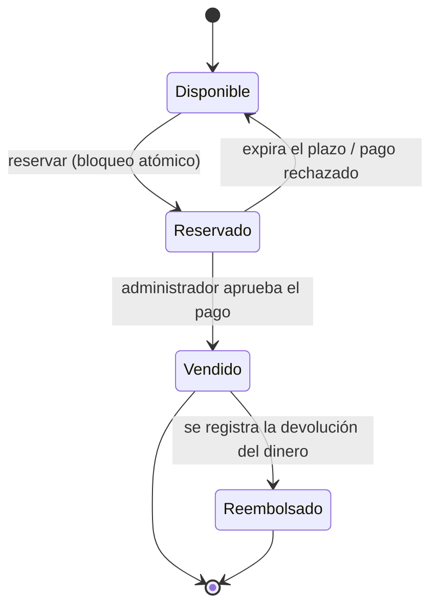

### 8.2 Estados de una rifa

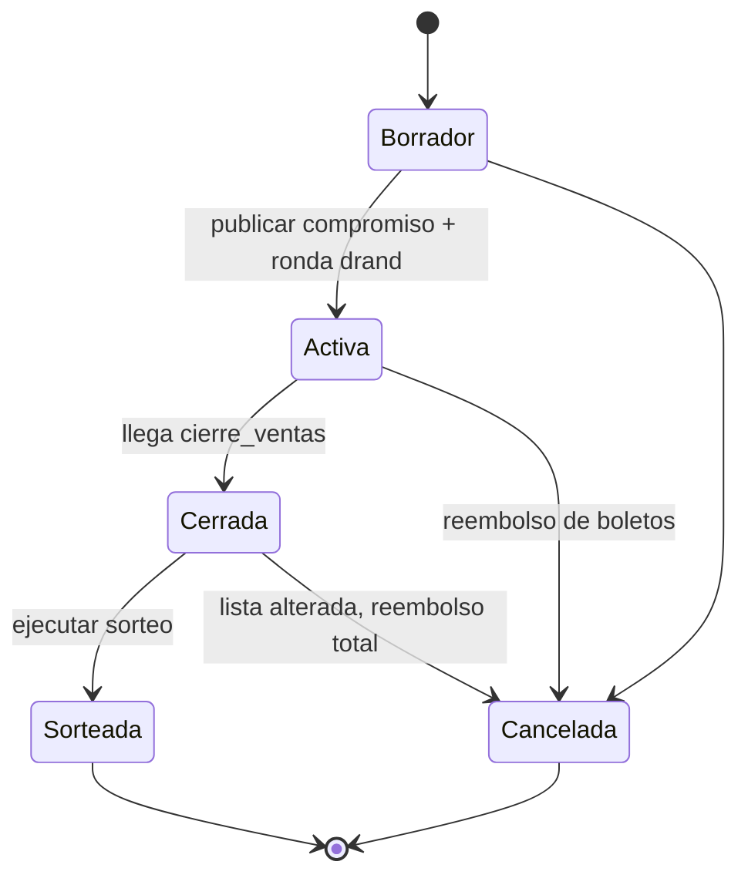

### 8.3 Estados de una orden

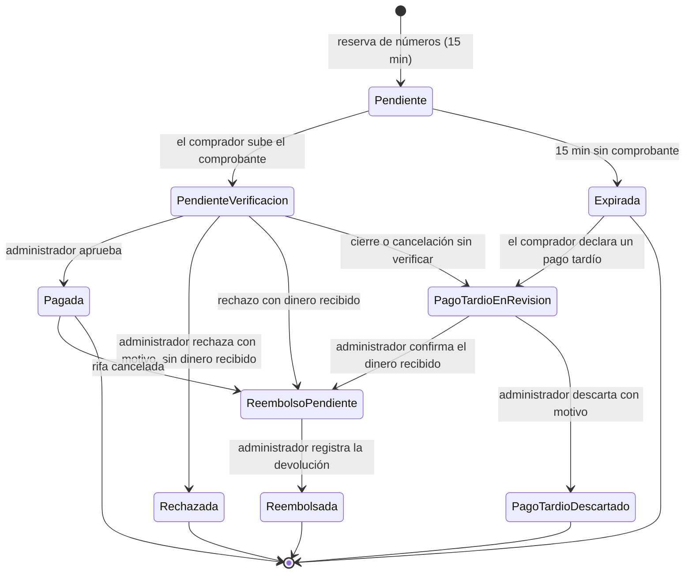

- **Plazos:** una orden `pendiente` tiene 15 minutos. Al subir el comprobante, el operador tiene 12 horas o hasta `cierre_ventas`, lo que ocurra primero, para revisarlo. Mientras tanto el número no se libera.
- **Aprobación (DT-12):** el operador indica el monto recibido, que lee de su banca, y solo se aprueba si es exactamente igual al total de la orden. Si es menor o mayor, la aprobación se rechaza, la orden sigue en `pendiente_verificacion` y sus números siguen retenidos. El operador la resuelve rechazando el pago e indicando el dinero recibido (DT-08). Decide la cifra del banco: si el monto declarado difiere o falta pero el recibido coincide, se aprueba y la auditoría guarda ambas cifras.
- **Colisión entre dos bancos (DT-12):** si dos bancos emitieron de verdad el mismo número, el operador declara la colisión con un motivo y el banco, al aprobar, rechazar con dinero o confirmar un pago tardío. Solo vale si el número ya existe en otro banco. Cada uso queda auditado y visible para los administradores.
- **Rechazo (DT-08):** libera los números de inmediato y deja visible el motivo para el comprador. El administrador debe indicar si recibió dinero. Si lo recibió, indica el monto y los datos de la operación, y la orden pasa a `reembolso_pendiente` con un reembolso por ese monto, nunca por el declarado.
- **Monto recibido mayor que el total (DT-14):** al rechazar con dinero recibido o al confirmar un pago tardío, un monto mayor que el total de la orden solo se acepta si el administrador confirma el exceso con un motivo. Sin esa confirmación se rechaza y no cambia nada. Con ella, el reembolso es por el monto recibido completo y la auditoría guarda el total, el monto, la diferencia y el motivo. Un monto igual o menor que el total no admite esa confirmación.
- **Plazo de comprobantes:** se aceptan hasta 2 horas antes de `cierre_ventas`, margen configurable, para dar tiempo a verificarlos (DT-05).
- **Plazo de reservas (DT-05):** las reservas cierran una duración de reserva antes del plazo de comprobantes, para que toda reserva tenga su tiempo completo para pagar. Por ejemplo, con cierre a las 18:00, los comprobantes se aceptan hasta las 16:00 y, con una reserva de 15 minutos, las reservas hasta las 15:45. Desde ese corte, y también después de `cierre_ventas` aunque el cierre aún no haya corrido, la reserva se rechaza y no retiene ningún número. Una rifa sin `cierre_ventas` no acepta reservas.
- **Cierre de ventas (DT-05):** en una sola transacción, la lista congelada toma solo los boletos `vendido`. Las órdenes `pendiente` pasan a `expirada` y las `pendiente_verificacion` a `pago_tardio_en_revision`, sin abrir un reembolso (DT-10). Sus números quedan libres. Desde ese momento ninguna orden puede aprobarse, aunque el job de cierre aún no haya corrido.
- **Cancelación (DT-05):** aplica lo mismo, y además las órdenes `pagada` pasan a `reembolso_pendiente`, porque ese pago ya fue verificado.
- **Comprobante sin verificar al terminar las ventas (DT-10):** la orden entra en la misma cola de revisión que un pago tardío, con su alerta y conservando lo declarado. El administrador confirma el monto recibido o descarta con un motivo. El comprador recibe un aviso de que su pago está en revisión, nunca de que tiene un reembolso pendiente.
- **Plazo de revisión vencido (DT-06):** si vencen las 12 horas sin que el operador resuelva, la orden sigue en `pendiente_verificacion` y sus números siguen retenidos. El operador recibe una alerta por orden y puede aprobar o rechazar hasta `cierre_ventas`. Solo el operador, el cierre de ventas o la cancelación resuelven la orden.
- **Pago tardío (DT-07):** declarar un pago sobre una orden `expirada` no abre un reembolso. La orden pasa a `pago_tardio_en_revision` y espera a un administrador. Si confirma, indica el monto recibido y los datos de la operación, y se abre el reembolso por ese monto, nunca por el declarado. Si descarta, indica un motivo; la decisión es final y la orden no admite otro reclamo. El cierre de ventas, la cancelación y el sorteo no tocan las órdenes que ya están en revisión.
- **Alerta de reclamo (DT-09, DT-10):** cada orden que entra en la cola de revisión crea una alerta en el panel de administración, sin correo. Muestra la rifa, la orden y el monto declarado, sin datos del comprador. Se apaga cuando un administrador la marca como leída o decide el reclamo.
- **Reembolso (DT-04):** una orden pasa a `reembolsada` solo cuando un administrador registra operador, destino y número de operación. Hasta entonces sus boletos vendidos siguen `vendido`.
- **Cuatro ojos (DT-17):** el administrador que completa un reembolso no puede ser el que registró el dinero que ese reembolso devuelve: el que aprobó el pago, el que rechazó con dinero recibido, el que confirmó el pago tardío o el que registró la transferencia extra. Si es el mismo, o si no se encuentra quién registró el dinero, el sistema rechaza la completación, no cambia nada y deja el intento en la auditoría. El identificador de un administrador es el de su usuario autenticado, en minúsculas, con letras, dígitos y `. _ @ -`, hasta 128 caracteres; cualquier otro se rechaza antes de registrar nada. Un pago registrado no cambia de estado, de orden ni de operador, no se borra, y ningún pago se vuelve un pago con dinero después de creado. Cada orden tiene un solo pago propio, y todo pago con dinero nombra a su administrador. Un reembolso completado no cambia más ni se borra. Estas reglas de la base frenan errores y escrituras accidentales, no a quien administra la base: su acceso debe estar restringido. Cada despliegue necesita al menos dos administradores: con uno solo, ningún reembolso se completa, y eso es intencional. Los reembolsos completados antes de esta regla no se revisan hacia atrás. El administrador sale siempre de la sesión autenticada.
- **Correos (DT-13):** cada correo se guarda en una bandeja dentro de la misma transacción que el cambio que avisa, y un trabajo lo envía después. Si el cambio se revierte, no hay correo; si se confirma, el correo no se pierde aunque el envío falle. Un mismo evento se guarda una sola vez. Cada envío tiene un límite de tiempo, y un envío fallido se reintenta con espera creciente durante al menos un día: unas 28,6 horas con los valores por defecto. Tras el último intento, o ante un error que ningún reintento corrige, el correo queda como fallido y los administradores reciben una alerta en el panel; un administrador puede volver a encolarlo. El error guardado no incluye direcciones de correo ni URLs. La entrega es al menos una vez: tras una caída, un correo puede llegar repetido, nunca perderse. A los 30 días (configurable), se borra el contenido de los correos enviados. El aviso al ganador va al comprador del boleto ganador. El correo de pago aprobado incluye además la sección "Datos para verificar tu sorteo": el compromiso, la ronda de drand, la fecha del sorteo y el cierre de ventas, cada fecha en hora de Lima y en ISO 8601, y el enlace a `/rifas/:id/verificacion` (DT-20). En producción, el enlace siempre es `https`. Son datos públicos de la rifa; el correo no agrega otros datos del comprador.
- **Lista alterada (DT-15):** una rifa `cerrada` cuya lista de vendidos ya no coincide con `hash_lista` no se sortea, y su única salida es cancelarla con reembolso total. Un administrador la cancela con un motivo obligatorio de hasta 500 caracteres. El sistema vuelve a comparar la lista al cancelar: si coincide, rechaza la cancelación, porque esa rifa se sortea. Los reembolsos siguen al dinero verificado y no a la lista: cada orden `pagada` recibe el total de la orden, una orden con un pago declarado pasa a la cola de revisión y un boleto vendido sin dinero verificado detrás no abre ningún reembolso. La auditoría guarda ambos hashes, el administrador y el motivo.
- **Transferencia extra (DT-16):** si un comprador transfiere dos veces, o transfiere después de que su orden quedó resuelta, un administrador registra esa transferencia contra la orden con el monto, el banco o billetera, el número de operación y un motivo obligatorio de hasta 500 caracteres. Se abre un reembolso por ese monto, aparte del reembolso propio de la orden, y la orden y sus boletos no cambian. Solo la aceptan las órdenes `pagada`, `reembolso_pendiente`, `reembolsada`, `rechazada` y `pago_tardio_descartado`: en los demás estados, el flujo de la orden maneja el dinero que llega. El número de operación sigue siendo único entre todos los pagos (DT-12), un monto mayor que el total exige la confirmación de sobrepago (DT-14) y la auditoría guarda el pago, el reembolso, el administrador y el motivo. El comprador nunca ve ese motivo: su aviso y su reembolso muestran un texto fijo, igual que en una cancelación, cuyo motivo queda en la rifa y en la auditoría.
- **Sorteo bloqueado (DT-13):** un boleto vendido siempre tiene la orden que lo compró, y la base de datos lo exige. Si aun así el boleto ganador no tuviera orden, nadie podría recibir el aviso: el sorteo no se guarda, la rifa sigue en cerrada, el intento queda en la auditoría y los administradores reciben una alerta de la rifa en el panel. Repetir el intento vuelve a mostrar la misma alerta, sin crear otra.

---

## 9. Flujos principales

### 9.1 Reserva y compra

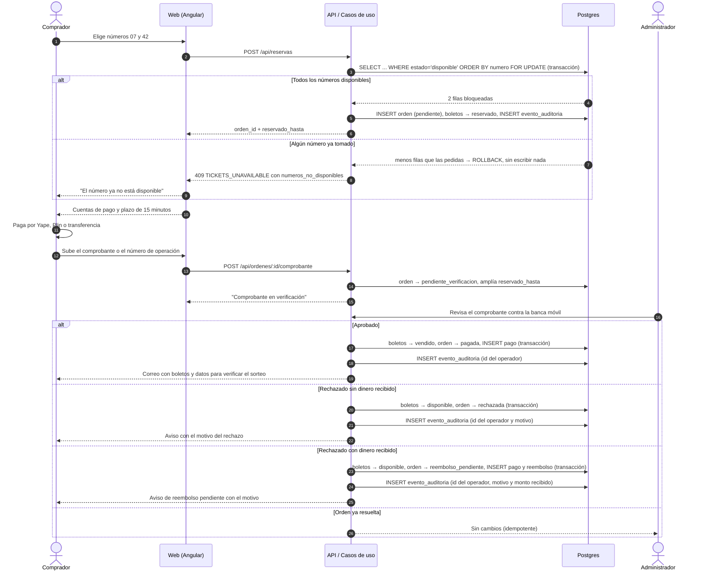

**Regla crítica:** subir un comprobante **no** confirma nada. Solo la aprobación de un administrador, registrada en auditoría, cambia el estado a `vendido`.

### 9.2 Liberación de reservas expiradas

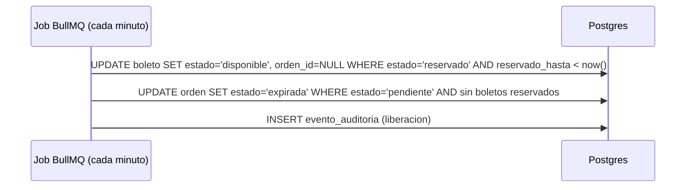

> Caso borde: un comprobante que llega **después** de que expiró la reserva no reactiva la orden, porque el número pudo haberlo tomado otra persona. Nunca se pisa una venta. Si el comprador pagó, declara el pago tardío en `POST /api/ordenes/:id/pago-tardio`: la orden pasa a `pago_tardio_en_revision` hasta que un administrador confirme el dinero recibido, y recién entonces se devuelve según DT-04 (DT-07).

---

## 10. Sorteo verificable (commit-reveal + drand)

### 10.1 Idea

1. **Antes de vender**, el sistema genera una semilla secreta y publica solo su **hash** (compromiso). También fija una **ronda futura de drand**, posterior al cierre de ventas.
2. Nadie conoce el valor de esa ronda de drand hasta que se publica, **ni siquiera el organizador**.
3. **Al cierre de ventas**, se congela la lista de boletos vendidos (se publica con su hash) y se revela la semilla. Cualquiera puede comprobar que el hash de la semilla coincide con el compromiso.
4. **Al publicarse la ronda de drand**, cada participante puede calcular el ganador con la semilla, el valor de drand y la lista congelada.

Así el organizador no puede elegir al ganador (no controla drand) y tampoco puede cambiar la semilla después (el hash ya era público).

> Revelar la semilla al cierre es seguro: una vez congelada la lista, el único dato impredecible que falta es el valor de drand, que todavía no existe. La semilla **nunca** debe revelarse antes de congelar la lista.

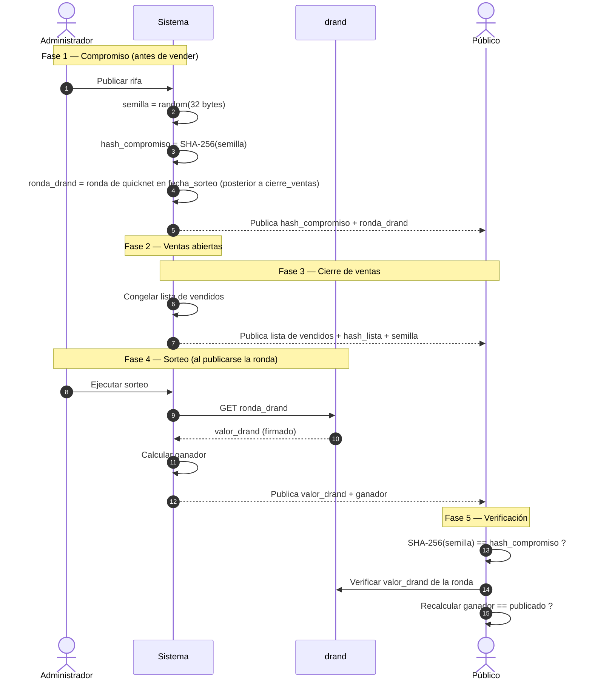

### 10.2 Algoritmo del ganador

```
entrada:
  semilla        (hex, 32 bytes)
  valor_drand    (hex)
  vendidos       lista de números vendidos, ORDENADA ascendente

h        = SHA-256( semilla || valor_drand || id_rifa )
n        = entero sin signo de 256 bits a partir de h
indice   = n mod longitud(vendidos)
ganador  = vendidos[indice]
```

- El sesgo del módulo es despreciable (2²⁵⁶ frente a miles de boletos).
- La lista de vendidos se congela al cierre y se publica en ese momento, junto con su hash.
- Antes de calcular el ganador, el servidor recalcula el hash de la lista y lo compara con `hash_lista`. Si no coinciden, no hay sorteo: la rifa sigue en `cerrada`, no se guarda ningún ganador, el intento queda en auditoría (DT-11) y los administradores reciben una alerta de la rifa en el panel (DT-15).
- La base de datos impide cambiar un boleto `vendido` de una rifa `cerrada` o `sorteada` (DT-11).
- El script de verificación es público (RF-21) y usa el mismo código del dominio.
- **Ronda del sorteo (DT-18):** el sorteo usa solo la ronda fijada al publicar la rifa, pedida por su número y con la firma BLS verificada. Si drand o sus relays no responden, el sorteo espera: drand guarda todas sus rondas, así que la ronda fijada sigue disponible después. Nunca se usa otra ronda.
- Mientras espera, el operador ve la alerta `DRAW_BLOCKED` en el panel. Cuando drand vuelve, el sorteo se completa solo y la alerta queda leída.
- **Decisión abierta:** si drand dejara de existir para siempre, no hay salida automática. Hará falta un camino de cancelación para ese caso, que todavía no está definido.

### 10.3 Sorteo en vivo

El sorteo se transmite en una página pública, `/rifas/:id/en-vivo`. Lo importante es que **cada navegador calcula el ganador por su cuenta**: pide el valor directamente a drand, sin pasar por el servidor de la plataforma, y ejecuta el mismo algoritmo de la sección 10.2. Si miran mil personas, son mil cálculos independientes que tienen que coincidir.

#### Línea de tiempo

```
 Cierre de ventas          Ronda drand #N             Resultado
 20:00                     20:30:00                   20:30:03
    │                          │                          │
    ├─ Se congela la lista     ├─ drand publica el valor  ├─ Ganador en pantalla
    │  de vendidos y se        │  y cada navegador lo     │  + botón "Verificar"
    │  publica su hash         │  pide DIRECTO a drand    │
    ├─ Se revela la semilla    │                          │
    └─ Se abre la página       └─ Cada navegador calcula  │
       "Sorteo en vivo"           el ganador localmente   │
       con cuenta regresiva
```

#### Flujo

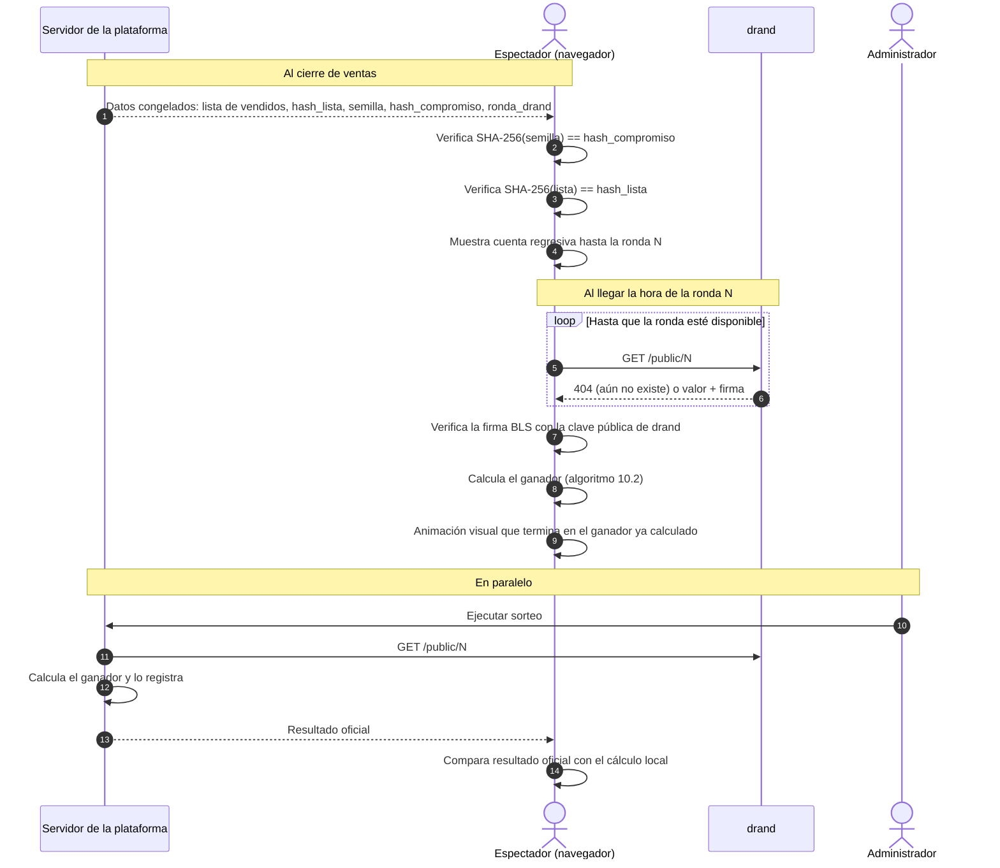

#### Estados de la página en vivo

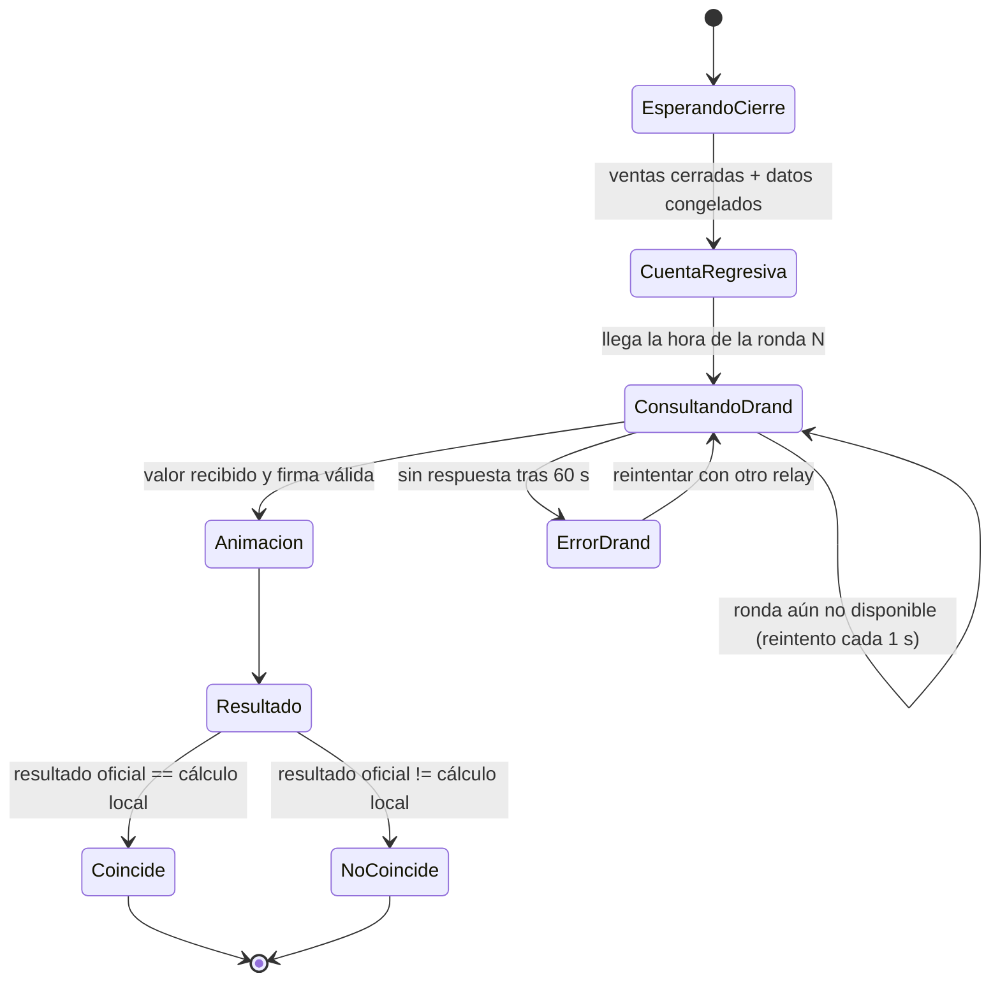

#### Reglas

| # | Regla | Motivo |
|---|---|---|
| V-01 | El navegador consulta drand **directamente**, nunca a través del servidor de la plataforma. | Si el valor pasara por el servidor, habría que confiar en él. |
| V-02 | Se usan varios relays públicos de drand (por ejemplo `api.drand.sh`, `api2.drand.sh`, `drand.cloudflare.com`) con reintento. | Que la caída de un relay no impida ver el sorteo. |
| V-03 | La firma BLS de la ronda se verifica en el cliente (por ejemplo, con la librería `drand-client`). | Asegura que el valor viene de la red drand y no lo inyectó un intermediario. |
| V-04 | El algoritmo del ganador vive en un **paquete compartido** que usan el servidor y el navegador. | Evita que los dos cálculos diverjan por diferencias de implementación. |
| V-05 | El reloj del navegador no decide nada. Solo se usa para la cuenta regresiva; la página consulta hasta que la ronda exista. | Un reloj local desfasado no puede alterar el resultado. |
| V-06 | La animación es **solo visual**: empieza después de calcular el ganador y siempre se detiene en él. | Si la animación "decidiera", se perdería la verificabilidad. |
| V-07 | Si el resultado oficial no coincide con el cálculo local, la página lo muestra de forma visible ("El resultado oficial NO coincide con tu cálculo"). | La transparencia también incluye exponer los fallos. |
| V-08 | Al terminar, la página en vivo pasa a ser la página permanente de verificación (RF-20). | El sorteo se puede auditar en cualquier momento posterior. |

#### Anclas del comprador (DT-20)

La página de verificación no depende solo de lo que la plataforma muestra hoy. Además de las comprobaciones de la sección 10.2, el navegador hace estas:

- **Ronda fijada:** al publicar, la ronda es `roundAt(fecha_sorteo)` en quicknet, y debe ser posterior a `roundAt(cierre_ventas)`. La página repite las dos reglas con `roundAt` del paquete compartido y la cadena quicknet fijada en el código: `ronda_drand` debe ser igual a `roundAt(fecha_sorteo)` y mayor que `roundAt(cierre_ventas)`. Si una falla, es una comprobación fallida y no se consulta drand. Una fecha del sorteo anterior al cierre falla: su ronda ya era pública mientras se vendía.
- **Tus números:** con la sesión iniciada, la página lee `GET /api/mis-boletos` y comprueba que cada número de las órdenes pagadas de esa rifa está en la lista de vendidos descargada. Si falta uno, la comprobación falla de forma visible. Sin sesión, o si los boletos no se pueden leer, la comprobación se omite y el resultado lo dice.
- **Valores guardados en el navegador:** la primera vez que el navegador ve una rifa, guarda el compromiso, la ronda, la fecha del sorteo y el cierre de ventas, y el hash de la lista cuando ya está congelada. El detalle de la rifa guarda los valores previos a la venta. La página de verificación los guarda solo si todas sus comprobaciones pasaron. En una visita posterior, si alguno cambió, la página lo muestra como alerta y no marca al ganador como verificado.
- **Correo de pago aprobado:** el correo trae la sección "Datos para verificar tu sorteo". La página tiene un campo para cada valor del correo: el compromiso, la ronda, la fecha del sorteo y el cierre de ventas. Compara solo los que se pegan. Si uno no coincide, la comprobación "Datos de tu correo" falla de forma visible y la verificación queda fallida.
- **Ancla:** la verificación está anclada cuando un valor guardado en una visita anterior coincide o cuando los valores del correo coinciden. En una primera visita, o si el navegador no guarda datos (por ejemplo, porque los bloquea), no hay ancla: el cálculo solo prueba que los datos de la plataforma son coherentes entre sí.
- **Etiqueta del ganador:** antes de recalcular, o si algo falla o no coincide, el ganador se muestra como "Resultado oficial (sin verificar)". Si el cálculo local coincide pero no hay ancla, se muestra "Coincide con drand (sin ancla previa: compara con los datos de tu correo)". Solo pasa a "Ganador verificado" cuando el cálculo coincide, la verificación está anclada y ningún valor guardado cambió.
- **Consultas a drand:** la página vuelve a preguntar mientras al menos un relay responda que la ronda aún no existe (`404` o `425`) y ninguno la haya entregado, aunque otros relays estén caídos. Pregunta cada segundo, hasta 60 segundos en total. Al salir de la página, recargar o volver a recalcular, la consulta en curso se cancela.

#### Transmisión y acta

- La página en vivo se puede retransmitir por YouTube, Facebook o TikTok Live. La transmisión es **complementaria**: la fuente de verdad es el cálculo verificable, no el video.
- Si la autorización exige la presencia de un notario o de un representante de la autoridad, el acta del sorteo registra: el número de ronda y el valor de drand, `hash_compromiso`, la semilla revelada, `hash_lista`, la cantidad de boletos vendidos y el número ganador.
- Con esos datos, cualquiera puede repetir el cálculo años después y obtener el mismo ganador.

---

## 11. API (MVP)

> **Estado:** todas las rutas de esta tabla están implementadas (F6). El comprador y el administrador entran con un enlace de un solo uso enviado por correo (D4): `POST /api/auth/enlace {email}` y luego `POST /api/auth/sesion {token}`, que devuelve el token de sesión para la cabecera `Authorization: Bearer`. Toda respuesta de error tiene la forma `{ code, message, details? }`. Además existe `POST /api/admin/notificaciones/:id/reencolar`, que vuelve a encolar un correo fallido (DT-13).

| Método | Ruta | Actor | Descripción |
|---|---|---|---|
| GET | `/api/rifas` | Público | Lista de rifas activas |
| GET | `/api/rifas/:id` | Público | Detalle + grilla de números |
| POST | `/api/reservas` | Comprador | Reserva números `{rifa_id, numeros[]}` → `orden_id` |
| POST | `/api/ordenes/:id/comprobante` | Comprador | Registra el comprobante `{archivo, numero_operacion, banco_o_billetera, monto_declarado, cuenta_id, cuenta_version}` y pasa la orden a verificación. `cuenta_id` y `cuenta_version` son obligatorios: la cuenta del operador a la que el comprador transfirió, que debe estar activa, y la versión que el comprador vio. Si la cuenta cambió desde entonces, responde 409 `PAYMENT_ACCOUNT_CHANGED` (DT-19). `banco_o_billetera` es el origen del pago y puede ser distinto del método de la cuenta |
| POST | `/api/ordenes/:id/pago-tardio` | Comprador | Declara un pago hecho después de expirar la reserva y lo deja en revisión |
| GET | `/api/ordenes/:id` | Comprador | Estado de la orden, plazo y motivo de rechazo |
| GET | `/api/ordenes/:id/comprobante` | Comprador dueño o Admin | Descarga el comprobante; nunca se sirve desde una ruta pública |
| GET | `/api/mis-boletos` | Comprador | Boletos del usuario |
| GET | `/api/cuentas-pago` | Público | Cuentas de pago activas del operador, en el orden de presentación (DT-19) |
| GET | `/api/admin/rifas` | Admin | Lista todas las rifas en cualquier estado (borrador, activa, cerrada, sorteada, cancelada) |
| GET | `/api/admin/rifas/:id` | Admin | Detalle de una rifa en cualquier estado con sus métricas |
| POST | `/api/admin/rifas` | Admin | Crea una rifa (borrador) |
| POST | `/api/admin/rifas/:id/publicar` | Admin | Genera el compromiso y activa la rifa |
| GET | `/api/admin/rifas/:id/ventas` | Admin | Reporte de ventas |
| GET | `/api/admin/comprobantes` | Admin | Órdenes pendientes de verificación de todas las rifas (RF-16) |
| GET | `/api/admin/rifas/:id/comprobantes` | Admin | Órdenes pendientes de verificación |
| GET | `/api/admin/alertas` | Admin | Alertas sin leer, la más antigua primero (DT-09) |
| POST | `/api/admin/alertas/:id/leida` | Admin | Marca la alerta como leída para todos los administradores |
| GET | `/api/admin/pagos-tardios` | Admin | Órdenes en `pago_tardio_en_revision` sin decidir, reclamos y comprobantes sin verificar al terminar las ventas, la más antigua primero |
| POST | `/api/admin/ordenes/:id/pago-tardio/confirmar` | Admin | Confirma el pago `{monto_recibido, banco_o_billetera, numero_operacion, sobrepago?}` y abre el reembolso. Un monto mayor que el total exige `sobrepago` con un motivo (DT-14) |
| POST | `/api/admin/ordenes/:id/pago-tardio/descartar` | Admin | Descarta el reclamo con `{motivo}` |
| POST | `/api/admin/ordenes/:id/aprobar` | Admin | Aprueba el pago con `{numero_operacion, monto_recibido, colision?}` si el monto recibido es igual al total (DT-12): boletos vendidos, orden pagada y evento de auditoría |
| GET | `/api/admin/pagos/colisiones` | Admin | Cada uso de la salida para colisiones entre bancos, el más reciente primero (DT-12) |
| POST | `/api/admin/ordenes/:id/rechazar` | Admin | Rechaza el pago con `{motivo, dinero_recibido}` y libera los números. Si `dinero_recibido` es verdadero, exige monto, banco o billetera y número de operación, y abre el reembolso (DT-08). Un monto mayor que el total exige `sobrepago` con un motivo (DT-14) |
| POST | `/api/admin/ordenes/:id/transferencia-extra` | Admin | Registra con `{monto_recibido, banco_o_billetera, numero_operacion, motivo, colision?, sobrepago?}` una segunda transferencia real de una orden resuelta y abre su reembolso, sin cambiar la orden ni sus boletos (DT-16) |
| GET | `/api/admin/reembolsos` | Admin | Reembolsos pendientes |
| POST | `/api/admin/reembolsos/:id/completar` | Admin | Registra `{destino, numero_operacion}` y marca la orden como reembolsada. El administrador sale de la sesión y no puede ser el que registró el dinero (DT-17) |
| GET | `/api/admin/cuentas-pago` | Admin | Todas las cuentas de pago, también las inactivas (DT-19) |
| POST | `/api/admin/cuentas-pago` | Admin | Propone una cuenta nueva `{metodo, titular, numero, cci?, orden?}` (202, un Cambio de cuenta). No es pública hasta que otro administrador la aprueba (DT-19) |
| PATCH | `/api/admin/cuentas-pago/:id` | Admin | `{metodo?, titular?, numero?, cci?, orden?}`. Si solo cambia `orden`, se aplica en el acto (200, la cuenta). Si cambia el método, el titular, el número o el CCI, se propone (202, un Cambio de cuenta). Un cambio que no cambia nada no deja rastro |
| POST | `/api/admin/cuentas-pago/:id/desactivar` | Admin | Desactiva la cuenta en el acto (200): es la dirección segura. No existe el borrado |
| POST | `/api/admin/cuentas-pago/:id/activar` | Admin | Propone volver a activarla (202, un Cambio de cuenta); si ya está activa, no hace nada (200) |
| GET | `/api/admin/cuentas-pago/cambios` | Admin | Cambios de cuenta pendientes, el más antiguo primero |
| POST | `/api/admin/cuentas-pago/cambios/:id/aprobar` | Admin | Aprueba un cambio propuesto por otro administrador y lo publica (200, la cuenta) |
| POST | `/api/admin/cuentas-pago/cambios/:id/rechazar` | Admin | Rechaza un cambio propuesto por otro administrador (200, el cambio) |
| POST | `/api/admin/cuentas-pago/cambios/:id/cancelar` | Admin | Quien lo propuso retira su cambio (200, el cambio) |
| POST | `/api/admin/rifas/:id/sorteo` | Admin | Ejecuta el sorteo |
| POST | `/api/admin/rifas/:id/cancelar-lista-alterada` | Admin | Cancela con `{motivo}` una rifa cerrada cuya lista de vendidos ya no coincide con `hash_lista`, y abre el reembolso de cada orden pagada (DT-15) |
| GET | `/api/rifas/:id/verificacion` | Público | Datos de verificación del sorteo |
| GET | `/api/rifas/:id/en-vivo` | Público | Datos congelados al cierre (lista, hashes, semilla, ronda) y resultado oficial cuando exista |

**Respuestas.** Usan las mismas claves en español y snake_case que los pedidos. Las fechas van en ISO 8601 (UTC) y la ronda de drand como texto.

| Respuesta | Claves | Rutas |
|---|---|---|
| Rifa | `rifa_id`, `titulo`, `premio`, `precio_boleto`, `numero_min`, `numero_max`, `estado`, `cierre_ventas`, `fecha_sorteo`, `resolucion_autorizacion`, `boletos_vendidos`, `boletos_reservados`, `boletos_disponibles`. Los conteos salen del estado de cada número: vendido (`SOLD`, pago aprobado), reservado (`RESERVED`, orden en espera de pago o en verificación: no se ofrece, pero tampoco está vendido) y disponible (`AVAILABLE`, el único que se puede reservar). Un número reembolsado no entra en ninguno de los tres. Solo son conteos: no incluyen datos de compradores ni de órdenes | Cada elemento de `GET /api/rifas`; `rifa` de `GET /api/rifas/:id` |
| Detalle | `rifa` (una Rifa), `grilla`: `{pagina, tamano, total, paginas, numeros: [{numero, estado}]}`. `estado` de un número: `AVAILABLE`, `RESERVED`, `SOLD` o `UNAVAILABLE` | `GET /api/rifas/:id?pagina=&tamano=` |
| En vivo | `rifa_id`, `titulo`, `estado`, `hash_compromiso`, `hash_cadena_drand`, `ronda_drand`, `cierre_ventas`, `fecha_sorteo`, `hash_lista`, `semilla_revelada`, `numeros_vendidos`, `resultado`: `{numero_ganador, indice_ganador, digest_hex, aleatoriedad_drand, ejecutado_en}` o `null`. `hash_lista`, `semilla_revelada` y `numeros_vendidos` valen `null` hasta el cierre | `GET /api/rifas/:id/en-vivo` |
| Verificación | `rifa_id`, `titulo`, `premio`, `version_algoritmo`, `resolucion_autorizacion`, `estado`, `hash_compromiso`, `semilla_revelada`, `hash_cadena_drand`, `ronda_drand`, `fecha_sorteo`, `cierre_ventas`, `aleatoriedad_drand`, `hash_lista`, `lista_verificada`, `numeros_vendidos`, `indice_ganador`, `numero_ganador`, `digest_hex`, `ejecutado_en` | `GET /api/rifas/:id/verificacion` |
| Orden | `orden_id`, `rifa_id`, `estado`, `numeros`, `monto_total`, `vence_en`, `verificacion_vence_en`, `monto_declarado`, `banco_o_billetera`, `motivo_rechazo`, `tiene_comprobante`, `creada_en`, `cuenta_destino`: `{cuenta_id, metodo, titular, numero, cci, version}`, la copia de la cuenta a la que el comprador dijo pagar al enviar el comprobante, o `null` | `POST /api/reservas`, `POST /api/ordenes/:id/comprobante`, `POST /api/ordenes/:id/pago-tardio`, `GET /api/ordenes/:id`, `GET /api/admin/pagos-tardios`; en `GET /api/admin/comprobantes` y `GET /api/admin/rifas/:id/comprobantes`, además `numero_operacion` |
| Orden con hora del servidor | Una Orden más `hora_servidor`: el reloj del servidor en ISO 8601 (UTC) al responder. La web calcula con ella la diferencia con el reloj del dispositivo y cuenta `vence_en` sin depender de la cabecera `Date` ni de CORS. `POST /api/reservas` no la lleva: la web solo usa esa respuesta para ir a la página de pago, que lee la orden | `GET /api/ordenes/:id`, `POST /api/ordenes/:id/comprobante`, `POST /api/ordenes/:id/pago-tardio` |
| Cuenta de pago (pública) | `cuenta_id`, `metodo` (`YAPE`, `PLIN`, `BCP`, `BBVA` o `INTERBANK`), `titular`, `numero` (celular para Yape y Plin, número de cuenta para un banco, solo dígitos), `cci` (solo bancos, o `null`), `version` (la que el comprobante devuelve como `cuenta_version`). Sin estado, sin auditoría y sin identificadores de operadores | Cada elemento de `GET /api/cuentas-pago` |
| Cuenta de pago (admin) | Las de la pública más `orden`, `activa`, `creada_en`, `actualizada_en`, `creada_por`, `actualizada_por` | `GET /api/admin/cuentas-pago`; las respuestas 200 de `PATCH`, `desactivar`, `activar` y `aprobar` |
| Cambio de cuenta | `solicitud_id`, `tipo` (`CREATE`, `UPDATE` o `ACTIVATE`), `cuenta_id`, `estado` (`PENDING`, `APPROVED`, `REJECTED` o `CANCELLED`), `propuesta` y `anterior`: `{metodo, titular, numero, cci, orden}` o `null`, `propuesta_por`, `propuesta_en`, `decidida_por`, `decidida_en` | `GET /api/admin/cuentas-pago/cambios`; las respuestas 202 de `POST`, `PATCH` y `activar`; `rechazar` y `cancelar` |
| Mis boletos | `orden_id`, `rifa_id`, `titulo_rifa`, `numeros`, `estado`, `monto_total`, `vence_en`: el fin de la reserva, con el mismo significado y formato (ISO 8601, UTC) que en la Orden; nunca es `null`, porque toda orden tiene vencimiento. La respuesta es una lista sin `hora_servidor`: la web muestra la hora límite, no una cuenta regresiva, que solo corre en la página de pago | `GET /api/mis-boletos` |
| Ventas | `rifa_id`, `titulo`, `estado`, `boletos_vendidos`, `boletos_reservados`, `boletos_disponibles`, `monto_pagado`, `ordenes_por_estado` | `GET /api/admin/rifas/:id/ventas` |
| Alerta | `alerta_id`, `tipo`, `rifa_id`, `titulo_rifa`, `orden_id`, `cuenta_pago_id`, `monto`, `creada_en`. Una alerta `PAYMENT_ACCOUNT_CHANGE` no tiene rifa: `rifa_id` y `titulo_rifa` valen `null` y `cuenta_pago_id` nombra la cuenta | `GET /api/admin/alertas` |
| Reembolso | `reembolso_id`, `orden_id`, `rifa_id`, `pago_id`, `monto`, `motivo`, `estado`, `creado_en` | `GET /api/admin/reembolsos` |
| Colisión | `pago_id`, `orden_id`, `banco`, `numero_operacion`, `motivo`, `operador_id`, `pago_existente_id`, `orden_existente_id`, `recibido_en` | `GET /api/admin/pagos/colisiones` |
| Rifa creada o cancelada | `rifa_id`, `estado` | `POST /api/admin/rifas`, `POST /api/admin/rifas/:id/cancelar-lista-alterada` |
| Rifa publicada | `rifa_id`, `estado`, `hash_compromiso`, `ronda_drand` | `POST /api/admin/rifas/:id/publicar` |
| Sorteo | `sorteo_id`, `numero_ganador`, `ronda_drand`, `ejecutado_en` | `POST /api/admin/rifas/:id/sorteo` |
| Sesión | `token_acceso`, `vence_en`, `usuario`: `{usuario_id, email, rol}` | `POST /api/auth/sesion`; `GET /api/auth/yo` devuelve el `usuario` |
| Enlace pedido | `{enviado: true}`, siempre con 202, aunque el correo ya tenga el máximo de enlaces | `POST /api/auth/enlace` |
| Sin cuerpo | 204 | Aprobar, rechazar, confirmar y descartar un pago tardío, transferencia extra, completar un reembolso, marcar una alerta leída, volver a encolar un correo, salir |

Una orden de otro comprador responde lo mismo que una orden inexistente: 404 `ORDER_NOT_FOUND`.

**Errores de las cuentas de pago (DT-19).**

| Código | Estado | Cuándo |
|---|---|---|
| `PAYMENT_ACCOUNT_INVALID` | 422 | Un campo no cumple el formato de su método: celular de Yape o Plin que no tiene 9 dígitos o no empieza con 9, CCI en una billetera, cuenta bancaria fuera de 10 a 20 dígitos, CCI sin 20 dígitos o con un código de banco que no es el del método, titular fuera de 2 a 100 caracteres. Un `orden` fuera de 0 a 999 responde 400 `VALIDATION_FAILED` |
| `PAYMENT_ACCOUNT_NOT_FOUND` | 404 | La cuenta no existe |
| `PAYMENT_ACCOUNT_DUPLICATE` | 409 | El método y el número ya son de otra cuenta, activa o no, o de otro cambio pendiente; se comprueba al proponer y al aprobar |
| `PAYMENT_ACCOUNT_CHANGE_PENDING` | 409 | La cuenta ya tiene un cambio pendiente: se aprueba, se rechaza o se cancela primero |
| `PAYMENT_ACCOUNT_CHANGE_NOT_FOUND` | 404 | El cambio no existe |
| `PAYMENT_ACCOUNT_CHANGE_CLOSED` | 409 | El cambio ya fue aprobado, rechazado o cancelado |
| `SAME_OPERATOR_APPROVAL` | 409 | Quien propuso el cambio intenta aprobarlo o rechazarlo |
| `NOT_CHANGE_PROPOSER` | 403 | Otro administrador intenta cancelar un cambio que no propuso |
| `PAYMENT_ACCOUNT_UNAVAILABLE` | 422 | El comprobante nombra en `cuenta_id` una cuenta que no existe o no está activa |
| `PAYMENT_ACCOUNT_CHANGED` | 409 | El comprobante nombra una `cuenta_version` que ya no es la de la cuenta: sus datos cambiaron. La web vuelve a leer las cuentas y pide al comprador revisar a cuál transfirió |
| `STALE_STATE` | 409 | Otro administrador cambió la cuenta o decidió el cambio entre la lectura y la escritura (versión distinta), o el destino de la cuenta ya no es el que había al proponer: se vuelve a intentar |

**Errores con `details`.** Solo estos códigos llevan la clave opcional `details`:

| Código | Estado | `details` | Rutas |
|---|---|---|---|
| `VALIDATION_FAILED` | 400 | Lista de `{path, message}`, una por campo inválido | Toda ruta con cuerpo o parámetros |
| `TICKETS_UNAVAILABLE` | 409 | `{numeros_no_disponibles: number[]}`: los números pedidos que no se pudieron reservar, ordenados y sin repetir. Se calculan en la misma transacción que la reserva. Solo dicen que el número no está disponible: no indican si está reservado o vendido, ni quién lo tiene | `POST /api/reservas` |

---

## 12. Plan de entrega (TDD)

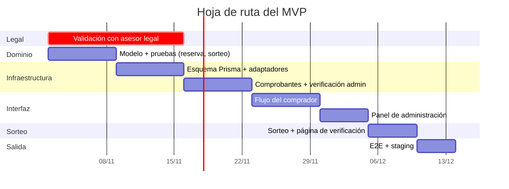

| Fase | Entregable | Criterio de terminado |
|---|---|---|
| 1. Dominio | Entidades `Rifa`, `Boleto`, `Sorteo` y el algoritmo del ganador | Pruebas unitarias en verde, sin dependencias externas |
| 2. Persistencia | Migraciones Prisma, repositorios | Prueba de concurrencia: 50 reservas simultáneas del mismo número → solo 1 gana |
| 3. Pagos | Comprobante, aprobación y rechazo | Aprobar dos veces no cambia el estado; rechazar libera los números de inmediato |
| 4. Interfaz | Comprador + administración | Compra completa con comprobante de prueba y aprobación administrativa |
| 5. Sorteo | Sorteo + verificación pública | Recalcular con datos publicados da el mismo ganador |

---

## 13. Criterios de aceptación (escenarios)

```gherkin
Escenario: Dos compradores reservan el mismo número a la vez
  Dado que el número 42 de la rifa R está disponible
  Cuando A y B intentan reservarlo en el mismo instante
  Entonces exactamente una reserva tiene éxito
  Y la otra recibe 409 Conflicto

Escenario: La reserva expira sin comprobante
  Dado que A reservó el número 42 a las 10:00
  Cuando son las 10:16 y A no subió un comprobante
  Entonces el número 42 vuelve a estar disponible
  Y la orden pasa a expirada

Escenario: Comprobante subido dentro del plazo
  Dado que A reservó el número 42 a las 10:00
  Cuando A sube su comprobante a las 10:10
  Entonces la orden pasa a pendiente_verificacion
  Y el operador tiene 12 horas o hasta cierre_ventas, lo que ocurra primero, para revisarlo
  Y el número 42 sigue sin estar vendido

Escenario: Plazo de revisión vencido sin resolver
  Dado que la orden de A está en pendiente_verificacion
  Cuando vence el plazo de revisión sin que el operador resuelva
  Entonces la orden sigue en pendiente_verificacion
  Y el número 42 sigue retenido
  Y no se abre ningún reembolso
  Y el operador recibe una sola alerta por esa orden
  Y el operador todavía puede aprobar o rechazar antes de cierre_ventas

Escenario: Comprobante subido después de expirar
  Dado que la orden de A expiró
  Cuando A intenta subir su comprobante
  Entonces la operación se rechaza
  Y ningún boleto cambia de estado

Escenario: Comprobante subido después del plazo previo al cierre
  Dado que el cierre de ventas de la rifa es a las 18:00
  Y que el plazo de comprobantes es de 2 horas
  Cuando A intenta subir su comprobante a las 16:00
  Entonces la operación se rechaza

Escenario: Última reserva antes del corte
  Dado que el cierre de ventas de la rifa es a las 18:00
  Y que el plazo de comprobantes es de 2 horas
  Y que una reserva dura 15 minutos
  Cuando A reserva el número 42 a las 15:44
  Entonces la reserva se acepta
  Y vence antes de las 16:00, el plazo de comprobantes

Escenario: Reserva desde el corte previo al cierre
  Dado que el cierre de ventas de la rifa es a las 18:00
  Y que el plazo de comprobantes es de 2 horas
  Y que una reserva dura 15 minutos
  Cuando A intenta reservar el número 42 a las 15:45
  Entonces la reserva se rechaza
  Y el número 42 sigue disponible
  Y no se crea ninguna orden

Escenario: Reserva después del cierre de ventas
  Dado que el cierre de ventas de la rifa fue a las 18:00
  Y que el cierre aún no corrió
  Cuando A intenta reservar el número 42 a las 18:01
  Entonces la reserva se rechaza
  Y el número 42 sigue disponible

Escenario: Rifa sin cierre de ventas
  Dado que una rifa activa no tiene cierre_ventas
  Cuando A intenta reservar el número 42
  Entonces la reserva se rechaza
  Y el número 42 sigue disponible

Escenario: Pago tardío
  Dado que la orden de A expiró
  Cuando A declara que pagó
  Entonces la orden pasa a pago_tardio_en_revision
  Y no se abre ningún reembolso
  Y ningún boleto cambia de estado

Escenario: Un reclamo alerta a los administradores en el panel
  Dado que la orden de A está expirada
  Cuando A declara un pago tardío
  Entonces el panel muestra una alerta sin leer con la rifa, la orden y el monto declarado
  Y la alerta no incluye datos de A
  Y no se envía ningún correo a los administradores

Escenario: La alerta se apaga al decidir el reclamo
  Dado que un reclamo tiene su alerta sin leer
  Cuando un administrador lo confirma o lo descarta
  Entonces la alerta deja de figurar como sin leer

Escenario: Una decisión revertida conserva la alerta
  Dado que un reclamo tiene su alerta sin leer
  Cuando la confirmación falla porque la operación ya estaba registrada
  Entonces la alerta sigue sin leer

Escenario: El administrador confirma un pago tardío
  Dado que la orden de A está en pago_tardio_en_revision con S/ 500 declarados
  Cuando un administrador confirma haber recibido S/ 10
  Entonces la orden pasa a reembolso_pendiente
  Y se abre un reembolso por S/ 10
  Y el registro de auditoría guarda ambos montos y el operador

Escenario: El administrador descarta un pago tardío
  Dado que la orden de A está en pago_tardio_en_revision
  Cuando un administrador la descarta con un motivo
  Entonces la orden pasa a pago_tardio_descartado
  Y no se abre ningún reembolso
  Y A ve el motivo
  Y A no puede reclamar de nuevo esa orden

Escenario: Un reclamo se decide una sola vez
  Dado que un pago tardío ya fue confirmado o descartado
  Cuando se intenta confirmarlo o descartarlo otra vez
  Entonces la operación se rechaza

Escenario: Un reclamo sobrevive al cierre y a la cancelación
  Dado que la orden O está en pago_tardio_en_revision
  Cuando la rifa cierra ventas o se cancela
  Entonces O sigue en pago_tardio_en_revision
  Y la lista congelada de vendidos no cambia

Escenario: El administrador aprueba el pago
  Dado que la orden O está en pendiente_verificacion con un total de S/ 100
  Cuando un administrador la aprueba indicando que recibió S/ 100
  Entonces sus boletos pasan a vendido y la orden a pagada en una sola transacción
  Y el registro de auditoría guarda el identificador del operador y el número de operación
  Y el comprador recibe el correo con sus boletos

Escenario: Aprobación con un monto recibido distinto del total
  Dado que la orden O tiene un total de S/ 100
  Cuando un administrador la aprueba indicando que recibió S/ 99,99 o S/ 100,01
  Entonces la operación se rechaza
  Y la orden sigue en pendiente_verificacion con sus números retenidos
  Y no se registra ningún pago

Escenario: Aprobación cuando el comprador declaró otro monto
  Dado que la orden O tiene un total de S/ 100 y declara S/ 60 o ningún monto
  Cuando un administrador la aprueba indicando que recibió S/ 100
  Entonces la orden pasa a pagada
  Y la auditoría guarda el monto recibido y el declarado

Escenario: Número de operación repetido en otro método de pago
  Dado que la operación OP-77 ya respalda un pago por Yape
  Cuando un administrador registra "op 77" por Plin, al aprobar, rechazar con dinero o confirmar un pago tardío
  Entonces la operación se rechaza
  Y la orden conserva su estado y sus números

Escenario: Número de operación con caracteres pegados
  Dado que la operación OP77 ya respalda un pago
  Cuando un administrador registra el mismo número con un carácter invisible, un guion largo o dígitos de ancho completo
  Entonces se reconoce como la misma operación y se rechaza

Escenario: Número de operación con caracteres no permitidos
  Cuando un administrador registra un número con letras cirílicas, signos de puntuación o solo separadores
  Entonces la operación se rechaza y nada cambia

Escenario: Colisión real entre dos bancos
  Dado que la operación OP77 ya respalda un pago por Yape
  Cuando un administrador declara con un motivo que OP77 es otra operación de BCP
  Entonces el pago se registra como OP77#BCP
  Y el evento de auditoría guarda el operador, el motivo, el banco y el pago existente
  Y el uso aparece en la lista de colisiones

Escenario: Colisión declarada sin fundamento
  Cuando un administrador declara una colisión sin motivo, para un número que no existe, para el banco que ya lo tiene o para un banco distinto del de la orden
  Entonces la operación se rechaza y nada cambia

Escenario: Segunda colisión con el mismo número y banco
  Dado que OP77#BCP ya está registrado
  Cuando un administrador declara otra vez OP77 para BCP
  Entonces la operación se rechaza

Escenario: El administrador rechaza el pago sin dinero recibido
  Dado que la orden O está en pendiente_verificacion
  Cuando un administrador la rechaza con un motivo e indica que no recibió dinero
  Entonces los boletos vuelven a estar disponibles de inmediato
  Y la orden pasa a rechazada
  Y el comprador ve el motivo del rechazo

Escenario: El administrador rechaza el pago con dinero recibido
  Dado que la orden O está en pendiente_verificacion con un monto declarado de S/ 100
  Cuando un administrador la rechaza con un motivo e indica que recibió S/ 30
  Entonces los boletos vuelven a estar disponibles de inmediato
  Y la orden pasa a reembolso_pendiente con un reembolso de S/ 30
  Y la operación queda registrada como pago
  Y el comprador recibe el aviso de reembolso pendiente con el motivo

Escenario: Rechazo con una operación ya registrada
  Dado que la operación OP ya respalda otro pago
  Cuando un administrador rechaza la orden O indicando que recibió dinero con OP
  Entonces la operación se rechaza
  Y la orden sigue en pendiente_verificacion con sus números retenidos

Escenario: Rechazo sin indicar si llegó dinero
  Dado que la orden O está en pendiente_verificacion
  Cuando un administrador la rechaza sin indicar si recibió dinero
  Entonces la operación se rechaza

Escenario: Rechazo con dinero repetido con los mismos datos
  Dado que la orden O fue rechazada con S/ 30 recibidos en la operación OP
  Cuando un administrador repite el rechazo con los mismos datos, aunque escriba OP con otro formato
  Entonces no cambia nada
  Y no se registra ningún evento ni se envía ningún aviso

Escenario: Rechazo con dinero repetido con otros datos
  Dado que la orden O fue rechazada con S/ 30 recibidos en la operación OP
  Cuando un administrador la rechaza de nuevo con otro monto, otra operación u otro banco
  Entonces la operación se rechaza
  Y la orden, el pago y el reembolso no cambian
  Y la auditoría guarda el operador y lo que intentó registrar

Escenario: Rechazo con un monto recibido mayor que el total, sin confirmar (DT-14)
  Dado que la orden O está en pendiente_verificacion con un total de S/ 100
  Cuando un administrador la rechaza indicando que recibió S/ 100.01, sin confirmar el exceso
  Entonces la operación se rechaza
  Y la orden sigue en pendiente_verificacion con sus números retenidos
  Y no se registra ningún pago, reembolso ni evento

Escenario: Rechazo con un monto recibido mayor que el total, confirmado (DT-14)
  Dado que la orden O está en pendiente_verificacion con un total de S/ 100
  Cuando un administrador la rechaza indicando que recibió S/ 120 y confirma el exceso con un motivo
  Entonces la orden pasa a reembolso_pendiente con un reembolso de S/ 120
  Y la auditoría guarda el total, el monto recibido, la diferencia de S/ 20, el administrador y el motivo

Escenario: Confirmación de exceso sin un exceso (DT-14)
  Dado que la orden O está en pendiente_verificacion con un total de S/ 100
  Cuando un administrador la rechaza indicando que recibió S/ 100 y confirma un exceso
  Entonces la operación se rechaza
  Y la orden sigue en pendiente_verificacion

Escenario: Pago tardío confirmado por más que el total (DT-14)
  Dado que la orden O está en pago_tardio_en_revision con un total de S/ 50
  Cuando un administrador confirma S/ 50.01 recibidos sin confirmar el exceso
  Entonces la operación se rechaza
  Y la orden sigue en pago_tardio_en_revision sin reembolso

Escenario: Aprobación duplicada
  Dado que la orden O ya fue aprobada
  Cuando se intenta aprobarla o rechazarla de nuevo
  Entonces el estado de los boletos y de la orden no cambia
  Y no se registra un evento adicional
  Y no se envía un segundo correo

Escenario: El correo de la aprobación falla (DT-13)
  Dado que un administrador aprobó la orden O
  Y que el servicio de correo no responde
  Cuando el trabajo de correos intenta enviar la confirmación
  Entonces la orden sigue pagada
  Y el correo queda en la bandeja para otro intento, con una espera mayor

Escenario: El correo agota sus intentos (DT-13)
  Dado que la confirmación de la orden O falló en todos sus intentos
  Cuando falla el último intento
  Entonces el correo queda como fallido
  Y los administradores ven una alerta de correo fallido en el panel
  Y la auditoría registra la falla

Escenario: Un administrador vuelve a encolar un correo fallido (DT-13)
  Dado que la confirmación de la orden O quedó como fallida tras una caída del correo
  Cuando un administrador la vuelve a encolar
  Entonces el correo vuelve a la bandeja con todos sus intentos
  Y la alerta de correo fallido queda leída
  Y la auditoría registra qué administrador lo encoló

Escenario: Una decisión revertida no deja correo (DT-13)
  Dado que la orden O está en pendiente_verificacion
  Cuando la aprobación falla antes de confirmarse
  Entonces la orden sigue en pendiente_verificacion
  Y no queda ningún correo en la bandeja

Escenario: Solo un administrador puede aprobar
  Cuando un usuario sin rol de administrador intenta aprobar una orden
  Entonces la API responde 403
  Y ningún boleto cambia de estado

Escenario: Aprobación durante o después del cierre
  Dado que la rifa R cerró ventas
  Cuando un administrador intenta aprobar una orden en pendiente_verificacion
  Entonces la operación se rechaza
  Y la lista congelada de vendidos no cambia

Escenario: Órdenes sin resolver al cierre
  Dado que la orden O está en pendiente_verificacion y la orden P en pendiente
  Cuando la rifa cierra ventas
  Entonces O pasa a pago_tardio_en_revision y P a expirada
  Y no se abre ningún reembolso
  Y sus números no entran en la lista congelada

Escenario: Comprobante sin verificar al terminar las ventas
  Dado que la orden O está en pendiente_verificacion con un monto declarado de S/ 100
  Cuando la rifa cierra ventas o se cancela
  Entonces O entra en la cola de revisión con una alerta para los administradores
  Y el comprador recibe un aviso de pago en revisión, no de reembolso
  Y si un administrador confirma S/ 30, se abre un reembolso de S/ 30
  Y si un administrador descarta con un motivo, no se abre ningún reembolso

Escenario: Cancelación con un pago verificado
  Dado que la orden O está pagada
  Cuando la rifa se cancela
  Entonces O pasa a reembolso_pendiente por el total de la orden, sin pasar por revisión

Escenario: Reembolso manual
  Dado que la orden O está en reembolso_pendiente
  Cuando un administrador registra operador, destino y número de operación
  Entonces la orden pasa a reembolsada
  Y el registro de auditoría guarda esos datos

Escenario: Reembolso completado por quien registró el dinero (DT-17)
  Dado que el administrador A aprobó el pago de la orden O
  Y la rifa se canceló, así que O está en reembolso_pendiente
  Cuando A intenta completar el reembolso de O
  Entonces el sistema lo rechaza
  Y O sigue en reembolso_pendiente
  Y el registro de auditoría guarda el intento de A

Escenario: Reembolso completado por otro administrador (DT-17)
  Dado que el administrador A registró el dinero que devuelve el reembolso R
  Cuando el administrador B completa R
  Entonces R queda completado
  Y el registro de auditoría guarda a B como quien lo completó y a A como quien registró el dinero

Escenario: Reembolso sin quien registró el dinero (DT-17)
  Dado que el pago detrás del reembolso R no tiene su administrador
  Cuando un administrador intenta completar R
  Entonces el sistema lo rechaza y deja el intento en la auditoría

Escenario: Verificación del sorteo
  Dado que la rifa R fue sorteada
  Cuando un auditor toma semilla, valor_drand y la lista de vendidos publicados
  Entonces SHA-256(semilla) es igual a hash_compromiso
  Y el ganador recalculado es igual al ganador publicado

Escenario: Lista de vendidos alterada después del cierre
  Dado que la rifa R cerró ventas y publicó hash_lista
  Y la lista de vendidos ya no produce ese hash
  Cuando el sistema intenta ejecutar el sorteo
  Entonces no se calcula ningún ganador
  Y la rifa sigue en cerrada
  Y el registro de auditoría guarda el intento con ambos hashes
  Y los administradores reciben una alerta de la rifa en el panel

Escenario: Cancelación de una rifa con la lista alterada (DT-15)
  Dado que la rifa R está cerrada y su lista de vendidos ya no produce hash_lista
  Y la orden O está pagada por S/ 50
  Cuando un administrador cancela R con un motivo
  Entonces R pasa a cancelada con ese motivo
  Y O pasa a reembolso_pendiente por S/ 50
  Y el registro de auditoría guarda ambos hashes, el administrador y el motivo
  Y la alerta del sorteo bloqueado queda leída

Escenario: Cancelación de una rifa cerrada con la lista intacta (DT-15)
  Dado que la rifa R está cerrada y su lista de vendidos produce hash_lista
  Cuando un administrador intenta cancelarla por lista alterada
  Entonces el sistema la rechaza
  Y R sigue en cerrada, lista para el sorteo
  Y no se abre ningún reembolso

Escenario: Cancelación por lista alterada sin motivo (DT-15)
  Dado que la rifa R está cerrada con la lista alterada
  Cuando un administrador la cancela con un motivo vacío
  Entonces el sistema la rechaza y no cambia nada

Escenario: Un boleto vendido sin dinero verificado no se reembolsa (DT-15)
  Dado que la rifa R está cerrada con la lista alterada
  Y un boleto aparece vendido sin una orden pagada detrás
  Cuando un administrador cancela R con un motivo
  Entonces ese boleto no abre ningún reembolso
  Y solo las órdenes pagadas reciben el suyo

Escenario: Transferencia extra sobre una orden pagada (DT-16)
  Dado que la orden O está pagada por S/ 50
  Y el comprador transfirió otros S/ 50 en la operación OP-2
  Cuando un administrador registra esa transferencia con un motivo
  Entonces se abre un reembolso de S/ 50 ligado a OP-2
  Y O sigue pagada y sus boletos siguen vendidos
  Y el registro de auditoría guarda el pago, el reembolso, el administrador y el motivo

Escenario: Transferencia extra sobre una orden en verificación (DT-16)
  Dado que la orden O está en pendiente_verificacion
  Cuando un administrador intenta registrar una transferencia extra
  Entonces el sistema la rechaza
  Y el administrador resuelve ese dinero al aprobar o rechazar la orden

Escenario: Transferencia extra con un número ya registrado (DT-16)
  Dado que la operación OP-2 ya está registrada en cualquier orden
  Cuando un administrador registra otra transferencia extra con OP-2
  Entonces el sistema la rechaza y no abre ningún reembolso

Escenario: Reembolso completo de una transferencia extra (DT-16)
  Dado que la orden O está en reembolso_pendiente
  Y tiene además el reembolso de una transferencia extra
  Cuando un administrador completa el reembolso de la transferencia extra
  Entonces ese reembolso queda completado
  Y O sigue en reembolso_pendiente con su propio reembolso pendiente

Escenario: Verificación con una lista alterada
  Dado que la rifa R fue sorteada
  Y la lista de vendidos ya no produce hash_lista
  Cuando se consultan los datos de verificación
  Entonces la respuesta indica que la lista no pasó la verificación

Escenario: Sorteo en vivo calculado en el navegador
  Dado que la rifa R cerró ventas y publicó sus datos congelados
  Cuando drand publica la ronda N
  Entonces el navegador del espectador obtiene el valor directamente de drand
  Y verifica la firma de la ronda
  Y calcula el mismo ganador que el resultado oficial

Escenario: El resultado oficial no coincide con el cálculo local
  Dado que el servidor publica un ganador distinto al calculado en el navegador
  Entonces la página muestra una alerta visible de discrepancia

Escenario: Un ganador sin orden detiene el sorteo y alerta a los administradores
  Dado que la rifa R cerró ventas
  Y el boleto ganador de R no tiene una orden
  Cuando el sistema intenta ejecutar el sorteo
  Entonces no se guarda ningún sorteo
  Y la rifa sigue en cerrada
  Y el registro de auditoría guarda el intento con el motivo
  Y los administradores ven una sola alerta de sorteo bloqueado para R

Escenario: Un boleto vendido no puede quedar sin orden
  Dado que un boleto de la rifa R está reservado sin orden
  Cuando se intenta marcarlo como vendido
  Entonces la base de datos rechaza la operación

Escenario: No se puede alterar el compromiso
  Dado que la rifa R está activa
  Cuando se intenta modificar hash_compromiso o ronda_drand
  Entonces la base de datos rechaza la operación
```

---

## 14. Riesgos

| Riesgo | Impacto | Mitigación |
|---|---|---|
| Operar sin autorización legal | Crítico | Bloquear la publicación de rifas sin `resolucion_autorizacion` |
| Doble venta de un número | Alto | Restricción única + `UPDATE` condicional en una transacción |
| Fraude o percepción de sorteo amañado | Alto | Commit-reveal + drand + página de verificación pública |
| Comprobante falso o adulterado | Alto | Verificar el depósito en la banca móvil antes de aprobar; auditoría con el identificador del operador |
| Demora o error en la verificación manual | Medio | Cola de comprobantes pendientes para el administrador; ampliación de la reserva mientras se verifica |
| Exposición de comprobantes con datos personales | Alto | Almacenamiento y acceso según la decisión D7 de la guía; Ley N.° 29733 |
| Caída de drand en la ronda fijada | Bajo | drand es distribuido y guarda todas sus rondas: si drand o sus relays no responden, el sorteo espera la misma ronda y nunca usa otra (DT-18). Si drand desapareciera para siempre no hay salida automática: queda como decisión abierta |
| Reembolso sin ejecutar o sin seguimiento tras cancelar una rifa | Alto | Definir el procedimiento en la decisión D8 de la guía antes de cobrar dinero real |
