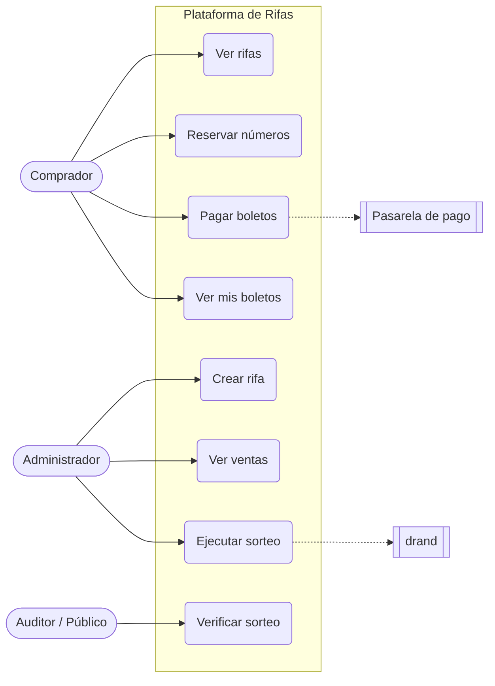
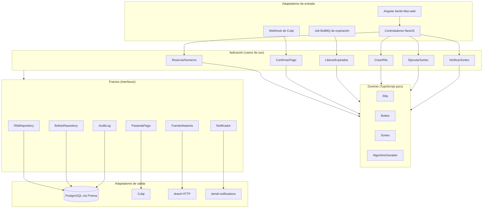
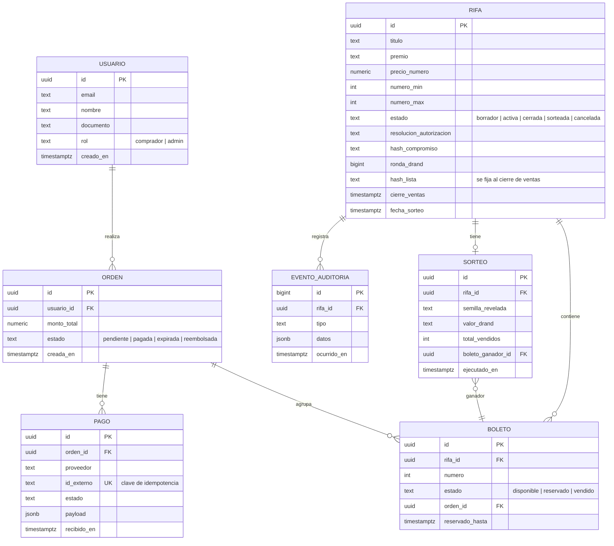
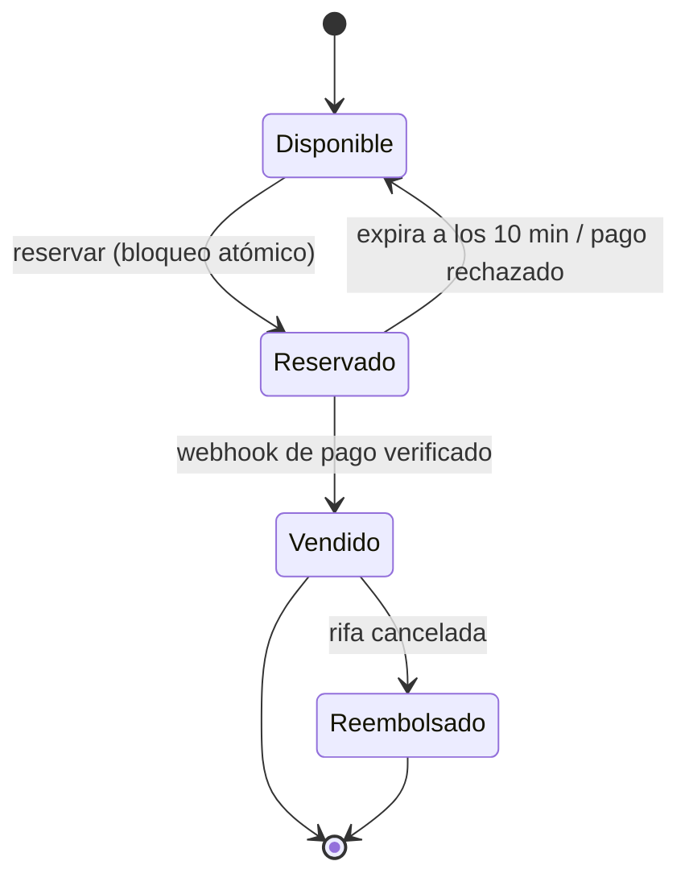
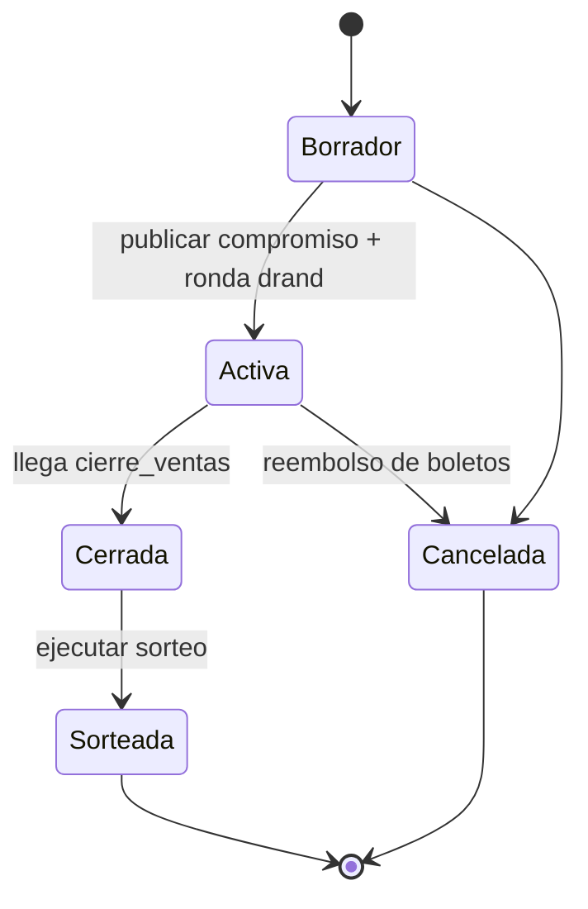
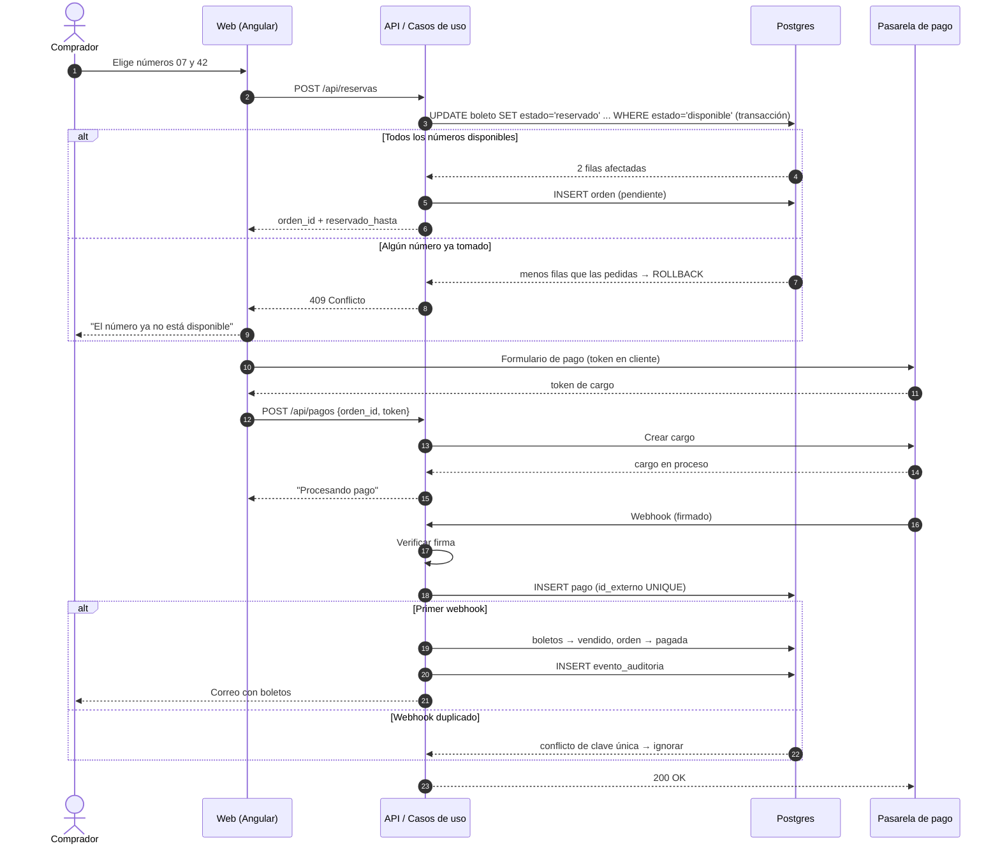
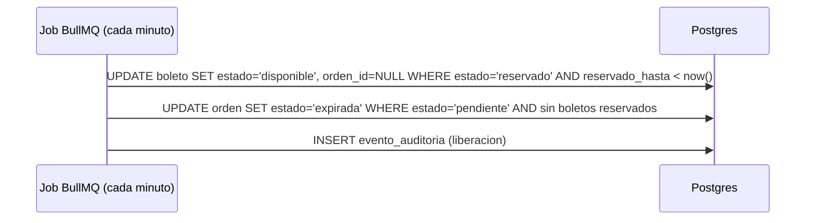
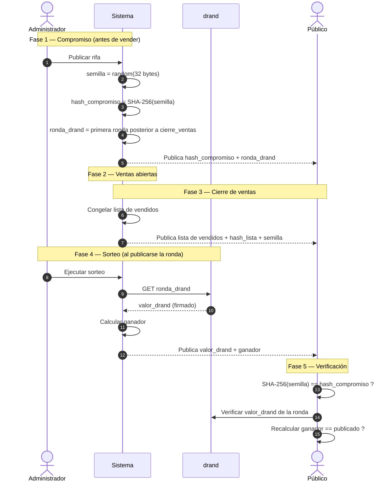
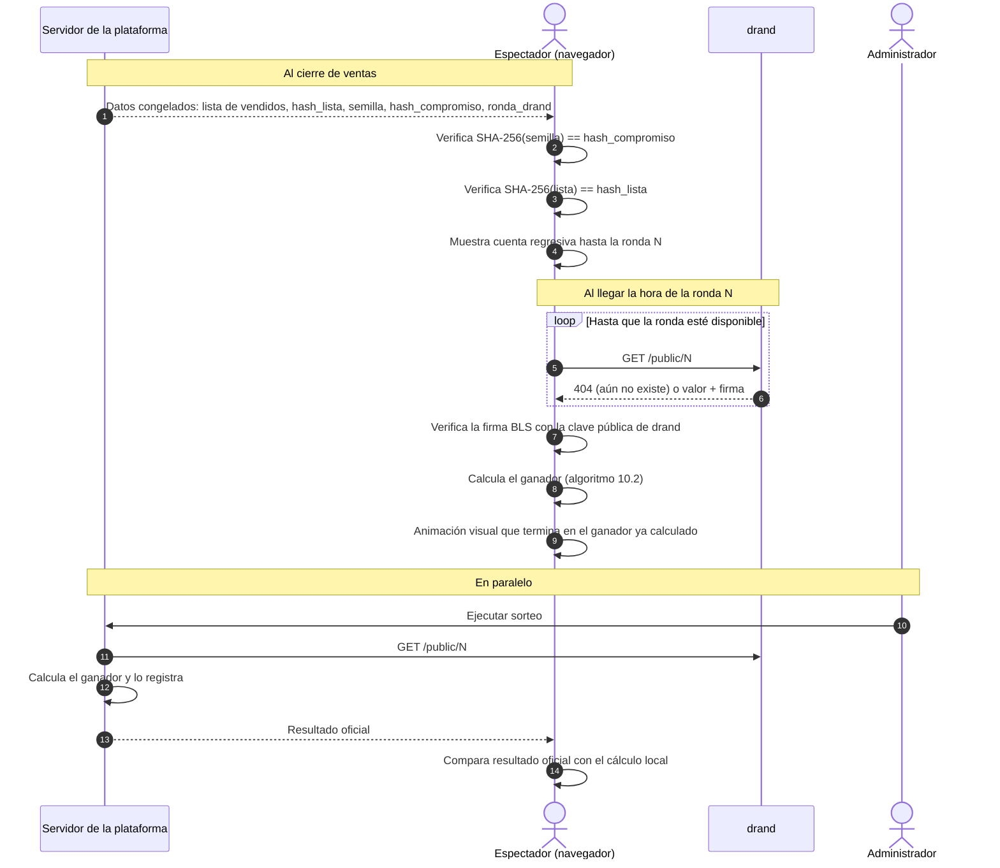
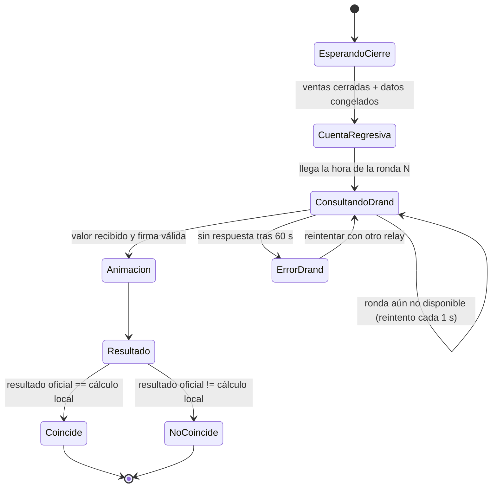

# Plataforma de Rifas Online — Especificaciones

> Versión 0.3 · 2026-10-29 · Estado: borrador para MVP · Cambios: stack alineado al monorepo (NestJS + Prisma + Angular); sorteo en vivo (10.3); semilla revelada al cierre
>
> Guía de implementación: [GUIA-IMPLEMENTACION-RIFAS.md](GUIA-IMPLEMENTACION-RIFAS.md)

---

## 1. Contexto y objetivo

Plataforma web para organizar **rifas recurrentes** como negocio en Perú, con venta de boletos online, pago automatizado y un **sorteo verificable públicamente**.

**Objetivos del MVP**

- Vender boletos numerados sin que dos compradores obtengan el mismo número.
- Confirmar los pagos de forma automática, sin intervención manual.
- Hacer un sorteo que cualquier persona pueda recalcular y auditar.
- Cumplir los requisitos legales y tributarios peruanos.

**Fuera del alcance del MVP**

- Varios organizadores (modelo SaaS).
- App móvil nativa.
- Programa de referidos o cupones.

---

## 2. Requisitos legales (bloqueantes)

Estos puntos se validan **antes de cobrar dinero real**.

| # | Requisito | Responsable | Estado |
|---|---|---|---|
| L1 | Autorización del Ministerio del Interior para cada rifa o sorteo (permiso, garantías, acta del sorteo, constancia de entrega del premio) | Negocio / asesoría legal | Pendiente de confirmar |
| L2 | Términos y condiciones de cada rifa | Legal | Pendiente |
| L3 | Política de privacidad conforme a la Ley N.° 29733 (Protección de Datos Personales) | Legal | Pendiente |
| L4 | Emisión de comprobantes electrónicos (boleta/factura SUNAT) | Contabilidad | Pendiente |
| L5 | Libro de reclamaciones virtual (INDECOPI) | Negocio | Pendiente |

> ⚠️ Antes de lanzar, un asesor legal tiene que confirmar los requisitos exactos del punto L1.

---

## 3. Actores

| Actor | Descripción |
|---|---|
| **Comprador** | Persona que elige números y paga boletos. |
| **Administrador** | Crea rifas, supervisa las ventas y ejecuta el sorteo. |
| **Pasarela de pago** | Sistema externo (Culqi / Izipay / Mercado Pago) que confirma los pagos por webhook. |
| **Fuente de aleatoriedad pública** | drand (League of Entropy): aporta un número aleatorio que nadie controla. |
| **Auditor / público** | Cualquier persona que verifica el resultado del sorteo. |



---

## 4. Requisitos funcionales

### 4.1 Comprador

| ID | Requisito | Prioridad |
|---|---|---|
| RF-01 | Ver el listado de rifas activas con premio, precio, fecha de cierre y números disponibles. | Alta |
| RF-02 | Ver la grilla de números de una rifa con su estado (disponible / reservado / vendido). | Alta |
| RF-03 | Reservar uno o más números por un tiempo limitado (**10 minutos**). | Alta |
| RF-04 | Pagar los números reservados con tarjeta o Yape a través de la pasarela. | Alta |
| RF-05 | Recibir el boleto por correo electrónico al confirmarse el pago. | Alta |
| RF-06 | Consultar el historial de boletos propios. | Media |
| RF-07 | Registrarse e iniciar sesión (correo + enlace mágico o contraseña). | Alta |

### 4.2 Administrador

| ID | Requisito | Prioridad |
|---|---|---|
| RF-10 | Crear una rifa: título, descripción, premio, imagen, precio por número, rango de números, fecha de cierre de ventas, fecha del sorteo y número de resolución de autorización. | Alta |
| RF-11 | Publicar el **compromiso** (hash de la semilla) y la ronda de drand **antes** de abrir las ventas. | Alta |
| RF-12 | Ver el reporte de ventas: vendidos, reservados, recaudación. | Alta |
| RF-13 | Ejecutar el sorteo cuando la ronda de drand ya fue publicada. | Alta |
| RF-14 | Registrar la entrega del premio (evidencia). | Media |
| RF-15 | Cancelar una rifa y marcar los boletos para reembolso. | Media |

### 4.3 Público

| ID | Requisito | Prioridad |
|---|---|---|
| RF-20 | Ver la página de verificación del sorteo: semilla revelada, hash de compromiso, ronda y valor de drand, lista de boletos vendidos y algoritmo. | Alta |
| RF-21 | Recalcular el ganador desde el navegador con un script público. | Media |
| RF-22 | Ver el sorteo en vivo: cuenta regresiva, consulta directa a drand desde el navegador, cálculo local del ganador y comparación con el resultado oficial (sección 10.3). | Alta |

---

## 5. Requisitos no funcionales

| ID | Requisito |
|---|---|
| RNF-01 | **Concurrencia**: un número no puede quedar vendido a dos compradores, ni siquiera con peticiones simultáneas. Lo garantiza la base de datos, no la aplicación. |
| RNF-02 | **Idempotencia**: si la pasarela repite un webhook, el resultado no cambia. |
| RNF-03 | **Integridad**: el estado `vendido` solo se asigna mediante un webhook verificado con firma. |
| RNF-04 | **Auditoría**: registro de eventos de solo inserción (reservas, pagos, sorteo). |
| RNF-05 | **Seguridad**: autorización por rol en la API (guards de NestJS); claves de la pasarela solo en el servidor; HTTPS. |
| RNF-06 | **Rendimiento**: la grilla de números carga en < 1 s con 10 000 números. |
| RNF-07 | **Disponibilidad**: 99,5 % mensual. |
| RNF-08 | **Accesibilidad**: WCAG 2.1 AA en el flujo de compra. |
| RNF-09 | **Pruebas**: TDD en el dominio; cobertura ≥ 90 % en reglas de negocio. |

---

## 6. Arquitectura

### 6.1 Stack

Alineado con el monorepo existente (`FUENTES/`), para reutilizar sus patrones y servicios.

| Capa | Tecnología | Referencia en el monorepo |
|---|---|---|
| API | NestJS 11 + TypeScript (`FUENTES/tiendi-rifas-api`) | `FUENTES/tiendi-api` |
| Base de datos | PostgreSQL + Prisma 5 (base de datos propia) | `FUENTES/tiendi-api/prisma/schema.prisma` |
| Jobs programados | BullMQ + Redis (jobs repetibles) | `FUENTES/tiendi-api/src/jobs/` |
| Frontend (comprador, sorteo en vivo, verificación, admin) | Angular 21 (`FUENTES/tiendi-rifas-web`) | `FUENTES/tiendi-web` |
| Algoritmo del sorteo (compartido API + web) | Paquete TypeScript `FUENTES/packages/raffle-draw` | `FUENTES/packages/` |
| Pagos | Culqi (tarjeta; Yape vía Culqi si la cuenta lo habilita) | `FUENTES/tiendi-api/src/modules/payments/` |
| Notificaciones (correo con boletos) | `tiendi-notifications` (M2M) | `DOCS/NOTIFICACIONES/` |
| Aleatoriedad pública | drand (API HTTP pública) | — |
| Observabilidad | `FUENTES/packages/telemetry` (OpenTelemetry) | `DOCS/OBSERVABILIDAD/` |
| Despliegue | Mismo esquema de ambientes que tiendi-api | `DOCS/INFRAESTRUCTURA/DEFINICION_AMBIENTES_TEST_Y_PRD.md` |
| Pruebas | Jest (API), Vitest (web), Playwright (E2E) | Configuración de cada repo |

### 6.2 Arquitectura hexagonal

El **dominio** no conoce ni a Prisma ni a la pasarela. Si se cambia Culqi por otra pasarela, solo se reemplaza un adaptador.



### 6.3 Estructura de carpetas

```
FUENTES/
├── packages/
│   └── raffle-draw/               # Algoritmo del ganador + verificación. Sin dependencias de framework.
├── tiendi-rifas-api/              # NestJS
│   ├── prisma/
│   │   ├── schema.prisma
│   │   └── migrations/
│   ├── src/
│   │   ├── modules/raffles/
│   │   │   ├── domain/            # Entidades, value objects, reglas. TypeScript puro.
│   │   │   ├── application/       # Casos de uso + puertos (interfaces)
│   │   │   ├── infrastructure/    # Adaptadores: prisma, culqi, drand, notifications
│   │   │   └── http/              # Controladores, DTOs, guards
│   │   └── jobs/                  # Jobs BullMQ (expiración de reservas, cierre de ventas)
│   └── test/                      # Integración y e2e (Jest)
└── tiendi-rifas-web/              # Angular 21
    ├── src/app/
    │   ├── features/catalogo/     # Rifas activas
    │   ├── features/compra/       # Elegir números + pago
    │   ├── features/en-vivo/      # Sorteo en vivo
    │   ├── features/verificacion/
    │   └── features/admin/
    └── e2e/                       # Playwright
```

---

## 7. Modelo de datos



**Restricciones clave**

- `UNIQUE (rifa_id, numero)` en `BOLETO`: un número existe una sola vez por rifa.
- `UNIQUE (proveedor, id_externo)` en `PAGO`: garantiza la idempotencia de los webhooks.
- `EVENTO_AUDITORIA`: sin permisos de `UPDATE` ni `DELETE` (solo inserción).
- `hash_compromiso` y `ronda_drand` quedan **inmutables** una vez que la rifa pasa a `activa` (trigger).

---

## 8. Ciclos de vida

### 8.1 Estados de un boleto



### 8.2 Estados de una rifa



---

## 9. Flujos principales

### 9.1 Reserva y compra



**Regla crítica:** la pantalla de "gracias" del cliente **no** confirma nada. Solo el webhook firmado cambia el estado a `vendido`.

### 9.2 Liberación de reservas expiradas



> Caso borde: si el webhook llega **después** de que expiró la reserva y el número ya lo tomó otra persona, la orden pasa a reembolso automático. Nunca se pisa una venta.

---

## 10. Sorteo verificable (commit-reveal + drand)

### 10.1 Idea

1. **Antes de vender**, el sistema genera una semilla secreta y publica solo su **hash** (compromiso). También fija una **ronda futura de drand**, posterior al cierre de ventas.
2. Nadie conoce el valor de esa ronda de drand hasta que se publica, **ni siquiera el organizador**.
3. **Al cierre de ventas**, se congela la lista de boletos vendidos (se publica con su hash) y se revela la semilla. Cualquiera puede comprobar que el hash de la semilla coincide con el compromiso.
4. **Al publicarse la ronda de drand**, cada participante puede calcular el ganador con la semilla, el valor de drand y la lista congelada.

Así el organizador no puede elegir al ganador (no controla drand) y tampoco puede cambiar la semilla después (el hash ya era público).

> Revelar la semilla al cierre es seguro: una vez congelada la lista, el único dato impredecible que falta es el valor de drand, que todavía no existe. La semilla **nunca** debe revelarse antes de congelar la lista.



### 10.2 Algoritmo del ganador

```
entrada:
  semilla        (hex, 32 bytes)
  valor_drand    (hex)
  vendidos       lista de números vendidos, ORDENADA ascendente

h        = SHA-256( semilla || valor_drand || id_rifa )
n        = entero sin signo de 256 bits a partir de h
indice   = n mod longitud(vendidos)
ganador  = vendidos[indice]
```

- El sesgo del módulo es despreciable (2²⁵⁶ frente a miles de boletos).
- La lista de vendidos se congela al cierre y se publica en ese momento, junto con su hash.
- El script de verificación es público (RF-21) y usa el mismo código del dominio.

### 10.3 Sorteo en vivo

El sorteo se transmite en una página pública, `/rifas/:id/en-vivo`. Lo importante es que **cada navegador calcula el ganador por su cuenta**: pide el valor directamente a drand, sin pasar por el servidor de la plataforma, y ejecuta el mismo algoritmo de la sección 10.2. Si miran mil personas, son mil cálculos independientes que tienen que coincidir.

#### Línea de tiempo

```
 Cierre de ventas          Ronda drand #N             Resultado
 20:00                     20:30:00                   20:30:03
    │                          │                          │
    ├─ Se congela la lista     ├─ drand publica el valor  ├─ Ganador en pantalla
    │  de vendidos y se        │  y cada navegador lo     │  + botón "Verificar"
    │  publica su hash         │  pide DIRECTO a drand    │
    ├─ Se revela la semilla    │                          │
    └─ Se abre la página       └─ Cada navegador calcula  │
       "Sorteo en vivo"           el ganador localmente   │
       con cuenta regresiva
```

#### Flujo



#### Estados de la página en vivo



#### Reglas

| # | Regla | Motivo |
|---|---|---|
| V-01 | El navegador consulta drand **directamente**, nunca a través del servidor de la plataforma. | Si el valor pasara por el servidor, habría que confiar en él. |
| V-02 | Se usan varios relays públicos de drand (por ejemplo `api.drand.sh`, `api2.drand.sh`, `drand.cloudflare.com`) con reintento. | Que la caída de un relay no impida ver el sorteo. |
| V-03 | La firma BLS de la ronda se verifica en el cliente (por ejemplo, con la librería `drand-client`). | Asegura que el valor viene de la red drand y no lo inyectó un intermediario. |
| V-04 | El algoritmo del ganador vive en un **paquete compartido** que usan el servidor y el navegador. | Evita que los dos cálculos diverjan por diferencias de implementación. |
| V-05 | El reloj del navegador no decide nada. Solo se usa para la cuenta regresiva; la página consulta hasta que la ronda exista. | Un reloj local desfasado no puede alterar el resultado. |
| V-06 | La animación es **solo visual**: empieza después de calcular el ganador y siempre se detiene en él. | Si la animación "decidiera", se perdería la verificabilidad. |
| V-07 | Si el resultado oficial no coincide con el cálculo local, la página lo muestra de forma visible ("El resultado oficial NO coincide con tu cálculo"). | La transparencia también incluye exponer los fallos. |
| V-08 | Al terminar, la página en vivo pasa a ser la página permanente de verificación (RF-20). | El sorteo se puede auditar en cualquier momento posterior. |

#### Transmisión y acta

- La página en vivo se puede retransmitir por YouTube, Facebook o TikTok Live. La transmisión es **complementaria**: la fuente de verdad es el cálculo verificable, no el video.
- Si la autorización exige la presencia de un notario o de un representante de la autoridad, el acta del sorteo registra: el número de ronda y el valor de drand, `hash_compromiso`, la semilla revelada, `hash_lista`, la cantidad de boletos vendidos y el número ganador.
- Con esos datos, cualquiera puede repetir el cálculo años después y obtener el mismo ganador.

---

## 11. API (MVP)

| Método | Ruta | Actor | Descripción |
|---|---|---|---|
| GET | `/api/rifas` | Público | Lista de rifas activas |
| GET | `/api/rifas/:id` | Público | Detalle + grilla de números |
| POST | `/api/reservas` | Comprador | Reserva números `{rifa_id, numeros[]}` → `orden_id` |
| POST | `/api/pagos` | Comprador | Inicia el cargo `{orden_id, token}` |
| POST | `/api/webhooks/pagos` | Pasarela | Confirma el pago (verifica la firma) |
| GET | `/api/mis-boletos` | Comprador | Boletos del usuario |
| POST | `/api/admin/rifas` | Admin | Crea una rifa (borrador) |
| POST | `/api/admin/rifas/:id/publicar` | Admin | Genera el compromiso y activa la rifa |
| GET | `/api/admin/rifas/:id/ventas` | Admin | Reporte de ventas |
| POST | `/api/admin/rifas/:id/sorteo` | Admin | Ejecuta el sorteo |
| GET | `/api/rifas/:id/verificacion` | Público | Datos de verificación del sorteo |
| GET | `/api/rifas/:id/en-vivo` | Público | Datos congelados al cierre (lista, hashes, semilla, ronda) y resultado oficial cuando exista |

---

## 12. Plan de entrega (TDD)


| Fase | Entregable | Criterio de terminado |
|---|---|---|
| 1. Dominio | Entidades `Rifa`, `Boleto`, `Sorteo` y el algoritmo del ganador | Pruebas unitarias en verde, sin dependencias externas |
| 2. Persistencia | Migraciones Prisma, repositorios | Prueba de concurrencia: 50 reservas simultáneas del mismo número → solo 1 gana |
| 3. Pagos | Adaptador de la pasarela + webhook | Webhook duplicado no cambia el estado; firma inválida → 401 |
| 4. Interfaz | Comprador + administración | Compra completa en el sandbox |
| 5. Sorteo | Sorteo + verificación pública | Recalcular con datos publicados da el mismo ganador |

---

## 13. Criterios de aceptación (escenarios)

```gherkin
Escenario: Dos compradores reservan el mismo número a la vez
  Dado que el número 42 de la rifa R está disponible
  Cuando A y B intentan reservarlo en el mismo instante
  Entonces exactamente una reserva tiene éxito
  Y la otra recibe 409 Conflicto

Escenario: La reserva expira sin pago
  Dado que A reservó el número 42 a las 10:00
  Cuando son las 10:11 y no hay pago confirmado
  Entonces el número 42 vuelve a estar disponible

Escenario: Webhook duplicado
  Dado que el pago P ya fue confirmado
  Cuando la pasarela reenvía el webhook de P
  Entonces el estado de los boletos no cambia
  Y no se envía un segundo correo

Escenario: Webhook con firma inválida
  Cuando llega un webhook con firma incorrecta
  Entonces se responde 401
  Y ningún boleto cambia de estado

Escenario: Verificación del sorteo
  Dado que la rifa R fue sorteada
  Cuando un auditor toma semilla, valor_drand y la lista de vendidos publicados
  Entonces SHA-256(semilla) es igual a hash_compromiso
  Y el ganador recalculado es igual al ganador publicado

Escenario: Sorteo en vivo calculado en el navegador
  Dado que la rifa R cerró ventas y publicó sus datos congelados
  Cuando drand publica la ronda N
  Entonces el navegador del espectador obtiene el valor directamente de drand
  Y verifica la firma de la ronda
  Y calcula el mismo ganador que el resultado oficial

Escenario: El resultado oficial no coincide con el cálculo local
  Dado que el servidor publica un ganador distinto al calculado en el navegador
  Entonces la página muestra una alerta visible de discrepancia

Escenario: No se puede alterar el compromiso
  Dado que la rifa R está activa
  Cuando se intenta modificar hash_compromiso o ronda_drand
  Entonces la base de datos rechaza la operación
```

---

## 14. Riesgos

| Riesgo | Impacto | Mitigación |
|---|---|---|
| Operar sin autorización legal | Crítico | Bloquear la publicación de rifas sin `resolucion_autorizacion` |
| Doble venta de un número | Alto | Restricción única + `UPDATE` condicional en una transacción |
| Fraude o percepción de sorteo amañado | Alto | Commit-reveal + drand + página de verificación pública |
| Webhook perdido | Medio | Conciliación periódica consultando la API de la pasarela |
| Caída de drand en la ronda fijada | Bajo | drand es distribuido; regla publicada de antemano: usar la siguiente ronda disponible |
| Contracargos con tarjeta | Medio | Políticas claras en T&C; evidencia en el registro de auditoría |
