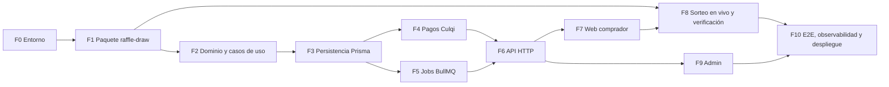

# Guía de implementación — Plataforma de Rifas

> Versión 1.0 · 2026-10-29
> Destinatario: **agente de implementación** (o desarrollador) que construirá el MVP.
> Fuente de verdad funcional: [ESPECIFICACIONES-RIFAS.md](ESPECIFICACIONES-RIFAS.md) (v0.3).
> Prototipos: [PROTOTIPOS/](PROTOTIPOS/) · canvas interactivo: https://claude.ai/artifact/9aLUVmhZusCakyj5sprmga (privado; puede no estar accesible para el agente; la copia local es suficiente).

---

## 0. Instrucciones para el agente

Lee esta sección completa antes de escribir código.

### 0.1 Orden de lectura

1. Esta guía, completa.
2. [ESPECIFICACIONES-RIFAS.md](ESPECIFICACIONES-RIFAS.md), con atención especial a las secciones 7 (modelo de datos), 8 (ciclos de vida), 9 (flujos), 10 (sorteo verificable) y 13 (criterios de aceptación).
3. Los archivos de [PROTOTIPOS/](PROTOTIPOS/) (markup HTML con estilos exactos; ver §8.1).
4. El código de referencia listado en §1.2, **solo para lectura**.

### 0.2 Reglas de trabajo

| # | Regla |
|---|---|
| R-01 | Ejecutar las fases **en orden**. Cada fase tiene criterios de entrada y de terminado; no avanzar si los de terminado no se cumplen. |
| R-02 | **TDD estricto**: primero la prueba que falla, luego el código mínimo, luego refactor. Aplica a dominio, casos de uso, adaptadores y componentes con lógica. |
| R-03 | Al llegar a un **⛔ Punto de decisión**, detenerse y preguntar al usuario. No suponer la respuesta. |
| R-04 | Código, identificadores, comentarios y mensajes de commit **en inglés**. Textos de interfaz **en español neutro con tuteo** ("Elige tus números", nunca "Elegí"): el público es peruano. |
| R-05 | Commits con **Conventional Commits** (`feat(raffles): ...`, `test(raffle-draw): ...`), uno o más por fase. **Sin** líneas de atribución de IA (`Co-Authored-By` u otras). No hacer `push` ni abrir PR sin pedido explícito del usuario. |
| R-06 | Los repos existentes (`tiendi-api`, `tiendi-web`, `tiendi-notifications`, etc.) se usan **como referencia**: copiar patrones, no modificarlos. Si hace falta cambiar uno, es un ⛔ Punto de decisión. |
| R-07 | La documentación nueva o actualizada va en `G:\PROYECTOS\ecommcerce-saas-sonet\DOCS\RIFAS\` (ver `AGENTS.md` en la raíz). |
| R-08 | Nunca escribir secretos en el repo. Variables sensibles solo en `.env` (ignorado por git) y en el gestor de secretos (§6.3). |
| R-09 | Si la especificación y esta guía se contradicen, **gana la especificación** en lo funcional y **esta guía** en lo técnico (stack, estructura, patrones). Reportar la contradicción al usuario. |
| R-10 | Al cerrar cada fase, actualizar la tabla de progreso (§11) con fecha, estado y evidencia (comando de prueba y resultado). |

### 0.3 Invariantes que nunca se rompen

Cualquier cambio que viole uno de estos puntos es un error bloqueante:

1. **Un número no se vende dos veces.** Lo garantiza la base de datos (restricción única + `UPDATE` condicional), no la aplicación.
2. **Solo un webhook verificado vende un boleto.** La redirección del navegador después del pago no cambia ningún estado.
3. **Los webhooks son idempotentes.** El mismo evento procesado dos veces produce el mismo resultado.
4. **El compromiso (`commitmentHash`) y la ronda de drand (`drandRound`) son inmutables** una vez que la rifa está activa.
5. **La semilla se revela solo después de congelar la lista de vendidos.**
6. **El algoritmo del ganador existe una sola vez**, en `packages/raffle-draw`, y lo usan tanto la API como el navegador.
7. **El navegador consulta drand directamente**, nunca a través de la API de rifas.
8. **La animación del sorteo es solo visual**: empieza después de calcular el ganador y termina en él.
9. **El registro de auditoría es de solo inserción.**

---

## 1. Contexto

### 1.1 Qué se construye

Plataforma para operar rifas recurrentes en Perú: venta de números con reserva temporal, pago con Culqi, sorteo con commit-reveal + drand transmitido en vivo, y página pública de verificación. El alcance del MVP está en la especificación, §1.

### 1.2 Código de referencia en el monorepo

| Necesidad | Dónde mirar | Qué reutilizar |
|---|---|---|
| Estructura de app NestJS, config, lint, Jest | `FUENTES/tiendi-api/` (`package.json`, `tsconfig*.json`, `eslint.config.*`, `jest` config) | Copiar configuración base |
| Validación de variables de entorno | `FUENTES/tiendi-api/src/config/env.validation.ts` | Patrón con `zod` |
| Cobro con Culqi | `FUENTES/tiendi-api/src/modules/payments/culqi.service.ts` (`createCharge`) | Cliente HTTP de Culqi |
| Webhook de Culqi con firma HMAC | `FUENTES/tiendi-api/src/modules/payments/payments.controller.ts` (`@Post('webhook')`) y `payments.service.ts` (`handleWebhook`, verificación con `createHmac` + `timingSafeEqual`) | Verificación de firma y uso de `rawBody` |
| Idempotencia de webhooks | Modelo `WebhookEvent` en `FUENTES/tiendi-api/prisma/schema.prisma` (`@@unique([provider, eventId])`) | Mismo modelo |
| Conciliación con Culqi | `FUENTES/tiendi-api/src/modules/ledger/culqi-reconciliation.service.ts`, `reconciliation.processor.ts` | Job que recupera webhooks perdidos |
| Reembolsos | `FUENTES/tiendi-api/src/modules/refunds/refund.service.ts` | Flujo de reembolso con Culqi |
| Jobs BullMQ | `FUENTES/tiendi-api/src/jobs/` | Registro de colas y jobs repetibles |
| Guards de autenticación y roles | `JwtAuthGuard`, `RolesGuard`, `ClientIpThrottlerGuard` en `FUENTES/tiendi-api/src/` | Patrón de guards |
| Llamada M2M a notificaciones | `FUENTES/tiendi-notifications/src/controllers/notifications-api.controller.ts` (`POST notifications/api/requests`), guard `NotificationsServiceTokenGuard` | Contrato de envío |
| Cómo otra app integró notificaciones | `DOCS/NOTIFICACIONES/GUIA-EXTRACCION-TIENDI-NOTIFICATIONS-KIPU.md` | Pasos de integración |
| App Angular 21, Playwright | `FUENTES/tiendi-web/` | Configuración base, SSR si aplica |
| Telemetría | `FUENTES/packages/telemetry`, `DOCS/OBSERVABILIDAD/` | Instrumentación OpenTelemetry |
| Ambientes | `DOCS/INFRAESTRUCTURA/DEFINICION_AMBIENTES_TEST_Y_PRD.md` | Test y producción |
| Gestión de secretos | `DOCS/SEGURIDAD/OPENBAO_IMPLEMENTATION_GUIDE.md` | Clave de cifrado de semillas |

> En Tiendi, Yape/Plin es un pago **manual** que no pasa por la plataforma (`PaymentMethod.YAPE` + confirmación manual). En rifas **no** se acepta confirmación manual: todo pago debe llegar por webhook de Culqi (invariante 2). Ver ⛔ D3.

---

## 2. Decisiones abiertas

Cada una bloquea la fase indicada. Preguntar al usuario **al llegar a esa fase**, no antes.

| ID | Decisión | Bloquea | Recomendación por defecto |
|---|---|---|---|
| ⛔ D1 | Autorización legal del Ministerio del Interior y requisitos exactos del acta (especificación §2) | Salida a producción (Fase 10) | No lanzar sin la resolución; el sistema exige `authorizationResolution` para publicar una rifa |
| ⛔ D2 | ¿Cuenta de comercio Culqi propia para rifas o la misma de Tiendi? | Fase 4 | Cuenta propia: separa conciliación, contabilidad y riesgo |
| ⛔ D3 | ¿La cuenta Culqi tiene habilitado Yape? | Fase 4 | Si no, el MVP sale solo con tarjeta y Yape queda para después |
| ⛔ D4 | Identidad del comprador: ¿cuentas propias de rifas o cuentas existentes de Tiendi? | Fase 6 | Cuentas propias con enlace mágico por correo (menos acoplamiento) |
| ⛔ D5 | ¿`tiendi-notifications` envía correo electrónico o solo push? | Fase 6 | Verificar en el código; si no envía correo, preguntar qué proveedor usar |
| ⛔ D6 | Dominio, hosting y ambiente de test | Fase 10 | Mismo esquema que `tiendi-api` |

---

## 3. Mapa de fases



| Fase | Entregable | Estimación |
|---|---|---|
| F0 | Repos creados, lint y pruebas en verde | 0,5 día |
| F1 | `packages/raffle-draw` con vectores de prueba | 1,5 días |
| F2 | Dominio + casos de uso con fakes en memoria | 2 días |
| F3 | Esquema Prisma, repositorios, prueba de concurrencia | 2 días |
| F4 | Cobro, webhook, idempotencia, reembolso, conciliación | 3 días |
| F5 | Jobs de expiración, cierre y sorteo | 1,5 días |
| F6 | Endpoints, guards, límites, notificaciones | 2 días |
| F7 | Pantallas 1–3 (catálogo, números, pago) | 3 días |
| F8 | Pantallas 4–5 (en vivo, verificación) | 2,5 días |
| F9 | Panel de administración | 2 días |
| F10 | E2E, telemetría, ambientes | 2 días |

---

## 4. Fase 0 — Preparación del entorno

**Entrada:** esta guía leída.

### Tareas

1. Crear tres proyectos dentro de `FUENTES/`:
   - `FUENTES/packages/raffle-draw/`: librería TypeScript sin dependencias de framework.
   - `FUENTES/tiendi-rifas-api/`: NestJS 11. Copiar desde `tiendi-api` la configuración de TypeScript, ESLint, Prettier y Jest. **No** copiar módulos de negocio.
   - `FUENTES/tiendi-rifas-web/`: Angular 21 (misma versión que `tiendi-web`), con Vitest y Playwright como en `tiendi-admin`.
2. Revisar cómo están organizados los repos en `FUENTES/` (repos git independientes o carpetas del repo raíz) y seguir la misma convención. Si no está claro, ⛔ preguntar.
3. Levantar PostgreSQL y Redis locales para desarrollo. Revisar primero si `infra/` ya trae un `docker-compose` reutilizable.
4. Crear `.env.example` en `tiendi-rifas-api` con las variables de §12.3 y la validación con `zod` (patrón de `env.validation.ts`).
5. Agregar un script de pruebas de integración que use una base PostgreSQL real (no SQLite ni mocks), necesaria para la prueba de concurrencia de la Fase 3.

### Terminado cuando

- `npm run lint` y `npm test` pasan en los tres proyectos (con una prueba trivial).
- `tiendi-rifas-api` arranca y responde `GET /health`.
- `tiendi-rifas-web` arranca y muestra una página vacía.

---

## 5. Fase 1 — Paquete `raffle-draw`

**Entrada:** F0 terminada. **Es la pieza más crítica del sistema**: si dos implementaciones calculan distinto, se pierde la verificabilidad.

### 5.1 Especificación exacta de bytes

Para que cualquiera reproduzca el resultado, la codificación queda fijada así. No cambiarla sin versionar el algoritmo.

| Operación | Definición |
|---|---|
| `seed` | 32 bytes aleatorios de un CSPRNG (`crypto.getRandomValues`). Se representa en hex minúscula (64 caracteres). |
| `commitmentHash` | `hex(SHA-256(seedBytes))` |
| `soldNumbers` | Enteros de los números vendidos, **ordenados de forma ascendente**, sin duplicados |
| `soldListHash` | `hex(SHA-256(utf8(soldNumbers.join(","))))`, por ejemplo `"1,2,5,427"` |
| `drandRandomness` | Campo `randomness` de la ronda de drand (hex, 32 bytes), decodificado a bytes |
| `raffleId` | UUID de la rifa en minúsculas, codificado en UTF-8 |
| `digest` | `SHA-256(seedBytes ‖ drandRandomnessBytes ‖ utf8(raffleId))` (concatenación de bytes en ese orden) |
| `index` | `BigInt("0x" + hex(digest)) % BigInt(soldNumbers.length)` (big-endian, sin signo) |
| `winner` | `soldNumbers[Number(index)]` |
| `algorithmVersion` | `"v1"`: se guarda con cada sorteo |

### 5.2 API pública del paquete

```ts
// Names are normative; signatures may be refined while keeping behavior.
export const ALGORITHM_VERSION = 'v1';
export function generateSeed(): string;                                   // hex
export function commitmentHash(seedHex: string): Promise<string>;
export function verifyCommitment(seedHex: string, commitmentHex: string): Promise<boolean>;
export function normalizeSoldNumbers(numbers: number[]): number[];        // sort asc, dedupe, validate ints
export function soldListHash(sortedNumbers: number[]): Promise<string>;
export function computeWinner(input: {
  seedHex: string;
  drandRandomnessHex: string;
  raffleId: string;
  soldNumbers: number[];                                                  // already normalized
}): Promise<{ index: number; winner: number; digestHex: string }>;
export function roundAt(timeMs: number, chain: { genesisTimeSec: number; periodSec: number }): number;
export function timeOfRound(round: number, chain: { genesisTimeSec: number; periodSec: number }): number;
```

- Usar **Web Crypto** (`crypto.subtle.digest`), disponible en Node 18+ y en el navegador. Sin dependencias de Node como `Buffer`.
- `computeWinner` lanza un error si `soldNumbers` está vacío.
- La verificación de la firma BLS de drand **no** va en este paquete (depende de la librería cliente de drand); va en los adaptadores de la API y de la web.

### 5.3 Spike técnico de drand (antes de cerrar la fase)

1. Elegir la red: **quicknet** (ronda cada 3 s) o la red principal por defecto (cada 30 s). Documentar el `chainHash`, el `genesisTime` y el `period` elegidos en `DOCS/RIFAS/DECISIONES-TECNICAS-RIFAS.md`.
2. Verificar que la librería cliente oficial de drand para JavaScript (`drand-client` en npm; confirmar el nombre y la versión vigente) verifica firmas de esa red en **Node y en el navegador**.
3. Confirmar qué relays HTTP públicos están activos y si aceptan CORS desde el navegador (la especificación menciona `api.drand.sh`, `api2.drand.sh` y `drand.cloudflare.com`; validar).
4. Si algo de esto falla, ⛔ reportar al usuario antes de seguir.

### 5.4 Pruebas (escribirlas primero)

- `test-vectors.json` versionado en el paquete: 5 casos fijos (entradas → `commitmentHash`, `soldListHash`, `digestHex`, `index`, `winner`). La API y la web importan los mismos vectores en sus propias pruebas.
- `commitmentHash` de una semilla conocida coincide con un SHA-256 calculado de forma independiente (por ejemplo, `sha256sum`). Documentar el comando en la prueba.
- `normalizeSoldNumbers([5, 1, 5, 3])` → `[1, 3, 5]`; rechaza valores no enteros y negativos.
- `computeWinner` es determinista y su `index` está en `[0, length)`.
- Distribución: con 10 000 semillas aleatorias y 10 números, cada índice sale entre el 9 % y el 11 % de las veces.
- `roundAt` / `timeOfRound` son inversas en los bordes de ronda.

### Terminado cuando

- Cobertura ≥ 95 % del paquete, vectores publicados y spike documentado.
- El paquete se compila a ESM y lo importan sin errores un proyecto Node y uno Angular.

---

## 6. Fases 2 a 6 — API (`tiendi-rifas-api`)

### 6.1 Fase 2 — Dominio y casos de uso

**Entrada:** F1 terminada.

Estructura según la especificación §6.3: `src/modules/raffles/{domain,application,infrastructure,http}`.

**Nombres en código** (la especificación usa nombres en español; el código va en inglés):

| Especificación | Código |
|---|---|
| Rifa | `Raffle` |
| Boleto | `Ticket` |
| Orden | `TicketOrder` |
| Pago | `Payment` |
| Sorteo | `Draw` |
| Evento de auditoría | `AuditEvent` |
| Estados de la rifa: borrador, activa, cerrada, sorteada, cancelada | `RaffleStatus`: `DRAFT`, `ACTIVE`, `CLOSED`, `DRAWN`, `CANCELLED` |
| Estados del boleto: disponible, reservado, vendido, reembolsado | `TicketStatus`: `AVAILABLE`, `RESERVED`, `SOLD`, `REFUNDED` |
| Estados de la orden | `OrderStatus`: `PENDING`, `PAID`, `EXPIRED`, `REFUNDED` |

**Dominio (TypeScript puro, sin NestJS ni Prisma):**

- `Raffle` con las transiciones de la especificación §8.2. Toda transición inválida lanza un error de dominio. `publish()` exige `authorizationResolution`, `salesCloseAt < drawAt` y que la ronda de drand sea posterior a `salesCloseAt`.
- `Ticket` con las transiciones de §8.1.
- Reglas de reserva: TTL de 10 minutos, **máximo 20 números por reserva y 20 números reservados en simultáneo por comprador** (protege contra el acaparamiento; dejar los límites configurables).

**Puertos (interfaces en `application/`):** `RaffleRepository`, `TicketRepository`, `OrderRepository`, `PaymentGateway`, `RandomnessBeacon`, `Notifier`, `AuditLog`, `SeedVault`, `Clock`.

**Casos de uso:** `CreateRaffle`, `PublishRaffle`, `ReserveTickets`, `StartPayment`, `ConfirmPayment` (desde el webhook), `ReleaseExpiredReservations`, `CloseSales`, `ExecuteDraw`, `GetVerificationData`, `CancelRaffle`, `RecordPrizeDelivery`.

**Pruebas:** cada caso de uso con fakes en memoria de los puertos. Cubrir todos los escenarios Gherkin de la especificación §13 que no dependen de la base de datos.

**Terminado cuando:** todas las transiciones válidas e inválidas están probadas y la cobertura del dominio es ≥ 90 %.

### 6.2 Fase 3 — Persistencia con Prisma

**Entrada:** F2 terminada.

1. `prisma/schema.prisma` con los modelos de la especificación §7 (nombres de la tabla de §6.1). Columnas adicionales respecto del diagrama:
   - `Raffle.soldListHash` (se fija al cierre), `Raffle.seedCiphertext` (semilla cifrada), `Raffle.seedRevealed` (texto, nulo hasta el cierre), `Raffle.drandChainHash`, `Raffle.authorizationResolution`.
   - `Draw.algorithmVersion`, `Draw.digestHex`, `Draw.winnerIndex`.
   - `WebhookEvent` igual al de `tiendi-api` (`@@unique([provider, eventId])`).
2. Restricciones: `@@unique([raffleId, number])` en `Ticket`; `@@unique([provider, externalId])` en `Payment`.
3. Migración SQL manual (Prisma permite SQL en la migración) para:
   - Un trigger que rechace `UPDATE` de `commitmentHash`, `drandRound` y `drandChainHash` cuando `status <> 'DRAFT'`.
   - Un trigger que rechace `UPDATE` y `DELETE` sobre `AuditEvent`.
4. **Los boletos se crean al publicar**: `PublishRaffle` inserta las filas de `numberMin` a `numberMax` en estado `AVAILABLE` dentro de la misma transacción (`createMany`).
5. **Reserva atómica** en `PrismaTicketRepository.reserve` (SQL crudo dentro de `$transaction`):

   ```sql
   UPDATE "Ticket"
   SET status = 'RESERVED', "orderId" = $1, "reservedUntil" = now() + interval '10 minutes'
   WHERE "raffleId" = $2 AND number = ANY($3) AND status = 'AVAILABLE'
   RETURNING number;
   ```

   Si la cantidad de filas devueltas es distinta de la pedida, se aborta la transacción y se responde `409` con los números que ya no estaban disponibles.
6. `AuditLog` inserta un evento por cada reserva, pago, liberación, cierre y sorteo.

**Pruebas de integración (PostgreSQL real):**

- **Concurrencia:** 50 reservas simultáneas del mismo número → exactamente 1 exitosa y 49 con conflicto.
- Reservas cruzadas: A pide [1, 2] y B pide [2, 3] al mismo tiempo → una sola gana y la otra no reserva nada (todo o nada).
- Los triggers rechazan los cambios prohibidos.

**Terminado cuando:** las pruebas de integración pasan 10 veces seguidas sin fallos intermitentes.

### 6.3 Fase 4 — Pagos con Culqi

**Entrada:** F3 terminada y ⛔ D2 y D3 respondidas.

1. Adaptador `CulqiPaymentGateway` (implementa `PaymentGateway`), basado en `culqi.service.ts`. Envía `metadata` con `orderId` y `raffleId`.
2. Endpoint de webhook con la **misma verificación de firma** que `tiendi-api` (`Culqi-Signature` + `Culqi-Timestamp` sobre el `rawBody`, HMAC SHA-256, `timingSafeEqual`). Habilitar `rawBody` en el bootstrap de NestJS igual que en `tiendi-api`.
3. Idempotencia: insertar en `WebhookEvent` **antes** de procesar; un conflicto de unicidad responde `200` sin hacer nada.
4. `ConfirmPayment` en una sola transacción: boletos de la orden de `RESERVED` a `SOLD`, orden a `PAID`, `Payment` registrado y evento de auditoría.
5. **Webhook tardío** (la reserva expiró): si los números siguen libres, se venden; si alguno lo tomó otra persona, la orden pasa a reembolso automático (patrón de `refund.service.ts`) y se notifica al comprador. Nunca se pisa una venta.
6. Job de conciliación (patrón de `culqi-reconciliation.service.ts`): cada 10 minutos consulta en Culqi los cargos de órdenes `PENDING` con más de 15 minutos y aplica `ConfirmPayment` si estaban pagados.

**Pruebas:** firma inválida → `401` sin cambios; webhook duplicado → un solo cambio de estado y un solo correo; webhook tardío con números tomados → reembolso; conciliación recupera un pago sin webhook.

**Terminado cuando:** una compra de punta a punta funciona contra el **sandbox de Culqi**, con el webhook recibido mediante un túnel local, y la evidencia queda registrada en §11.

### 6.4 Fase 5 — Jobs con BullMQ

**Entrada:** F3 terminada (puede hacerse en paralelo con F4).

| Job | Frecuencia | Acción |
|---|---|---|
| `release-expired-reservations` | Cada minuto | `ReleaseExpiredReservations` |
| `close-sales` | Programado en `salesCloseAt` de cada rifa | `CloseSales`: estado `CLOSED`, congela la lista, calcula `soldListHash` y revela la semilla (descifra y guarda `seedRevealed`) |
| `execute-draw` | Programado en `timeOfRound(drandRound)` + 5 s, con reintentos cada 5 s durante 10 min | `ExecuteDraw`: obtiene la ronda de drand (adaptador con varios relays), **verifica la firma BLS**, calcula con `raffle-draw` y guarda `Draw` |
| `reconcile-payments` | Cada 10 minutos | Fase 4, paso 6 |

- **Semilla:** se genera en `PublishRaffle`, se cifra con AES-256-GCM usando una clave del gestor de secretos (`SeedVault`; ver `DOCS/SEGURIDAD/OPENBAO_IMPLEMENTATION_GUIDE.md`) y nunca se guarda ni se registra en logs en texto plano antes del cierre.
- **drand caído:** si tras 10 minutos no hay ronda, se aplica la regla publicada: usar la siguiente ronda disponible y registrarlo en auditoría y en la página de verificación.
- Los jobs son idempotentes: ejecutar `close-sales` o `execute-draw` dos veces no cambia el resultado.

**Pruebas:** con un `Clock` falso y un `RandomnessBeacon` falso que devuelve vectores de F1; reintento ante drand caído; idempotencia de cada job.

### 6.5 Fase 6 — API HTTP

**Entrada:** F4, F5 terminadas y ⛔ D4 y D5 respondidas.

1. Endpoints de la especificación §11. Validación de entrada con `zod` (como en `tiendi-api`).
2. Guards: público, comprador autenticado (según D4) y `ADMIN` (patrón `RolesGuard`).
3. Límite de tasa en `POST /api/reservas` y `POST /api/pagos` (patrón `ClientIpThrottlerGuard`).
4. `GET /api/rifas/:id/en-vivo` devuelve únicamente datos congelados: no expone `seedRevealed` antes de `CLOSED`.
5. `GET /api/rifas/:id`: grilla paginada por rangos (por ejemplo, 42 números por página como en el prototipo) con el estado de cada número. Respuesta cacheable por 3 segundos.
6. `Notifier` mediante `tiendi-notifications` (`POST notifications/api/requests` con el token M2M): correo con los boletos al confirmarse el pago, aviso de reembolso y aviso del resultado del sorteo.
7. Errores con un formato uniforme `{ code, message, details? }`, con códigos estables (`TICKETS_UNAVAILABLE`, `RESERVATION_LIMIT`, `RAFFLE_NOT_ACTIVE`, etc.).
8. Documentar la API (OpenAPI/Swagger, si `tiendi-api` lo usa).

**Pruebas e2e (Jest + supertest):** todos los escenarios de la especificación §13 por HTTP.

---

## 7. Fase 7 — Web del comprador (`tiendi-rifas-web`)

**Entrada:** F6 terminada.

### 7.1 Pantallas

| Prototipo | Ruta | Contenido clave |
|---|---|---|
| `PROTOTIPOS/Main.dc.html` | `/` | Rifas activas: premio, precio, avance de ventas, fecha de cierre, sello de la resolución |
| `PROTOTIPOS/Rifa.dc.html` | `/rifas/:id` | Datos, compromiso + ronda, grilla por rangos, leyenda de estados, barra inferior con total y "Reservar 10 min" |
| `PROTOTIPOS/Pago.dc.html` | `/rifas/:id/pago/:orderId` | Contador de reserva, resumen, tarjeta/Yape, aceptación de términos, aviso de confirmación por webhook |

### 7.2 Comportamiento

- La grilla consulta el estado cada 5 segundos mientras la pantalla está abierta. Ante un `409` al reservar, refresca y muestra qué números se perdieron.
- El contador de la reserva usa `reservedUntil` del servidor, no el reloj local. Al llegar a cero, vuelve a la grilla con un mensaje.
- El formulario de tarjeta usa la librería oficial de Culqi para tokenizar en el navegador: **los datos de la tarjeta nunca pasan por la API de rifas**.
- Después de pagar, la pantalla queda en "Procesando pago" y consulta el estado de la orden hasta `PAID` (o hasta un tiempo máximo con un mensaje claro). Nunca da por pagada la orden solo por la respuesta del cobro.
- "Mis boletos" (RF-06) es una lista simple; no tiene prototipo y sigue los mismos tokens visuales.

### 7.3 Pruebas

Vitest para componentes con lógica (grilla, contador, selección). Playwright para el flujo completo contra la API con el sandbox de Culqi.

---

## 8. Fase 8 — Sorteo en vivo y verificación

**Entrada:** F1 y F7 terminadas.

### 8.1 Pantallas

| Prototipo | Ruta | Contenido clave |
|---|---|---|
| `PROTOTIPOS/EnVivo.dc.html` | `/rifas/:id/en-vivo` | Fondo oscuro, cuenta regresiva hasta la ronda, lista de verificaciones locales, número ganador, comparación con el resultado oficial |
| `PROTOTIPOS/Verificacion.dc.html` | `/rifas/:id/verificacion` | Ganador, datos públicos, algoritmo con valores, botón "Recalcular en mi navegador", descarga de la lista y del acta |

El botón "Simular llegada de la ronda (prototipo)" del prototipo **no** va en producción.

### 8.2 Lógica en el navegador (especificación §10.3)

Implementar la máquina de estados de §10.3 como un servicio Angular con signals:

1. Al cargar: obtener los datos congelados de la API y verificar localmente `verifyCommitment(seed, commitmentHash)` y `soldListHash(list) === soldListHash` publicado. Si algo falla, mostrar el error de forma visible (V-07).
2. La cuenta regresiva usa `timeOfRound(drandRound)`. **El reloj local no decide nada** (V-05): al llegar a cero, consultar drand cada segundo hasta que la ronda exista.
3. Consultar drand **directamente** (V-01), rotando entre relays (V-02), y **verificar la firma BLS** en el navegador (V-03).
4. Calcular con `raffle-draw.computeWinner` (V-04). Luego la animación (V-06): 1,5 a 2 segundos de números girando, que terminan siempre en el ganador ya calculado. Respetar `prefers-reduced-motion` mostrando el resultado sin animación.
5. Consultar el resultado oficial de la API y compararlo. Mostrar "Coincide con el resultado oficial" o la alerta de discrepancia.
6. Al terminar, la ruta en vivo redirige a la página de verificación (V-08).

### 8.3 Pruebas

- Unitarias del servicio con drand falso (vectores de F1): ronda tardía, relay caído, firma inválida, discrepancia con el resultado oficial.
- Playwright: el ganador calculado en el navegador coincide con el de la API para una rifa de prueba sorteada con datos conocidos.

---

## 9. Fase 9 — Panel de administración

**Entrada:** F6 terminada. Sin prototipo: usar los mismos tokens y priorizar formularios claros.

Rutas bajo `/admin` (guard `ADMIN`):

1. **Crear rifa** (RF-10): formulario con validación; queda en `DRAFT`.
2. **Publicar** (RF-11): muestra un resumen (rango, fechas, ronda de drand calculada y su hora) y una confirmación explícita, porque después **no se puede editar**. Al publicar se muestra el `commitmentHash`.
3. **Ventas** (RF-12): vendidos, reservados, recaudado y órdenes pendientes.
4. **Sorteo** (RF-13): estado del job `execute-draw`; botón manual solo si el job falló, y ejecuta el mismo caso de uso.
5. **Entrega del premio** (RF-14): adjuntar evidencia; queda en auditoría.
6. **Cancelar** (RF-15): doble confirmación; inicia los reembolsos.

---

## 10. Fase 10 — E2E, observabilidad y despliegue

**Entrada:** F8, F9 terminadas. ⛔ D1 y D6 antes de producción.

1. Playwright de punta a punta: crear → publicar → comprar (sandbox) → cerrar → sortear (con drand real en test) → verificar.
2. Telemetría con `packages/telemetry`: trazas de reserva, webhook y sorteo; métricas de reservas en conflicto, webhooks rechazados, duración del sorteo y fallas de drand.
3. Alertas: webhook con firma inválida repetido, `execute-draw` fallido, conciliación con diferencias.
4. Ambientes según `DEFINICION_AMBIENTES_TEST_Y_PRD.md`. Las variables de §12.3 cargadas en cada ambiente.
5. Runbook en `DOCS/RIFAS/RUNBOOK-RIFAS.md`: drand caído, webhook perdido, reembolso manual, cancelación de una rifa.
6. Accesibilidad: auditoría WCAG 2.1 AA del flujo de compra (axe con Playwright, como en `tiendi-admin`).

### Definición de terminado del MVP

- [ ] Todos los escenarios Gherkin de la especificación §13 automatizados y en verde.
- [ ] Prueba de concurrencia estable (10 ejecuciones seguidas sin fallos).
- [ ] Vectores de `raffle-draw` verificados en API y web.
- [ ] Compra real en el sandbox de Culqi de punta a punta.
- [ ] Sorteo de prueba con drand real verificado desde dos navegadores distintos.
- [ ] Ningún secreto en el repo (revisión con `git grep` de claves conocidas).
- [ ] Runbook escrito.
- [ ] ⛔ D1 resuelta antes de habilitar pagos reales.

---

## 11. Progreso

El agente actualiza esta tabla al cerrar cada fase.

| Fase | Estado | Fecha | Evidencia (comando y resultado) |
|---|---|---|---|
| F0 | Completada | 2026-10-29 | `packages/raffle-draw`: lint + test ok (1/1); `tiendi-rifas-api`: lint + test ok (2/2), e2e health ok, test:integration ok; `tiendi-rifas-web`: lint + test ok (2/2), build ok |
| F1 | Completada | 2026-10-29 | Cobertura 95.77% (20/20 tests ok, 10k seeds 9-11%, 5 vectores JSON); spike quicknet documentado en DT-01; dual build importado y verificado en Node (NestJS) y Angular (Vitest + build) |
| F2 | Pendiente | | |
| F3 | Pendiente | | |
| F4 | Pendiente | | |
| F5 | Pendiente | | |
| F6 | Pendiente | | |
| F7 | Pendiente | | |
| F8 | Pendiente | | |
| F9 | Pendiente | | |
| F10 | Pendiente | | |

---

## 12. Anexos

### 12.1 Tokens visuales (de los prototipos)

| Token | Valor | Uso |
|---|---|---|
| `--ink` | `#0F172A` | Texto principal, fondo del sorteo en vivo |
| `--muted` | `#475569` | Texto secundario |
| `--border` | `#CBD5E1` | Bordes |
| `--ground` | `#F1F5F9` | Fondo de la app |
| `--surface` | `#FFFFFF` | Tarjetas |
| `--accent` | `#C2410C` | Acción de compra, número elegido |
| `--accent-soft` | `#FFEDD5` | Banner de reserva |
| `--verify` | `#1D4ED8` | Todo lo relacionado con la verificación |
| `--success` | `#047857` | Verificaciones correctas |
| `--sold` | `#334155` | Número vendido (con texto tachado) |
| `--reserved` | `#E2E8F0` + borde discontinuo `#64748B` | Número reservado |
| Tipografía de títulos | Space Grotesk 700 | Títulos |
| Tipografía de texto | Inter 400/500/600 | Texto |
| Tipografía de números y hashes | JetBrains Mono 500/700 | Números, montos, hashes, contadores |
| Radios | 8 px (celdas), 10–12 px (botones), 14–16 px (tarjetas) | |
| Área táctil mínima | 44 px | Todos los controles |

Los estados de la grilla se distinguen también por **luminosidad y estilo** (relleno, borde discontinuo, tachado), no solo por el color.

### 12.2 Textos de interfaz

Español neutro con tuteo. Ejemplos de los prototipos: "Elige tus números", "Reservar 10 min", "Si no pagas a tiempo, vuelven a quedar libres.", "Tus boletos se confirman cuando la pasarela valida el pago.", "Coincide con el resultado oficial", "Recalcular en mi navegador". Los valores entre corchetes del prototipo (`[MARCA]`, `[N.° RESOLUCIÓN]`, `[N.° ACTA]`) se reemplazan por datos reales: nunca inventar valores.

### 12.3 Variables de entorno (`tiendi-rifas-api`)

| Variable | Descripción |
|---|---|
| `DATABASE_URL` | PostgreSQL de rifas (base propia) |
| `REDIS_URL` | Redis para BullMQ |
| `CULQI_SECRET_KEY` | Clave secreta de Culqi (según D2) |
| `CULQI_PUBLIC_KEY` | Clave pública (la usa la web para tokenizar) |
| `CULQI_WEBHOOK_SECRET` | Secreto para verificar la firma del webhook |
| `DRAND_CHAIN_HASH` | Red de drand elegida en el spike de F1 |
| `DRAND_RELAYS` | Lista de relays separados por coma |
| `SEED_ENCRYPTION_KEY_REF` | Referencia a la clave en el gestor de secretos (no la clave en sí) |
| `NOTIFICATIONS_URL` | URL de `tiendi-notifications` |
| `NOTIFICATIONS_SERVICE_TOKEN` | Token M2M |
| `RESERVATION_TTL_MINUTES` | Por defecto `10` |
| `MAX_TICKETS_PER_RESERVATION` | Por defecto `20` |
| `MAX_ACTIVE_RESERVED_PER_BUYER` | Por defecto `20` |
| `JWT_*` | Según D4 |
