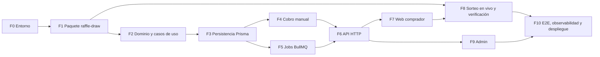

# Guía de implementación — Plataforma de Rifas

> Versión 1.1 · 2026-11-01 · Cambios: cobro manual según DT-02
> Destinatario: **agente de implementación** (o desarrollador) que construirá el MVP.
> Fuente de verdad funcional: [ESPECIFICACIONES-RIFAS.md](ESPECIFICACIONES-RIFAS.md) (v0.4).
> Prototipos: [PROTOTIPOS/](PROTOTIPOS/) · canvas interactivo: https://claude.ai/artifact/9aLUVmhZusCakyj5sprmga (privado; puede no estar accesible para el agente; la copia local es suficiente).

---

## 0. Instrucciones para el agente

Lee esta sección completa antes de escribir código.

### 0.1 Orden de lectura

1. Esta guía, completa.
2. [ESPECIFICACIONES-RIFAS.md](ESPECIFICACIONES-RIFAS.md), con atención especial a las secciones 7 (modelo de datos), 8 (ciclos de vida), 9 (flujos), 10 (sorteo verificable) y 13 (criterios de aceptación).
3. Los archivos de [PROTOTIPOS/](PROTOTIPOS/) (markup HTML con estilos exactos; ver §8.1).
4. El código de referencia listado en §1.2, **solo para lectura**.

### 0.2 Reglas de trabajo

| # | Regla |
|---|---|
| R-01 | Ejecutar las fases **en orden**. Cada fase tiene criterios de entrada y de terminado; no avanzar si los de terminado no se cumplen. |
| R-02 | **TDD estricto**: primero la prueba que falla, luego el código mínimo, luego refactor. Aplica a dominio, casos de uso, adaptadores y componentes con lógica. |
| R-03 | Al llegar a un **⛔ Punto de decisión**, detenerse y preguntar al usuario. No suponer la respuesta. |
| R-04 | Código, identificadores, comentarios y mensajes de commit **en inglés**. Textos de interfaz **en español neutro con tuteo** ("Elige tus números", nunca "Elegí"): el público es peruano. |
| R-05 | Commits con **Conventional Commits** (`feat(raffles): ...`, `test(raffle-draw): ...`), uno o más por fase. **Sin** líneas de atribución de IA (`Co-Authored-By` u otras). No hacer `push` ni abrir PR sin pedido explícito del usuario. |
| R-06 | Los repos existentes (`tiendi-api`, `tiendi-web`, `tiendi-notifications`, etc.) se usan **como referencia**: copiar patrones, no modificarlos. Si hace falta cambiar uno, es un ⛔ Punto de decisión. |
| R-07 | La documentación nueva o actualizada va en `DOCS/RIFAS/` de este repositorio. |
| R-08 | Nunca escribir secretos en el repo. Variables sensibles solo en `.env` (ignorado por git) y en el gestor de secretos (§6.3). |
| R-09 | Si la especificación y esta guía se contradicen, **gana la especificación** en lo funcional y **esta guía** en lo técnico (stack, estructura, patrones). Reportar la contradicción al usuario. |
| R-10 | Al cerrar cada fase, actualizar la tabla de progreso (§11) con fecha, estado y evidencia (comando de prueba y resultado). |

### 0.3 Invariantes que nunca se rompen

Cualquier cambio que viole uno de estos puntos es un error bloqueante:

1. **Un número no se vende dos veces.** Lo garantiza la base de datos (restricción única + `UPDATE` condicional), no la aplicación.
2. **Solo la aprobación de un administrador, registrada en auditoría, vende un boleto.** Subir un comprobante no vende ningún número.
3. **Aprobar y rechazar son idempotentes.** Repetir la operación sobre la misma orden produce el mismo resultado, sin eventos duplicados.
4. **El compromiso (`commitmentHash`) y la ronda de drand (`drandRound`) son inmutables** una vez que la rifa está activa.
5. **La semilla se revela solo después de congelar la lista de vendidos.**
6. **El algoritmo del ganador existe una sola vez**, en `packages/raffle-draw`, y lo usan tanto la API como el navegador.
7. **El navegador consulta drand directamente**, nunca a través de la API de rifas.
8. **La animación del sorteo es solo visual**: empieza después de calcular el ganador y termina en él.
9. **El registro de auditoría es de solo inserción.**

---

## 1. Contexto

### 1.1 Qué se construye

Plataforma para operar rifas recurrentes en Perú: venta de números con reserva temporal, pago manual con comprobante verificado por un administrador, sorteo con commit-reveal + drand transmitido en vivo, y página pública de verificación. El alcance del MVP está en la especificación, §1.

### 1.2 Código de referencia en el monorepo

Este repositorio contiene solo los proyectos de rifas. Las rutas de referencia de esta sección (`FUENTES/tiendi-api/`, `DOCS/NOTIFICACIONES/` y similares) se consultan en la copia de respaldo del monorepo original: `E:\Hector\BACKUP-DISCO1-I\PROYECTOS\ecommcerce-saas-sonet\`, donde `FUENTES/` y `DOCS/` son carpetas hermanas.

| Necesidad | Dónde mirar | Qué reutilizar |
|---|---|---|
| Estructura de app NestJS, config, lint, Jest | `FUENTES/tiendi-api/` (`package.json`, `tsconfig*.json`, `eslint.config.*`, `jest` config) | Copiar configuración base |
| Validación de variables de entorno | `FUENTES/tiendi-api/src/config/env.validation.ts` | Patrón con `zod` |
| Jobs BullMQ | `FUENTES/tiendi-api/src/jobs/` | Registro de colas y jobs repetibles |
| Guards de autenticación y roles | `JwtAuthGuard`, `RolesGuard`, `ClientIpThrottlerGuard` en `FUENTES/tiendi-api/src/` | Patrón de guards |
| Llamada M2M a notificaciones | `FUENTES/tiendi-notifications/src/controllers/notifications-api.controller.ts` (`POST notifications/api/requests`), guard `NotificationsServiceTokenGuard` | Contrato de envío |
| Cómo otra app integró notificaciones | `DOCS/NOTIFICACIONES/GUIA-EXTRACCION-TIENDI-NOTIFICATIONS-KIPU.md` | Pasos de integración |
| App Angular 21, Playwright | `FUENTES/tiendi-web/` | Configuración base, SSR si aplica |
| Telemetría | `FUENTES/packages/telemetry`, `DOCS/OBSERVABILIDAD/` | Instrumentación OpenTelemetry |
| Ambientes | `DOCS/INFRAESTRUCTURA/DEFINICION_AMBIENTES_TEST_Y_PRD.md` | Test y producción |
| Gestión de secretos | `DOCS/SEGURIDAD/OPENBAO_IMPLEMENTATION_GUIDE.md` | Clave de cifrado de semillas |

> En Tiendi, Yape/Plin es un pago **manual** que no pasa por la plataforma (`PaymentMethod.YAPE` + confirmación manual). Rifas sigue la misma idea, pero exige comprobante y aprobación auditada (invariante 2). Ver DT-02 en [DECISIONES-TECNICAS-RIFAS.md](DECISIONES-TECNICAS-RIFAS.md).

---

## 2. Decisiones abiertas

Cada una bloquea la fase indicada. Preguntar al usuario **al llegar a esa fase**, no antes.

| ID | Decisión | Bloquea | Recomendación por defecto |
|---|---|---|---|
| ⛔ D1 | Autorización legal del Ministerio del Interior y requisitos exactos del acta (especificación §2) | Salida a producción (Fase 10) | No lanzar sin la resolución; el sistema exige `authorizationResolution` para publicar una rifa |
| D2 | ~~¿Cuenta de comercio Culqi propia para rifas o la misma de Tiendi?~~ | — | **Obsoleta por DT-02:** no hay pasarela de pago |
| D3 | ~~¿La cuenta Culqi tiene habilitado Yape?~~ | — | **Obsoleta por DT-02:** Yape se cobra de forma directa |
| ✅ D4 | Identidad del comprador: ¿cuentas propias de rifas o cuentas existentes de Tiendi? | Fase 6 | **Resuelta:** cuentas propias, sin contraseña. Quien escribe su correo recibe un enlace de un solo uso que vence a los 15 minutos; el enlace abre una sesión (§6.5). Los operadores usan el mismo acceso, con el rol `admin` en la base |
| ✅ D5 | ¿`tiendi-notifications` envía correo electrónico o solo push? | Fase 6 | **Resuelta:** solo enviaba push e in-app. Se le agregó el canal de correo (Brevo HTTP o SMTP) y las rifas envían todos sus correos por él. WhatsApp y SMS quedan para más adelante, por costo |
| ⛔ D6 | Dominio, hosting y ambiente de test | Fase 10 | Mismo esquema que `tiendi-api` |
| ✅ D7 | ¿Dónde se guardan los comprobantes (imagen o PDF) y quién puede acceder a ellos? Son datos sensibles (Ley N.° 29733) | Fase 4 | **Resuelta (DT-03):** disco privado en el servidor por ahora, fuera de la raíz pública, con acceso solo para el comprador dueño de la orden y los administradores |
| ✅ D8 | ¿Cómo se devuelve el dinero al cancelar una rifa, o ante un pago recibido con la reserva vencida, sin pasarela? Incluye qué pasa si la devolución falla y cómo se da seguimiento a un reembolso pendiente | Fase 4 | **Resuelta (DT-04):** reembolso manual registrado como pendiente; un administrador registra operador, destino y número de operación, y la orden pasa a `REFUNDED` solo al confirmarse la devolución |
| ✅ D9 | ¿Qué pasa con las órdenes `PENDING` y `PENDING_VERIFICATION` al llegar `salesCloseAt` y al cancelar la rifa? Una aprobación tardía no debe cambiar la lista congelada de vendidos | Fase 4 | **Resuelta (DT-05):** al cierre, solo los boletos `SOLD` entran en la lista; toda orden sin resolver deja de poder aprobarse, y la que declaró un pago entra en la cola de revisión (DT-10). Los comprobantes se aceptan hasta 2 horas antes del cierre (configurable) |

---

## 3. Mapa de fases



| Fase | Entregable | Estimación |
|---|---|---|
| F0 | Repos creados, lint y pruebas en verde | 0,5 día |
| F1 | `packages/raffle-draw` con vectores de prueba | 1,5 días |
| F2 | Dominio + casos de uso con fakes en memoria | 2 días |
| F3 | Esquema Prisma, repositorios, prueba de concurrencia | 2 días |
| F4 | Comprobante, aprobación, rechazo, idempotencia y reembolso | 3 días |
| F5 | Jobs de expiración, cierre y sorteo | 1,5 días |
| F6 | Endpoints, guards, límites, notificaciones | 2 días |
| F7 | Pantallas 1–3 (catálogo, números, pago) | 3 días |
| F8 | Pantallas 4–5 (en vivo, verificación) | 2,5 días |
| F9 | Panel de administración | 2 días |
| F10 | E2E, telemetría, ambientes | 2 días |

---

## 4. Fase 0 — Preparación del entorno

**Entrada:** esta guía leída.

### Tareas

1. Crear tres proyectos dentro de `FUENTES/`:
   - `FUENTES/packages/raffle-draw/`: librería TypeScript sin dependencias de framework.
   - `FUENTES/tiendi-rifas-api/`: NestJS 11. Copiar desde `tiendi-api` la configuración de TypeScript, ESLint, Prettier y Jest. **No** copiar módulos de negocio.
   - `FUENTES/tiendi-rifas-web/`: Angular 21 (misma versión que `tiendi-web`), con Vitest y Playwright como en `tiendi-admin`.
2. Revisar cómo están organizados los repos en `FUENTES/` (repos git independientes o carpetas del repo raíz) y seguir la misma convención. Si no está claro, ⛔ preguntar.
3. Levantar PostgreSQL y Redis locales para desarrollo. Revisar primero si `infra/` ya trae un `docker-compose` reutilizable.
4. Crear `.env.example` en `tiendi-rifas-api` con las variables de §12.3 y la validación con `zod` (patrón de `env.validation.ts`).
5. Agregar un script de pruebas de integración que use una base PostgreSQL real (no SQLite ni mocks), necesaria para la prueba de concurrencia de la Fase 3.

### Terminado cuando

- `npm run lint` y `npm test` pasan en los tres proyectos (con una prueba trivial).
- `tiendi-rifas-api` arranca y responde `GET /health`.
- `tiendi-rifas-web` arranca y muestra una página vacía.

---

## 5. Fase 1 — Paquete `raffle-draw`

**Entrada:** F0 terminada. **Es la pieza más crítica del sistema**: si dos implementaciones calculan distinto, se pierde la verificabilidad.

### 5.1 Especificación exacta de bytes

Para que cualquiera reproduzca el resultado, la codificación queda fijada así. No cambiarla sin versionar el algoritmo.

| Operación | Definición |
|---|---|
| `seed` | 32 bytes aleatorios de un CSPRNG (`crypto.getRandomValues`). Se representa en hex minúscula (64 caracteres). |
| `commitmentHash` | `hex(SHA-256(seedBytes))` |
| `soldNumbers` | Enteros de los números vendidos, **ordenados de forma ascendente**, sin duplicados |
| `soldListHash` | `hex(SHA-256(utf8(soldNumbers.join(","))))`, por ejemplo `"1,2,5,427"` |
| `drandRandomness` | Campo `randomness` de la ronda de drand (hex, 32 bytes), decodificado a bytes |
| `raffleId` | UUID de la rifa en minúsculas, codificado en UTF-8 |
| `digest` | `SHA-256(seedBytes ‖ drandRandomnessBytes ‖ utf8(raffleId))` (concatenación de bytes en ese orden) |
| `index` | `BigInt("0x" + hex(digest)) % BigInt(soldNumbers.length)` (big-endian, sin signo) |
| `winner` | `soldNumbers[Number(index)]` |
| `algorithmVersion` | `"v1"`: se guarda con cada sorteo |

### 5.2 API pública del paquete

```ts
// Names are normative; signatures may be refined while keeping behavior.
export const ALGORITHM_VERSION = 'v1';
export function generateSeed(): string;                                   // hex
export function commitmentHash(seedHex: string): Promise<string>;
export function verifyCommitment(seedHex: string, commitmentHex: string): Promise<boolean>;
export function normalizeSoldNumbers(numbers: number[]): number[];        // sort asc, dedupe, validate ints
export function soldListHash(sortedNumbers: number[]): Promise<string>;
export function computeWinner(input: {
  seedHex: string;
  drandRandomnessHex: string;
  raffleId: string;
  soldNumbers: number[];                                                  // already normalized
}): Promise<{ index: number; winner: number; digestHex: string }>;
export function roundAt(timeMs: number, chain: { genesisTimeSec: number; periodSec: number }): number;
export function timeOfRound(round: number, chain: { genesisTimeSec: number; periodSec: number }): number;
```

- Usar **Web Crypto** (`crypto.subtle.digest`), disponible en Node 18+ y en el navegador. Sin dependencias de Node como `Buffer`.
- `computeWinner` lanza un error si `soldNumbers` está vacío.
- La verificación de la firma BLS de drand **no** va en este paquete (depende de la librería cliente de drand); va en los adaptadores de la API y de la web.

### 5.3 Spike técnico de drand (antes de cerrar la fase)

1. Elegir la red: **quicknet** (ronda cada 3 s) o la red principal por defecto (cada 30 s). Documentar el `chainHash`, el `genesisTime` y el `period` elegidos en `DOCS/RIFAS/DECISIONES-TECNICAS-RIFAS.md`.
2. Verificar que la librería cliente oficial de drand para JavaScript (`drand-client` en npm; confirmar el nombre y la versión vigente) verifica firmas de esa red en **Node y en el navegador**.
3. Confirmar qué relays HTTP públicos están activos y si aceptan CORS desde el navegador (la especificación menciona `api.drand.sh`, `api2.drand.sh` y `drand.cloudflare.com`; validar).
4. Si algo de esto falla, ⛔ reportar al usuario antes de seguir.

### 5.4 Pruebas (escribirlas primero)

- `test-vectors.json` versionado en el paquete: 5 casos fijos (entradas → `commitmentHash`, `soldListHash`, `digestHex`, `index`, `winner`). La API y la web importan los mismos vectores en sus propias pruebas.
- `commitmentHash` de una semilla conocida coincide con un SHA-256 calculado de forma independiente (por ejemplo, `sha256sum`). Documentar el comando en la prueba.
- `normalizeSoldNumbers([5, 1, 5, 3])` → `[1, 3, 5]`; rechaza valores no enteros y negativos.
- `computeWinner` es determinista y su `index` está en `[0, length)`.
- Distribución: con 10 000 semillas aleatorias y 10 números, cada índice sale entre el 9 % y el 11 % de las veces.
- `roundAt` / `timeOfRound` son inversas en los bordes de ronda.

### Terminado cuando

- Cobertura ≥ 95 % del paquete, vectores publicados y spike documentado.
- El paquete se compila a ESM y lo importan sin errores un proyecto Node y uno Angular.

---

## 6. Fases 2 a 6 — API (`tiendi-rifas-api`)

### 6.1 Fase 2 — Dominio y casos de uso

**Entrada:** F1 terminada.

Estructura según la especificación §6.3: `src/modules/raffles/{domain,application,infrastructure,http}`.

**Nombres en código** (la especificación usa nombres en español; el código va en inglés):

| Especificación | Código |
|---|---|
| Rifa | `Raffle` |
| Boleto | `Ticket` |
| Orden | `TicketOrder` |
| Pago | `Payment` |
| Sorteo | `Draw` |
| Evento de auditoría | `AuditEvent` |
| Estados de la rifa: borrador, activa, cerrada, sorteada, cancelada | `RaffleStatus`: `DRAFT`, `ACTIVE`, `CLOSED`, `DRAWN`, `CANCELLED` |
| Estados del boleto: disponible, reservado, vendido, reembolsado | `TicketStatus`: `AVAILABLE`, `RESERVED`, `SOLD`, `REFUNDED` |
| Estados de la orden | `OrderStatus`: `PENDING`, `PAID`, `EXPIRED`, `REFUNDED` |

**Dominio (TypeScript puro, sin NestJS ni Prisma):**

- `Raffle` con las transiciones de la especificación §8.2. Toda transición inválida lanza un error de dominio. `publish()` exige `authorizationResolution`, `salesCloseAt < drawAt` y que la ronda de drand sea posterior a `salesCloseAt`.
- `Ticket` con las transiciones de §8.1.
- Reglas de reserva: TTL de 15 minutos, **máximo 20 números por reserva y 20 números reservados en simultáneo por comprador** (protege contra el acaparamiento; dejar los límites configurables).

**Puertos (interfaces en `application/`):** `RaffleRepository`, `TicketRepository`, `OrderRepository`, `ProofStorage` (según ⛔ D7), `RandomnessBeacon`, `Notifier`, `NotificationOutbox` (DT-13), `AuditLog`, `SeedVault`, `Clock`.

**Casos de uso:** `CreateRaffle`, `PublishRaffle`, `ReserveTickets`, `SubmitPaymentProof`, `ApprovePayment`, `RejectPayment`, `ClaimLatePayment`, `ConfirmLatePayment`, `DismissLatePayment`, `ListLatePaymentClaims`, `ListOperationCollisions`, `ReleaseExpiredReservations`, `AlertOverdueVerifications`, `CloseSales`, `ExecuteDraw`, `GetVerificationData`, `CancelRaffle`, `CancelAlteredRaffle`, `RecordExtraTransfer`, `RecordPrizeDelivery`.

**Pruebas:** cada caso de uso con fakes en memoria de los puertos. Cubrir todos los escenarios Gherkin de la especificación §13 que no dependen de la base de datos.

**Terminado cuando:** todas las transiciones válidas e inválidas están probadas y la cobertura del dominio es ≥ 90 %.

### 6.2 Fase 3 — Persistencia con Prisma

**Entrada:** F2 terminada.

1. `prisma/schema.prisma` con los modelos de la especificación §7 (nombres de la tabla de §6.1). Columnas adicionales respecto del diagrama:
   - `Raffle.soldListHash` (se fija al cierre), `Raffle.seedCiphertext` (semilla cifrada), `Raffle.seedRevealed` (texto, nulo hasta el cierre), `Raffle.drandChainHash`, `Raffle.authorizationResolution`.
   - `Draw.algorithmVersion`, `Draw.digestHex`, `Draw.winnerIndex`.
   - `WebhookEvent` igual al de `tiendi-api` (`@@unique([provider, eventId])`). Obsoleto por DT-02: se retira en F4.
2. Restricciones: `@@unique([raffleId, number])` en `Ticket`; `externalId @unique` en `Payment`, normalizado con `normalizeOperationNumber` o, en una colisión declarada, número más banco (DT-12).
3. Migración SQL manual (Prisma permite SQL en la migración) para:
   - Un trigger que rechace `UPDATE` de `commitmentHash`, `drandRound` y `drandChainHash` cuando `status <> 'DRAFT'`.
   - Un trigger que rechace `UPDATE` y `DELETE` sobre `AuditEvent`.
4. **Los boletos se crean al publicar**: `PublishRaffle` inserta las filas de `numberMin` a `numberMax` en estado `AVAILABLE` dentro de la misma transacción (`createMany`).
5. **Reserva atómica** en `PrismaReservationStore.reserve`, dentro de una sola transacción:

   ```sql
   SELECT id, number FROM "Ticket"
   WHERE "raffleId" = $1 AND number = ANY($2) AND status = 'AVAILABLE'
   ORDER BY number
   FOR UPDATE;
   ```

   Si la cantidad de filas devueltas es distinta de la pedida, se aborta la transacción sin escribir nada y se responde `409` con los números que ya no estaban disponibles. Si están todas, se crea la orden, se reservan los boletos y se registra la auditoría.
6. `AuditLog` inserta un evento por cada reserva, pago, liberación, cierre y sorteo.

**Pruebas de integración (PostgreSQL real):**

- **Concurrencia:** 50 reservas simultáneas del mismo número → exactamente 1 exitosa y 49 con conflicto.
- Reservas cruzadas: A pide [1, 2] y B pide [2, 3] al mismo tiempo → una sola gana y la otra no reserva nada (todo o nada).
- Los triggers rechazan los cambios prohibidos.

**Terminado cuando:** las pruebas de integración pasan 10 veces seguidas sin fallos intermitentes.

**Migraciones que solo van hacia adelante:** `20261102000200_raffle_alert_and_sold_order` (DT-13) no tiene vuelta atrás automática. Hace cuatro cambios:

- `OperatorAlert.orderId` y `amount` admiten nulos.
- Crea el índice único parcial de las alertas de la rifa.
- Agrega la restricción `Ticket_sold_has_order`.
- Cambia `Ticket_orderId_fkey` a `ON DELETE RESTRICT`.

- **Ventana de mantenimiento:** `ADD CONSTRAINT ... CHECK` toma un bloqueo `ACCESS EXCLUSIVE` sobre `Ticket` y recorre la tabla entera para validarla. Mientras dura, ni las reservas ni las lecturas de boletos avanzan. Volver a crear la clave foránea también valida cada fila. El bloque previo recorre `Ticket` y detiene la migración si hay boletos vendidos sin orden. Córrela en una ventana de mantenimiento, con las ventas en pausa.
- **Por qué no se revierte sola:** en cuanto exista una alerta `DRAW_BLOCKED`, hay filas con `orderId` nulo. Desde ahí, `ALTER COLUMN "orderId" SET NOT NULL` falla: Postgres valida la columna entera y se detiene en la primera fila nula. Lo mismo pasa con `amount`.
- **Vuelta atrás manual:** primero vuelve a desplegar el código anterior, que no conoce las alertas de la rifa. Después, en una transacción:
  1. Resuelve las alertas sin orden. Exporta las filas de `OperatorAlert` con `orderId` nulo para conservar la evidencia, y bórralas. El evento `DRAW_REFUSED` de la auditoría sigue registrando cada sorteo bloqueado.
  2. `DROP INDEX "OperatorAlert_type_raffleId_raffle_level_key";`
  3. `ALTER TABLE "OperatorAlert" ALTER COLUMN "orderId" SET NOT NULL, ALTER COLUMN "amount" SET NOT NULL;`
  4. `ALTER TABLE "Ticket" DROP CONSTRAINT "Ticket_sold_has_order";`
  5. `ALTER TABLE "Ticket" DROP CONSTRAINT "Ticket_orderId_fkey", ADD CONSTRAINT "Ticket_orderId_fkey" FOREIGN KEY ("orderId") REFERENCES "TicketOrder"("id") ON DELETE SET NULL ON UPDATE CASCADE;`
  6. `DELETE FROM "_prisma_migrations" WHERE migration_name = '20261102000200_raffle_alert_and_sold_order';`

  Volver a `SET NULL` reabre el hueco que la migración cerró: borrar una orden dejaría un boleto vendido sin comprador. Prefiere corregir hacia adelante con una migración nueva.

**Transferencias extra (DT-16), también solo hacia adelante:** `20261102000300_extra_transfer_refund` permite más de un reembolso por orden, y `20261102000400_refund_payment_same_order` agrega los triggers que atan el reembolso de una transferencia extra a la orden de su `Payment`.

- **Código y esquema van juntos:** despliega las dos migraciones con el código que las usa. El código anterior lee el reembolso de una orden con `findUnique` sobre `orderId`, que ya no es único, y no conoce `paymentId`. El código nuevo sobre el esquema anterior falla al guardar `paymentId`.
- **Por qué no se revierte sola:** en cuanto exista una transferencia extra, una orden puede tener dos reembolsos, y el índice único de `orderId` ya no se puede volver a crear.
- **Vuelta atrás manual:** primero vuelve a desplegar el código anterior. Después, en una transacción:
  1. Archiva los reembolsos de transferencias extra antes de tocarlos: son dinero que se le debe al comprador. Exporta las filas de `Refund` con `paymentId` no nulo y los `Payment` `EXTRA_RECEIVED` que nombran, y registra fuera del sistema cada reembolso todavía `PENDING` para devolverlo a mano. El evento `EXTRA_TRANSFER_RECORDED` de la auditoría conserva cada uno.
  2. Borra esas filas de `Refund`. Los `Payment` pueden quedarse: el número de operación sigue ocupado, así que nadie lo vuelve a usar.
  3. `DROP TRIGGER trg_refund_payment_order ON "Refund"; DROP TRIGGER trg_payment_refund_order ON "Payment"; DROP FUNCTION check_refund_payment_order(); DROP FUNCTION check_payment_refund_order();`
  4. `ALTER TABLE "Refund" DROP CONSTRAINT "Refund_paymentId_fkey";` y `DROP INDEX "Refund_order_refund_key", "Refund_paymentId_key", "Refund_orderId_idx";`
  5. `ALTER TABLE "Refund" DROP COLUMN "paymentId";` y `CREATE UNIQUE INDEX "Refund_orderId_key" ON "Refund"("orderId");`
  6. `DELETE FROM "_prisma_migrations" WHERE migration_name IN ('20261102000300_extra_transfer_refund', '20261102000400_refund_payment_same_order');`

  Si al recrear `Refund_orderId_key` aparece una orden con dos reembolsos, quedó un reembolso extra sin archivar: vuelve al paso 1.

**Cuatro ojos (DT-17), también solo hacia adelante:** `20261102000500_refund_four_eyes` se detiene antes de cambiar nada si un pago con dinero no tiene operador, si una orden tiene más de un pago propio o si un reembolso `PENDING` no tiene a quién atribuirle el dinero. Corrige esos datos a mano y vuelve a desplegar. No hay vuelta atrás prevista: quitar los triggers, la restricción o el índice quita el control.

### 6.3 Fase 4 — Cobros manuales con verificación de comprobante (Yape, Plin y Transferencia)

**Entrada:** F3 terminada, DT-02 aprobada y ⛔ D7, D8 y D9 respondidas.

1. **Modelo de comprobante y estados:**
   - Nuevos estados en `OrderStatus`: `PENDING_VERIFICATION`, `REJECTED`, `LATE_PAYMENT_REVIEW` y `LATE_PAYMENT_DISMISSED`.
   - Registro de datos de comprobante: `proofUrl` (imagen/PDF), `operationNumber`, `bankOrWallet` (Yape, Plin, BCP, BBVA, Interbank), `declaredAmount`.
2. **Ciclo de vida de la reserva:**
   - `PENDING`: 15 minutos para efectuar el pago y subir el comprobante. Si expira sin comprobante, el job libera los números a `AVAILABLE`.
   - `PENDING_VERIFICATION`: al adjuntar el comprobante, la orden recibe `verificationDueAt` (12 horas o hasta `salesCloseAt`), el plazo de revisión del operador. Vencerlo no libera los boletos ni abre un reembolso: solo alerta al operador una vez por orden (DT-06).
   - Los comprobantes se aceptan hasta 2 horas antes de `salesCloseAt`, margen configurable (DT-05).
   - Las reservas cierran una duración de reserva antes del plazo de comprobantes (DT-05). Por ejemplo, con cierre a las 18:00, los comprobantes se aceptan hasta las 16:00 y, con una reserva de 15 minutos, las reservas hasta las 15:45. `ProofPolicy.reservationCutoff` resta al plazo de comprobantes el `reservationTtlMinutes` de la misma `ReservationPolicy` que fija `expiresAt`. `ReserveTickets` recibe `ProofPolicy`, y el `ReservationStore` llama a `assertReservationsOpen` con `order.createdAt` y el `salesCloseAt` que lee bajo `FOR SHARE` en la transacción de la reserva. Desde el corte, o si la rifa no tiene `salesCloseAt`, lanza `ReservationsClosedError` y no persiste nada.
3. **Casos de uso de aplicación:**
   - `SubmitPaymentProof`: asocia comprobante a la orden y realiza la transición a `PENDING_VERIFICATION`.
   - `ApprovePayment`: transacción atómica que exige `receivedAmount`, leído del banco, igual a `totalAmount` (DT-12), pasa la orden a `PAID`, los boletos a `SOLD`, registra el `Payment` exitoso y emite el `AuditEvent` con el ID del operador.
   - `RejectPayment`: transacción atómica que libera inmediatamente los boletos a `AVAILABLE`, guarda el motivo del rechazo y notifica al comprador. El operador debe indicar si recibió dinero. Si no lo recibió, la orden pasa a `REJECTED`. Si lo recibió, indica monto y operación, se registra el `Payment` con estado `REJECTED_RECEIVED`, se abre el reembolso por ese monto y la orden pasa a `REFUND_PENDING` (DT-08). Repetirlo con los mismos datos no cambia nada; con otro número, monto o banco se rechaza con `ConflictingRejectionError` y queda el evento `PAYMENT_REJECTION_REFUSED`. Decide el `Payment` registrado, no el estado de la orden. Un monto mayor que `totalAmount`, comparado en céntimos, exige `overpayment` con `confirmed: true` y un motivo; sin él lanza `OverpaymentNotConfirmedError` y no escribe nada, también al repetir el rechazo (DT-14).
   - `ClaimLatePayment`: guarda lo que declara el comprador de una orden `EXPIRED`, la pasa a `LATE_PAYMENT_REVIEW` y crea su alerta para los operadores en la misma transacción. No abre un reembolso (DT-07, DT-09).
   - `ConfirmLatePayment`: el operador indica el monto recibido y la operación. Registra el `Payment`, abre el reembolso por ese monto y pasa la orden a `REFUND_PENDING` (DT-07). Un monto mayor que el total exige la misma confirmación que el rechazo (DT-14).
   - `RecordExtraTransfer`: registra una segunda transferencia real de una orden ya resuelta (`PAID`, `REFUND_PENDING`, `REFUNDED`, `REJECTED` o `LATE_PAYMENT_DISMISSED`). Exige el operador, un motivo de hasta 500 caracteres y el dinero con las reglas de DT-12, más la confirmación de sobrepago si supera el total (DT-14). Guarda un `Payment` `EXTRA_RECEIVED`, abre un reembolso ligado a ese `Payment` con `paymentId` y audita `EXTRA_TRANSFER_RECORDED`, en la misma transacción. La orden y sus boletos no cambian; en otro estado lanza `ExtraTransferNotAcceptedError`. Completar ese reembolso tampoco toca la orden (DT-16).
   - `DismissLatePayment`: descarta el reclamo con un motivo auditado. La orden queda en `LATE_PAYMENT_DISMISSED` y no admite otro reclamo (DT-07).
   - `ListOperationCollisions`: devuelve cada uso de la salida para colisiones entre bancos, el más reciente primero (DT-12).
   - `ListLatePaymentClaims`: devuelve las órdenes en `LATE_PAYMENT_REVIEW` sin decidir, la más antigua primero: reclamos y órdenes que `CloseSales` o `CancelRaffle` enviaron a revisión.
   - `CloseSales` y `CancelRaffle`: una orden en `PENDING_VERIFICATION` pasa a `LATE_PAYMENT_REVIEW` con su alerta, sin abrir un reembolso, y el comprador recibe `sendPaymentUnderReview`. Las órdenes `PAID` de una rifa cancelada van directo a reembolso (DT-10).
   - `CancelAlteredRaffle`: la única salida de una rifa `CLOSED` cuya lista no coincide con `soldListHash`. Exige el operador y un motivo de hasta 500 caracteres. Bajo el bloqueo de la rifa recalcula el hash; si coincide, lanza `SoldListIntactError` y no escribe nada. Si no, cancela la rifa y reembolsa como `CancelRaffle`: cada orden `PAID` por su total, y las órdenes con un pago declarado a revisión. Marca leída la alerta `DRAW_BLOCKED` y audita `RAFFLE_CANCELLED_LIST_ALTERED` con ambos hashes, en la misma transacción (DT-15).
   - `CompleteRefund`: registra que un operador devolvió el dinero, con destino y número de operación. Exige el operador, sin espacios al inicio ni al final. Bajo los bloqueos busca quién registró el dinero en el `verifiedBy` del `Payment`: el `EXTRA_RECEIVED` que nombra el reembolso, o, leyendo todos los pagos de la orden con `findOrderPayments`, el único `APPROVED`, `REJECTED_RECEIVED` o `LATE_CONFIRMED`. Compara los dos operadores por igualdad entre formas canónicas: `parseOperatorId` valida y normaliza el operador de la petición antes de leer nada, y un `verifiedBy` fuera del patrón no nombra a nadie. Todos los casos de uso que registran un operador usan `parseOperatorId`. Si es el mismo operador lanza `SameOperatorRefundError`, y si no lo encuentra lanza `RefundRecorderUnknownError`. En los dos casos audita `REFUND_COMPLETION_REFUSED` en una transacción que se confirma y no cambia nada más. Si pasa, guarda al operador en el reembolso y audita `REFUND_COMPLETED` con `operatorId` y `recordedBy`. Repetirlo sobre un reembolso completado no hace nada. El trigger `trg_refund_four_eyes` sostiene la misma regla en la base, también al insertar. `trg_payment_money_immutable` congela los pagos con dinero y no deja que un pago se vuelva uno, `trg_payment_money_kept` impide borrarlos, `trg_refund_completed_immutable` congela y protege del borrado los reembolsos completados, y los triggers de `TRUNCATE` protegen ambas tablas. `Payment_order_money_key` admite un pago propio por orden, `Payment_money_has_operator` exige su operador canónico, y `check_refund_payment_order` solo deja nombrar una transferencia extra de la misma orden (DT-16, DT-17). `prisma-ticket-ledger.ts` traduce cada una de esas reglas a un error de dominio con `mapGuardError`. El `operatorId` sale de la sesión autenticada. Estas reglas frenan errores de la aplicación, no a un superusuario de la base: la aplicación se conecta con un usuario sin privilegios para quitar triggers.
   - `ListUnreadOperatorAlerts` y `MarkOperatorAlertRead`: listan las alertas sin leer y marcan una como leída para todos los operadores. Confirmar o descartar el reclamo también la apaga (DT-09).
   - `AlertOverdueVerifications`: alerta al operador por cada orden con el plazo de revisión vencido. Envía primero y marca después, así que un envío fallido se reintenta en la siguiente corrida (DT-06).
4. **Pruebas unitarias e integración:**
   - Subida de comprobante dentro de los 15 min vs después de expirar.
   - Aprobación administrativa: boletos pasan atómicamente a `SOLD` y se registra auditoría.
   - Rechazo administrativo: boletos vuelven inmediatamente a `AVAILABLE`.
   - Idempotencia: intentar aprobar o rechazar dos veces una orden no duplica eventos ni altera estados inconsistentes.
5. **Retirar lo heredado del diseño con pasarela:**
   - `PaymentGateway`, `StartPayment`, `ConfirmPayment` y `WebhookEvent`, incluidos los reembolsos de `CancelRaffle` que dependen de ese puerto (según ⛔ D8).
   - Agregar `declaredAmount` al esquema: todavía no existe.
   - `approveByAdmin` y `rejectByAdmin` solo aceptan órdenes `PENDING_VERIFICATION`.
   - TTL de reserva por defecto en 15 minutos.

**Terminado cuando:** pruebas unitarias de los casos de uso y pruebas de integración con base de datos en verde.

### 6.4 Fase 5 — Jobs con BullMQ

**Entrada:** F3 terminada (puede hacerse en paralelo con F4).

| Job | Frecuencia | Acción |
|---|---|---|
| `release-expired-reservations` | Cada minuto | `ReleaseExpiredReservations`: libera solo órdenes `PENDING`; nunca toca una orden en `PENDING_VERIFICATION` (DT-06) |
| `alert-overdue-verifications` | Cada 15 minutos | `AlertOverdueVerifications`: marca la orden y encola el correo a los operadores en una transacción (DT-13) |
| `dispatch-notifications` | Cada 30 segundos | `DispatchNotifications`: envía los correos de la bandeja `NotificationOutbox` con `FOR UPDATE SKIP LOCKED`, renueva la reserva de cada fila antes de su envío y corta cada envío a `NOTIFICATION_SEND_TIMEOUT_SECONDS`. Reintenta con espera exponencial y, al agotar los intentos o ante un error permanente, marca `FAILED` y crea la alerta `NOTIFICATION_FAILED` (DT-13). Entrega al menos una vez y registra los conteos de cada lote |
| `purge-sent-notifications` | Cada día | `PurgeSentNotifications`: borra el contenido y el destinatario de los correos `SENT` con más de `NOTIFICATION_RETENTION_DAYS` días, y conserva la fila y su `dedupeKey` (DT-13) |
| `reconcile-raffle-jobs` | Cada minuto y al arrancar | `ScheduleRaffleJobs`: programa el `close-sales` de cada rifa `ACTIVE` y el `execute-draw` de cada rifa `CLOSED`. Los ids de job son fijos (`close-sales.<raffleId>`, `execute-draw.<raffleId>`), así que repetirlo nunca duplica un job |
| `close-sales` | Programado en `salesCloseAt` de cada rifa; 10 intentos con espera exponencial | `CloseSales`: estado `CLOSED`, congela la lista, calcula `soldListHash` y revela la semilla (descifra y guarda `seedRevealed`). Si corre antes de `salesCloseAt` por un desfase de reloj, falla con `SalesStillOpenError` y se reintenta. Al cerrar, programa el `execute-draw` sin esperar al siguiente `reconcile-raffle-jobs` |
| `execute-draw` | Programado en `timeOfRound(drandRound)` + 5 s, con reintentos cada 5 s durante 60 min (`DRAW_RETRY_WINDOW_MINUTES`) | `ExecuteDraw`: comprueba la lista contra `soldListHash`, obtiene la ronda de drand (adaptador con varios relays), **verifica la firma BLS**, calcula con `raffle-draw` y guarda `Draw`. **No reintenta** ante ningún error de dominio: ni `SoldListMismatchError` ni `WinningTicketWithoutOrderError`, que dejan una alerta `DRAW_BLOCKED` en el panel (DT-11, DT-13, DT-15), ni `DrawNotPossibleError` (rifa no cerrada, sin boletos vendidos o semilla que no coincide con su compromiso). Ninguno se corrige solo y cada intento agregaría un evento de auditoría. Sí reintenta mientras la ronda no está disponible (`BeaconRoundUnavailableError`) y ante errores de infraestructura |

- **Dónde vive:** un solo queue de BullMQ, `raffle-jobs`, con su worker en `JobsModule` (concurrencia 5, para que un lote largo de correos no retrase un cierre ni un sorteo). Los jobs repetidos se registran con `upsertJobScheduler`, con el nombre del job como id: cada arranque actualiza el mismo programador y no agrega otro. `JOBS_ENABLED=false` deja el módulo afuera; las pruebas e2e, que solo prueban HTTP, lo usan así.
- **Programación de cada rifa:** la base de datos es la fuente de verdad. `PublishRaffle` no programa nada dentro de su transacción. `reconcile-raffle-jobs` corre al arrancar y cada minuto, y programa lo que el estado de cada rifa pide. Un job que se pierda entre un commit y su programación vuelve en menos de un minuto, sin outbox. Los jobs terminados se conservan 30 días: mientras su id exista, BullMQ ignora un job nuevo con ese id, así que el `reconcile` no vuelve a correr un cierre ni un sorteo.
- **Semilla:** se genera en `PublishRaffle` y se cifra con AES-256-GCM (`AesGcmSeedVault`), con el id de la rifa como dato adicional: un texto cifrado copiado a otra rifa no se abre. Formato `v1.<keyId>.<iv>.<tag>.<cifrado>`. Nunca se guarda ni se registra en logs en texto plano antes del cierre. La clave viene de un `SeedKeyProvider`:
  - En desarrollo y pruebas, `EnvSeedKeyProvider` la lee de `SEED_ENCRYPTION_KEY` (32 bytes en base64).
  - En producción ese proveedor se rechaza, igual que la variable. El proveedor del gestor de secretos (ver `DOCS/SEGURIDAD/OPENBAO_IMPLEMENTATION_GUIDE.md`) todavía no existe, así que en producción `close-sales` no puede revelar ninguna semilla hasta construirlo.
- **drand:** `DrandHttpBeacon` pregunta a cada relay de `DRAND_RELAYS` en orden y no confía en ninguno. Cada relay debe ser una URL `https`, y la lista se depura por origen; una lista vacía se rechaza al arrancar. Comprueba que la ronda sea la pedida, que `randomness` sea el SHA-256 de la firma y que la firma BLS (`bls-unchained-g1-rfc9380`) verifique contra `DRAND_PUBLIC_KEY`. Una respuesta que falla pasa al relay siguiente. Si ninguno da una ronda verificada, lanza `BeaconRoundUnavailableError`. La cadena (génesis y periodo) sale de la configuración, nunca de un relay.
- **drand caído (DT-18):** el sorteo pide solo la ronda fijada, por su número y con la firma BLS verificada. Si drand o sus relays no responden, reintenta cada 5 s durante 60 minutos. Después falla, levanta `DRAW_BLOCKED` y `reconcile-raffle-jobs` lo vuelve a agregar pasada la pausa, así que sigue esperando esa misma ronda sin límite. Nunca usa otra ronda. Cuando drand vuelve, el sorteo se completa y marca leída su alerta `DRAW_BLOCKED` (lectora `system`); el cierre hace lo mismo con `CLOSE_BLOCKED`. Si drand desapareciera para siempre no hay salida automática: es una decisión abierta.
- **Idempotencia:** `CloseSales` sobre una rifa que ya no está `ACTIVE` devuelve la rifa sin escribir nada, también si otro cierre o una cancelación ganan la carrera mientras se revela la semilla. `ExecuteDraw` sobre una rifa `DRAWN` devuelve el sorteo ya guardado, también si otro sorteo ganó la carrera mientras este esperaba el bloqueo de la rifa.
- **Jobs trabados:** cuando un `close-sales` o un `execute-draw` falla para siempre, el operador recibe una alerta de la rifa en el panel, una por rifa y tipo, que se reabre si vuelve a pasar: `CLOSE_BLOCKED` para el cierre y `DRAW_BLOCKED` para el sorteo. La auditoría registra `RAFFLE_JOB_BLOCKED` con el job y la clase del error.
  - Si falló por un error de dominio, el job queda fallido: reintentarlo no cambia nada.
  - Si falló por un error de infraestructura, `reconcile-raffle-jobs` lo quita y lo vuelve a agregar, pasados `JOB_RECOVERY_COOLDOWN_MINUTES` desde la falla, para que no gire sin pausa.
  - El sorteo reintenta durante 60 minutos antes de fallar, así que un incidente corto no gasta sus intentos.
  - Un sorteo sobre una rifa cancelada termina sin hacer nada y sin alerta, también si la cancelación llega mientras corre. `CancelAlteredRaffle` además quita el `execute-draw` pendiente de la rifa.
- **Cierre adelantado:** `salesCloseAt` y `drawAt` no cambian una vez que la rifa sale de `DRAFT`: el trigger `trg_raffle_schedule_immutable` lo impide. Si `close-sales` corre antes de `salesCloseAt` por un desfase de reloj, el job se vuelve a dormir hasta esa hora sin gastar un intento.
- **Arranque y apagado:** el arranque registra los jobs en segundo plano: si Redis o la base no responden, la aplicación igual arranca y escucha, lo registra en el log y el `reconcile` de cada minuto se pone al día. La conexión a Redis reintenta cada vez con más espera, hasta 10 s entre intentos. `main.ts` llama a `enableShutdownHooks`: al recibir `SIGTERM` se cierran el worker y los queues.
- **Health:** `/health` no consulta Redis. Es un chequeo de vida: una caída de Redis solo pausa los jobs y no debe reiniciar la API.
- **Persistencia de Redis:** en producción, Redis debe guardar en disco con AOF (`appendonly yes`), como el `rifas-redis` del `docker-compose.yml`. Si Redis pierde sus datos, `reconcile-raffle-jobs` vuelve a programar los cierres y los sorteos desde la base. Los jobs repetidos, `reconcile` incluido, se registran de nuevo recién al reiniciar la aplicación, así que después de perder los datos de Redis reinicia la API.
- **drand, chequeo al arrancar:** `DrandHttpBeacon` calcula el hash de la cadena con `DRAND_PUBLIC_KEY`, el periodo, la génesis, `DRAND_GROUP_HASH` y `DRAND_BEACON_ID`, sin red, y se niega a arrancar si no coincide con `DRAND_CHAIN_HASH`.
- Ningún caso de uso envía correos: los encola en `NotificationOutbox` dentro de su transacción, y solo `dispatch-notifications` llama al `Notifier` (DT-13).
- **Notifier:** `NotificationsModule` entrega los correos con `TiendiNotificationsNotifier` cuando están definidos `NOTIFICATIONS_URL` y `NOTIFICATIONS_SERVICE_TOKEN` (D5). Sin ellos usa `LoggingNotifier`, que no entrega nada y registra solo qué correo enviaría y el id interno de la orden o la rifa, nunca el destinatario, montos, motivos ni números. La validación del entorno permite ese caso solo en pruebas o en desarrollo con `EMAIL_LOG_ONLY=true`. Como resguardo, si en producción no hubiera adaptador real, `dispatch-notifications` queda apagado y su programador se borra al arrancar: los correos esperan en la bandeja en vez de marcarse como enviados por un adaptador que los descarta.
- El índice parcial de la bandeja (`NotificationOutbox_pending_nextAttemptAt_idx`) existe solo en la migración. Prisma 5.22 no lo declara ni lo borra: `prisma migrate diff --exit-code` sigue sin diferencias. Si una versión futura de Prisma lo marcara como deriva, no lo borres: las pruebas de integración fallan si el índice falta o si la toma deja de usarlo. Lo mismo vale para el índice único parcial de las alertas de la rifa (`OperatorAlert_type_raffleId_raffle_level_key`) y para el del reembolso propio de cada orden (`Refund_order_refund_key`, DT-16).
- `RequeueFailedNotification` se llama desde `POST /api/admin/notificaciones/:id/reencolar`, que exige sesión de administrador.
- **Redis local:** el `docker-compose.yml` del proyecto levanta su propio Redis en el puerto `55380`, y `redis-test` (perfil `test`) en el `55379`. El `6379` pertenece a otro proyecto en la máquina de desarrollo, y los puertos `563xx` caen en rangos reservados por Windows. Todos los puertos del `docker-compose.yml`, los de Redis y los de PostgreSQL, escuchan solo en `127.0.0.1`.

**Pruebas:** con un `Clock` falso y un `RandomnessBeacon` falso que devuelve vectores de F1; reintento ante drand caído; idempotencia de cada job. El adaptador de drand se prueba con una ronda real de quicknet guardada en la prueba, sin red. Las pruebas de integración (`test/jobs.integration-spec.ts`) corren contra `postgres-test` y `redis-test`: `docker compose --profile test up -d --wait postgres-test redis-test`.

### 6.5 Fase 6 — API HTTP

**Entrada:** F4, F5 terminadas y ⛔ D4 y D5 respondidas.

1. Endpoints de la especificación §11. Validación de entrada con `zod` (como en `tiendi-api`).
2. Guards: público, comprador autenticado (según D4) y `ADMIN` (patrón `RolesGuard`).
3. Límite de tasa en `POST /api/reservas` y `POST /api/ordenes/:id/comprobante` (patrón `ClientIpThrottlerGuard`). La subida valida tipo de archivo (imagen o PDF) y tamaño.
4. `GET /api/rifas/:id/en-vivo` devuelve únicamente datos congelados: no expone `seedRevealed` antes de `CLOSED`.
5. `GET /api/rifas/:id`: grilla paginada por rangos (por ejemplo, 42 números por página como en el prototipo) con el estado de cada número. Respuesta cacheable por 3 segundos.
6. `Notifier` mediante `tiendi-notifications` (`POST notifications/api/requests` con el token M2M): correo con los boletos al aprobarse el pago, aviso de rechazo con su motivo, aviso de pago en revisión, aviso de reembolso y aviso del resultado del sorteo.
7. Errores con un formato uniforme `{ code, message, details? }`, con códigos estables (`TICKETS_UNAVAILABLE`, `RESERVATION_LIMIT`, `RAFFLE_NOT_ACTIVE`, etc.).
8. Documentar la API (OpenAPI/Swagger, si `tiendi-api` lo usa).
9. **Obligatorio:** rutas de alertas `GET /api/admin/alertas` y `POST /api/admin/alertas/:id/leida` con guard `ADMIN` (DT-09). El `operatorId` sale del guard.

**Cómo quedó implementado:**

- **Acceso (D4):** `POST /api/auth/enlace {email}` no crea ningún usuario. En una sola transacción guarda la fila del enlace, con el correo normalizado y solo el SHA-256 del token, y encola su correo en `NotificationOutbox` (tipo `MAGIC_LINK`); el despachador lo envía y lo reintenta como cualquier otro correo (DT-13). El token va en el fragmento del enlace (`#token=`), que el navegador nunca manda a un servidor. `POST /api/auth/sesion {token}` usa el enlace una vez, de forma atómica, busca o crea al usuario por ese correo y abre una sesión de `SESSION_TTL_HOURS` horas. La respuesta trae un JWT (HS256, `JWT_SECRET`) que nombra la sesión; `POST /api/auth/salir` la revoca. En cada pedido se relee la sesión y el rol en la base: el token no decide el rol.
- **El token en el outbox:** mientras el correo del enlace espera su envío, el token está en la fila del outbox. Apenas sale, la fila pierde el contenido y el destinatario. Un enlace vencido antes de salir se descarta sin enviarse, y su falla no crea alerta, porque no pertenece a ninguna orden.
- **Límites del enlace:** hasta `MAGIC_LINK_MAX_PER_WINDOW` enlaces por correo cada `MAGIC_LINK_TTL_MINUTES` minutos, contados bajo un bloqueo por correo. Por encima del tope no se escribe nada, pero la respuesta es la misma (202), y el trabajo en la base también, así que la respuesta no dice nada del correo. El tope no bloquea a nadie: los enlaces anteriores fueron al buzón de esa persona y siguen valiendo. Además hay un límite por IP.
- **Guards:** `SessionGuard` exige una sesión válida (401) y `AdminGuard` exige el rol `admin` (403). El `operatorId` de cada acción de administración es el id del usuario de la sesión; los cuerpos son estrictos, así que un campo `operatorId` se rechaza con 400 (DT-17).
- **Límites por IP:** `ClientIpThrottlerGuard` usa solo `req.ip`. Express lo saca de X-Forwarded-For únicamente para los proxies que nombra `TRUST_PROXY` (por defecto `loopback`); nunca se leen a mano CF-Connecting-IP ni X-Forwarded-For, que cualquiera puede inventar. Detrás de Cloudflare, `TRUST_PROXY` lleva sus rangos publicados. Hay tres límites con nombre: reservas, comprobantes y enlaces de acceso. Los contadores viven en cada proceso: con varias réplicas, el límite real es el configurado por la cantidad de réplicas.
- **Arranque cerrado:** `NODE_ENV` es obligatorio. `JWT_SECRET` no tiene valor por defecto fuera de las pruebas. Sin `NOTIFICATIONS_URL` y `NOTIFICATIONS_SERVICE_TOKEN` la aplicación no arranca, salvo en pruebas o en desarrollo con `EMAIL_LOG_ONLY=true`, que registra los enlaces y los correos en vez de enviarlos. `CORS_ORIGINS` lista los orígenes permitidos; en producción no puede estar vacía ni ser `*`.
- **Comprobantes:** `multipart/form-data` con el campo `archivo`. `ProofPolicy` valida el tipo por sus primeros bytes (PNG, JPEG, WEBP o PDF) y el tamaño (`PROOF_MAX_FILE_BYTES`), además de un tope fijo de 10 MB en la subida. Se guardan con `LocalProofStorage` en `PROOF_STORAGE_DIR`, fuera de toda ruta pública, y solo se descargan por `GET /api/ordenes/:id/comprobante`, para el dueño o un operador, con `Cache-Control: private, no-store`. La subida acepta un archivo y los tres campos, con tamaños acotados. Un comprobante es evidencia: una vez que una orden lo referencia no se borra, y su clave queda en el evento de auditoría (`PAYMENT_PROOF_SUBMITTED`, `LATE_PAYMENT_CLAIMED`). Un segundo comprobante sobre la misma orden se rechaza y el primero queda.
- **Otra orden:** una orden de otro comprador responde exactamente lo mismo que una inexistente (404 `ORDER_NOT_FOUND`, el mismo mensaje), para no confirmar que existe.
- **Respuestas:** todas usan las mismas claves en español y snake_case que los pedidos (`orden_id`, `rifa_id`, `estado`…). Spec §11 lista la forma de cada respuesta.
- **Errores:** una sola tabla (`src/common/http/api-errors.ts`) da a cada error de dominio y de guardas de la base su estado HTTP y su código estable. Una prueba falla si aparece un error de dominio sin fila, y otra si queda una fila sin su error. Otra más impide un `throw new Error(` en los casos de uso. Un error desconocido responde 500 `INTERNAL_ERROR` sin su mensaje.
- **Correos (D5):** `TiendiNotificationsNotifier` envía cada correo a `tiendi-notifications` por el canal `email`, en texto plano, con la clave de deduplicación del outbox como `idempotencyKey`. La dirección se lee de `User.email` al enviar, así que nunca queda en el outbox. Un 2xx significa que el servicio lo aceptó. Solo 400, 413 y 422 son permanentes: la fila pasa a `FAILED` con su alerta, sin reintentos. 401, 403 y 404 son de configuración (un token rotado, una app o categoría no permitida, una URL errónea) y se reintentan con la espera normal, así que no queman la bandeja; si duran, la alerta de intentos agotados lo avisa. 409 significa que el servicio ya aceptó esa clave con otro contenido: el correo cuenta como enviado y queda un aviso en el registro, solo con la clase. 408, 429, 5xx, un corte de red o un tiempo agotado se reintentan; ese caso es ambiguo, porque el servicio puede haberlo encolado, pero el reenvío lleva la misma clave y el servicio lo trata como duplicado. Los correos a operadores van a `OPERATOR_ALERT_EMAILS`. En producción, `NOTIFICATIONS_URL` y `NOTIFICATIONS_SERVICE_TOKEN` son obligatorios y `dispatch-notifications` queda encendido.
- **Categorías en `tiendi-notifications`:** `sourceApp` es `tiendi-rifas`, y las categorías son `raffle-tickets`, `raffle-payments`, `raffle-refunds`, `raffle-draws`, `raffle-operations` y `raffle-access`. Hay que agregarlas a `NOTIFICATIONS_ALLOWED_APPS` y `NOTIFICATIONS_ALLOWED_CATEGORIES` del servicio; si no, responde 403 y cada correo se reintenta hasta agotar sus intentos y dejar su alerta.
- **Rutas que agrega esta fase:** además de las de §11, `POST /api/admin/notificaciones/:id/reencolar` (DT-13) y las de acceso (`/api/auth/enlace`, `/api/auth/sesion`, `/api/auth/salir`, `/api/auth/yo`).
- **Documentación:** Swagger en `/api/docs`, fuera de producción, como en `tiendi-api`. Los cuerpos se validan con zod, así que la documentación lista las rutas, pero todavía no sus esquemas.

**Pruebas e2e (Jest + supertest):** `test/api.e2e-spec.ts` corre contra `postgres-test` (`docker compose --profile test up -d --wait postgres-test`). Cubre por HTTP la matriz de autorización, el acceso por enlace y los escenarios de §13 que tienen una ruta: reservas, comprobantes, aprobación, rechazo, pago tardío, alertas, reembolsos de cuatro ojos, transferencias extra, el sorteo y su verificación, y la cancelación por lista alterada. Los escenarios que dependen del reloj o de las guardas de la base (vencimientos, cierre, guardas de SQL) siguen cubiertos por las pruebas unitarias y de integración, no por HTTP.

---

## 7. Fase 7 — Web del comprador (`tiendi-rifas-web`)

**Entrada:** F6 terminada.

**Móvil primero (RNF-10):** esta regla aplica a F7, F8 y F9. Los estilos base corresponden a 360 px y los anchos mayores se agregan con `@media (min-width: ...)`, nunca con `max-width`. Los prototipos están dibujados a 390 px y no definen cómo se ven en pantallas más grandes: cada pantalla debe resolver también ese caso.

### 7.1 Pantallas

| Prototipo | Ruta | Contenido clave |
|---|---|---|
| `PROTOTIPOS/Main.dc.html` | `/` | Rifas activas: premio, precio, avance de ventas, fecha de cierre, sello de la resolución |
| `PROTOTIPOS/Rifa.dc.html` | `/rifas/:id` | Datos, compromiso + ronda, grilla por rangos, leyenda de estados, barra inferior con total y "Reservar 15 min" |
| `PROTOTIPOS/Pago.dc.html` | `/rifas/:id/pago/:orderId` | Contador de reserva, resumen, cuentas de pago del operador, subida del comprobante, número de operación, banco o billetera, monto declarado, aceptación de términos y estado de la verificación |

> **Discrepancia conocida:** `Pago.dc.html` todavía muestra el diseño anterior (formulario de tarjeta, Yape con código de aprobación y aviso de pasarela) y su contador parte de 10 minutos. Para el flujo de pago manda esta guía; del prototipo solo valen los estilos. Lo mismo aplica al texto "Reservar 10 min" de `Rifa.dc.html`.

### 7.2 Comportamiento

- La grilla consulta el estado cada 5 segundos mientras la pantalla está abierta. Ante un `409` al reservar, refresca y muestra qué números se perdieron.
- El contador de la reserva usa `reservedUntil` del servidor, no el reloj local. Al llegar a cero, vuelve a la grilla con un mensaje.
- La pantalla no tiene formulario de cobro: muestra las cuentas de pago y permite subir el comprobante o indicar el número de operación.
- Después de subir el comprobante, la pantalla muestra "Comprobante en verificación" y consulta el estado de la orden hasta `PAID`, `REJECTED`, `REFUND_PENDING` o `LATE_PAYMENT_REVIEW`. Si es `REJECTED`, muestra el motivo; si es `REFUND_PENDING`, muestra también que el reembolso está pendiente (DT-08); si es `LATE_PAYMENT_REVIEW`, muestra que un operador está revisando el pago, sin prometer un reembolso (DT-10). Nunca da por pagada la orden solo por haber subido el comprobante.
- "Mis boletos" (RF-06) es una lista simple; no tiene prototipo y sigue los mismos tokens visuales.

### 7.3 Pruebas

Vitest para componentes con lógica (grilla, contador, selección). Playwright para el flujo completo contra la API, con un comprobante de prueba y aprobación administrativa.

Agregar a `playwright.config.ts` un proyecto móvil con viewport de 360 × 800 y `hasTouch`, además de `Desktop Chrome`. Toda prueba de F7, F8 y F9 corre en ambos proyectos y comprueba que la página no tenga desplazamiento horizontal.

---

## 8. Fase 8 — Sorteo en vivo y verificación

**Entrada:** F1 y F7 terminadas.

### 8.1 Pantallas

| Prototipo | Ruta | Contenido clave |
|---|---|---|
| `PROTOTIPOS/EnVivo.dc.html` | `/rifas/:id/en-vivo` | Fondo oscuro, cuenta regresiva hasta la ronda, lista de verificaciones locales, número ganador, comparación con el resultado oficial |
| `PROTOTIPOS/Verificacion.dc.html` | `/rifas/:id/verificacion` | Ganador, datos públicos, algoritmo con valores, botón "Recalcular en mi navegador", descarga de la lista y del acta |

El botón "Simular llegada de la ronda (prototipo)" del prototipo **no** va en producción.

### 8.2 Lógica en el navegador (especificación §10.3)

Implementar la máquina de estados de §10.3 como un servicio Angular con signals:

1. Al cargar: obtener los datos congelados de la API y verificar localmente `verifyCommitment(seed, commitmentHash)` y `soldListHash(list) === soldListHash` publicado. Si algo falla, mostrar el error de forma visible (V-07). `GetVerificationData` también devuelve `soldListVerified`; si es `false`, la pantalla de verificación lo muestra como verificación fallida, nunca como resultado válido (DT-11).
2. La cuenta regresiva usa `timeOfRound(drandRound)`. **El reloj local no decide nada** (V-05): al llegar a cero, consultar drand cada segundo hasta que la ronda exista.
3. Consultar drand **directamente** (V-01), rotando entre relays (V-02), y **verificar la firma BLS** en el navegador (V-03).
4. Calcular con `raffle-draw.computeWinner` (V-04). Luego la animación (V-06): 1,5 a 2 segundos de números girando, que terminan siempre en el ganador ya calculado. Respetar `prefers-reduced-motion` mostrando el resultado sin animación.
5. Consultar el resultado oficial de la API y compararlo. Mostrar "Coincide con el resultado oficial" o la alerta de discrepancia.
6. Al terminar, la ruta en vivo redirige a la página de verificación (V-08).

### 8.3 Pruebas

- Unitarias del servicio con drand falso (vectores de F1): ronda tardía, relay caído, firma inválida, discrepancia con el resultado oficial.
- Playwright: el ganador calculado en el navegador coincide con el de la API para una rifa de prueba sorteada con datos conocidos.

---

## 9. Fase 9 — Panel de administración

**Entrada:** F6 terminada. Sin prototipo: usar los mismos tokens y priorizar formularios claros. Aplica móvil primero (RNF-10): el operador revisa comprobantes junto a su banca móvil, así que las colas y sus acciones deben funcionar en un celular.

Rutas bajo `/admin` (guard `ADMIN`):

1. **Crear rifa** (RF-10): formulario con validación; queda en `DRAFT`.
2. **Publicar** (RF-11): muestra un resumen (rango, fechas, ronda de drand calculada y su hora) y una confirmación explícita, porque después **no se puede editar**. Al publicar se muestra el `commitmentHash`.
3. **Ventas** (RF-12): vendidos, reservados, recaudado y órdenes pendientes.
4. **Sorteo** (RF-13): estado del job `execute-draw`; botón manual solo si el job falló, y ejecuta el mismo caso de uso.
5. **Entrega del premio** (RF-14): adjuntar evidencia; queda en auditoría.
6. **Cancelar** (RF-15): doble confirmación; inicia los reembolsos según ⛔ D8.
6a. **Reembolsos** (DT-04, DT-17): lista de reembolsos pendientes, cada uno con su origen y con quién registró el dinero. Completar pide destino y número de operación. Si el operador de la sesión es quien registró el dinero, la acción se muestra deshabilitada con el motivo, porque otro operador debe completarla; la API la rechaza igual.
7. **Comprobantes** (RF-16): cola de órdenes `PENDING_VERIFICATION`, vista del comprobante, y aprobar o rechazar con motivo. Muestra el monto declarado junto al total y marca la diferencia. Aprobar pide número de operación y monto recibido, que el operador lee del banco: con un monto distinto del total, aprobar se rechaza y el camino es rechazar con dinero recibido (DT-12). Rechazar obliga a elegir si llegó dinero, sin opción preseleccionada; si llegó, pide monto recibido, banco o billetera y número de operación (DT-08). Si el monto recibido supera el total, muestra la diferencia y pide confirmar el exceso con un motivo; sin confirmarlo no se envía (DT-14). Si el número ya está registrado, muestra a qué orden corresponde y ofrece marcar "operación distinta, mismo número", con motivo y banco obligatorios (DT-12). Esta acción no se ofrece por defecto: el operador debe confirmarla.
7a. **Colisiones de operación** (DT-12): lista de `ListOperationCollisions`, con operador, motivo, banco, número y la orden que ya lo tenía. Mantiene a la vista cada uso de la excepción.
7b. **Transferencia extra** (DT-16): desde una orden pagada, rechazada, descartada o en reembolso, registrar una segunda transferencia con monto recibido, banco o billetera, número de operación y un motivo obligatorio. Muestra que se abrirá un reembolso por ese monto y que la orden y sus números no cambian. Los reembolsos de la orden se listan por separado, cada uno con su origen. Las mismas validaciones del rechazo aplican al número y al exceso sobre el total (DT-12, DT-14).
8. **Pagos tardíos** (RF-16, DT-07): cola de `ListLatePaymentClaims`, con lo que declaró el comprador y su comprobante. Incluye los reclamos y los comprobantes sin verificar al cerrar o cancelar la rifa (DT-10). Confirmar pide monto recibido, banco o billetera y número de operación, y la confirmación del exceso si el monto supera el total (DT-14); descartar pide un motivo. El `operatorId` sale del guard, nunca del cuerpo de la petición.
9. **Alertas** (DT-09, **obligatorio**): contador de alertas sin leer visible en todas las pantallas de `/admin`, con la lista de alertas y un enlace a cada reclamo. Sin este contador, los operadores no se enteran de un reclamo nuevo.

---

## 10. Fase 10 — E2E, observabilidad y despliegue

**Entrada:** F8, F9 terminadas. ⛔ D1 y D6 antes de producción.

1. Playwright de punta a punta: crear → publicar → comprar (comprobante de prueba) → aprobar → cerrar → sortear (con drand real en test) → verificar.
2. Telemetría con `packages/telemetry`: trazas de reserva, aprobación y sorteo; métricas de reservas en conflicto, comprobantes rechazados, tiempo de verificación, duración del sorteo y fallas de drand.
3. Alertas: comprobantes sin verificar cerca de vencer, `execute-draw` fallido.
4. Ambientes según `DEFINICION_AMBIENTES_TEST_Y_PRD.md`. Las variables de §12.3 cargadas en cada ambiente.
5. Runbook en `DOCS/RIFAS/RUNBOOK-RIFAS.md`: drand caído, comprobante dudoso, reembolso manual, cancelación de una rifa y lista de vendidos que no coincide.
   - **Reembolso rechazado por cuatro ojos (DT-17):** el evento `REFUND_COMPLETION_REFUSED` trae el reembolso, la orden, el operador y el motivo. Con `SAME_OPERATOR`, pide a otro operador que lo complete; no cambies el operador del pago. Con `RECORDER_UNKNOWN`, la orden no tiene exactamente un pago propio con su operador. La base ya no admite ese estado, así que es un incidente de integridad: revisa los `Payment` de la orden y la auditoría de su aprobación, rechazo o confirmación, y escala antes de devolver el dinero. No hay forma de saltarse el control, y no debe haberla. Un despliegue con un solo operador no puede completar reembolsos: agrega otro antes de cobrar dinero real.
   - **Lista de vendidos que no coincide (DT-11):** el evento `DRAW_REFUSED` trae `expectedHash`, `actualHash` y `totalSold`. Es un incidente de integridad, porque alguien cambió datos saltándose la base de datos. No ejecutes el sorteo a mano ni edites `soldListHash`: el hash ya es público. Conserva la base de datos, investiga quién cambió los boletos comparando `TicketOrder`, `Payment` y `AuditEvent`, y escala al responsable legal antes de cualquier decisión. La rifa queda en `CLOSED` y el panel muestra una alerta `DRAW_BLOCKED`. Su única salida es `CancelAlteredRaffle` con un motivo, que reembolsa cada orden `PAID` por su total (DT-15). Antes de completar esos reembolsos, que son manuales, revisa que cada orden pagada tenga su `Payment` y su evento de aprobación: una orden falsificada también figuraría como pagada.
   - **Sorteo bloqueado sin orden (DT-13):** el panel muestra una alerta `DRAW_BLOCKED` de la rifa, y el evento `DRAW_REFUSED` trae el motivo `WINNING_TICKET_WITHOUT_ORDER`, el número y el boleto. La restricción `Ticket_sold_has_order` impide que ocurra, así que es un incidente de integridad: investígalo como una lista alterada. `CancelAlteredRaffle` no sirve aquí si la lista sigue coincidiendo con el hash: hoy esa rifa no tiene salida en el sistema.
6. Accesibilidad: auditoría WCAG 2.1 AA del flujo de compra (axe con Playwright, como en `tiendi-admin`).

### Definición de terminado del MVP

- [ ] Todos los escenarios Gherkin de la especificación §13 automatizados y en verde.
- [ ] Prueba de concurrencia estable (10 ejecuciones seguidas sin fallos).
- [ ] Vectores de `raffle-draw` verificados en API y web.
- [ ] Compra de punta a punta con comprobante de prueba y aprobación administrativa.
- [ ] Pruebas de Playwright en verde en los proyectos móvil (360 × 800) y escritorio (RNF-10).
- [ ] Sorteo de prueba con drand real verificado desde dos navegadores distintos.
- [ ] Ningún secreto en el repo (revisión con `git grep` de claves conocidas).
- [ ] Runbook escrito.
- [ ] ⛔ D1 resuelta antes de habilitar pagos reales.

---

## 11. Progreso

El agente actualiza esta tabla al cerrar cada fase.

| Fase | Estado | Fecha | Evidencia (comando y resultado) |
|---|---|---|---|
| F0 | Completada | 2026-10-29 | `packages/raffle-draw`: lint + test ok (1/1); `tiendi-rifas-api`: lint + test ok (2/2), e2e health ok, test:integration ok; `tiendi-rifas-web`: lint + test ok (2/2), build ok |
| F1 | Completada | 2026-10-29 | Cobertura 95.77% (20/20 tests ok, 10k seeds 9-11%, 5 vectores JSON); spike quicknet documentado en DT-01; dual build importado y verificado en Node (NestJS) y Angular (Vitest + build) |
| F2 | Completada | 2026-10-29 | `tiendi-rifas-api`: 72/72 tests unitarios ok (12 suites), cobertura de dominio y casos de uso 85.7% total / >97% modelos y reglas, 11 casos de uso probados con fakes en memoria, lint ok |
| F3 | Completada | 2026-11-01 | La evidencia anterior (`test:integration` 5/5, 2026-10-29) no era válida: las pruebas terminaban sin comprobar nada si la base no respondía. Rehecha contra PostgreSQL real (`docker compose --profile test up -d --wait postgres-test`): `npm run test:integration` 50/50 en 10 corridas seguidas sobre base nueva; `npm test` 103/103 (13 suites); `prisma migrate diff --exit-code` sin diferencias; con la base detenida la corrida falla. Escrituras de boletos con estado esperado y `TicketLedger` transaccional, trigger de transiciones en `Ticket`, límite por comprador y estado de la rifa dentro de la transacción de reserva, `PublishRaffle` atómico |
| F4 | Completada | 2026-11-01 | `npm test` 202/202 (18 suites); `npm run test:integration` 71/71 en 10 corridas seguidas sobre base nueva; `npm run test:e2e` 1/1; `tsc` y `nest build` ok; `prisma migrate diff --exit-code` sin diferencias; con la base detenida la corrida falla (`P1001`). Mutaciones detectadas: propiedad de la orden (al subir y al leer), bloqueo de aprobación al cierre, guardia de estado al aprobar y validación de rutas. Comprobante, aprobación, rechazo, pago tardío y reembolso manual sobre `TicketLedger`; `CloseSales` y `CancelRaffle` resuelven órdenes abiertas en una sola transacción; trigger que impide vender en una rifa no activa; retirados `PaymentGateway`, `StartPayment`, `ConfirmPayment` y `WebhookEvent`. Pendiente: quitar `CULQI_*` y agregar `PROOF_*` en `.env.example`, editable solo por el usuario |
| F5 | Completada | 2026-11-02 | `npm test` 842/842 (39 suites); `npm run test:integration` 331/331 en 3 corridas seguidas sobre base y Redis nuevos (`docker compose --profile test up -d --wait postgres-test redis-test`); `npm run test:e2e` 1/1 con caché fría; `npm run typecheck` (incluye `test/`) y `nest build` ok; eslint sin errores; `prisma migrate diff --exit-code` sin diferencias. Mutaciones: 28/28 de la primera versión, 27/27 de la revisión y 19/20 de la ronda sin reemplazo (solo la ronda fijada, recuperación del `reconcile`, alertas marcadas leídas al completar, sorteo de una rifa cancelada sin efecto, relays `https` sin duplicados); la que sobrevive es equivalente. Queue `raffle-jobs` con worker en `JobsModule`, `reconcile-raffle-jobs` en lugar de outbox, `DrandHttpBeacon` con verificación BLS, `AesGcmSeedVault` y regla de ronda DT-18 (solo la ronda fijada). Pendiente: proveedor de clave del gestor de secretos para producción y adaptador real de correos (F6); decisión abierta sobre drand perdido para siempre (DT-18); `SEED_ENCRYPTION_KEY`, `JOBS_ENABLED`, `JOB_RECOVERY_COOLDOWN_MINUTES`, `DRAW_*` y `DRAND_*` en `.env.example`, editable solo por el usuario |
| F6 | Completada | 2026-11-03 | `npm test` 941/941; `npm run test:e2e` 104/104 contra `postgres-test` (matriz de autorización con el camino feliz del operador, acceso por enlace y escenarios de §13 con ruta, entre ellos RESERVATION_EXPIRED y RESERVATIONS_CLOSED); `npm run test:integration` 331/331 en 3 corridas seguidas; `typecheck`, `nest build` y `eslint` sin errores; `prisma migrate diff --exit-code` sin diferencias. Mutaciones detectadas: 31/31 (guards, dueño de la orden, enlace de un solo uso y con vencimiento, hash del token, sesión revocada o ajena, tope por correo, semilla antes del cierre, IP solo por `req.ip`, `TRUST_PROXY` nunca `true`, arranque cerrado, 404 unificado, usuario creado solo al usar el enlace, 409 como enviado, 401 y 404 reintentados, token del enlace borrado al enviar). D4 y D5 resueltas |
| F7 | Completada | 2026-11-03 | Web: `ng test` 327/327; Playwright 92/92 en `mobile-360` (360 × 800, táctil) y `Desktop Chrome`, todas con chequeo de desplazamiento horizontal y API simulada con `page.route`; lint, build y `tsc` de `e2e/` sin errores. API tras los cambios de F7: `npm test` 1024/1024, `npm run test:integration` 355/355, `npm run test:e2e` 147/147, `prisma migrate diff --exit-code` sin diferencias. Pantallas: catálogo con avance de ventas y resolución (RF-01), grilla con consulta cada 5 s y `409` con `numeros_no_disponibles`, pago con cuentas desde la base (DT-19), cuenta destino y versión en el comprobante, contador con `hora_servidor`, y "Mis boletos" con `vence_en`. Pendiente: reclamo de pago tardío en la web, términos y condiciones (L2), pantallas de administración de cuentas (F9) y al menos dos administradores antes de producción |
| F8 | Completada | 2026-11-03 | Web: `ng test` 436/436 (33 suites); Playwright 138/138 en `mobile-360` (360 × 800, táctil) y `Desktop Chrome`, todas sin desplazamiento horizontal; lint, build y `tsc` de `e2e/` sin errores. API: `npm test` 1031/1031, `npm run test:integration` 356/356, `npm run test:e2e` 147/147, `prisma migrate diff --exit-code` sin diferencias. Sorteo en vivo en `/rifas/:id/en-vivo` (V-01..V-08) con cuenta regresiva basada en `timeOfRound`, consulta directa a relays de drand con verificación BLS, animación respetando `prefers-reduced-motion`, alerta de discrepancia y enlace a verificación. Verificación en `/rifas/:id/verificacion` con anclas en localStorage (`anchored`, `first-visit`, `no-storage`), campos de comparación del correo de pago aprobado (DT-20), comprobación de números propios (`/api/mis-boletos`), validación de ronda posterior al cierre (`roundAt`) y etiqueta condicionada de "Ganador verificado". API con `fecha_sorteo` pública y `MAGIC_LINK_BASE_URL` https en producción |
| F9 | Completada | 2026-11-04 | Web: `ng test` 507/507 (46 suites); Playwright 172/172 en `mobile-360` (360 × 800, táctil) y `Desktop Chrome`, todas sin desplazamiento horizontal; lint, build y `tsc` de `e2e/` sin errores. API: `npm test` 1035/1035, `npm run test:integration` 356/356, `npm run test:e2e` 156/156, `prisma migrate diff --exit-code` sin diferencias. Panel de administración bajo `/admin` con guard de operador (Slice 1: layout, contador y drawer de alertas reactivo DT-09, dashboard; Slice 2: `/admin/rifas` catálogo y creación RF-10, detalle RF-11..15 con cálculo dinámico de ronda Drand y métricas de venta RF-12, sorteo manual RF-13 y cancelación con reembolso RF-15/DT-15; Slice 3: `/admin/comprobantes` cola global RF-16 con aprobación y colisiones DT-12, rechazo con apertura de reembolso DT-08/DT-14 y transferencia extra DT-16; `/admin/pagos-tardios` DT-07/DT-10 con aviso de boletos liberados; `/admin/reembolsos` con control de 4 ojos DT-04/DT-17; `/admin/cuentas` gestión de cuentas y propuestas con control de 4 ojos DT-19). Pendiente: L2 términos y condiciones; al menos dos administradores antes de producción |
| F10 | Completada | 2026-11-04 | Playwright 182/182 en `mobile-360` (360 × 800, táctil) y `Desktop Chrome`, incluyendo flujo completo de ciclo de vida (`e2e/e2e-full-flow.spec.ts`: crear → publicar → reservar → pagar → aprobar → sortear → verificar) y auditoría de accesibilidad WCAG 2.1 AA (`e2e/accessibility.spec.ts` con `@axe-core/playwright` en catálogo, detalle, verificación y colas admin). Web: `ng test` 507/507 (46 suites), lint y build limpios. API: `npm test` 1035/1035, `npm run test:integration` 356/356, `npm run test:e2e` 156/156, `prisma migrate diff --exit-code` sin diferencias contra contenedor desechable. Auditoría de secretos (`git grep`) limpia sin claves ni tokens en el repositorio. Runbook operativo completo en `DOCS/RIFAS/RUNBOOK-RIFAS.md` (drand caído, reembolsos cuatro ojos DT-17, lista alterada DT-11/DT-15, sorteo bloqueado sin orden DT-13, colisiones y pagos tardíos). Contenedores de prueba destruidos con `docker compose rm -sfv`. Stack de desarrollo detenido. |

---

## 12. Anexos

### 12.1 Tokens visuales (de los prototipos)

| Token | Valor | Uso |
|---|---|---|
| `--ink` | `#0F172A` | Texto principal, fondo del sorteo en vivo |
| `--muted` | `#475569` | Texto secundario |
| `--border` | `#CBD5E1` | Bordes |
| `--ground` | `#F1F5F9` | Fondo de la app |
| `--surface` | `#FFFFFF` | Tarjetas |
| `--accent` | `#C2410C` | Acción de compra, número elegido |
| `--accent-soft` | `#FFEDD5` | Banner de reserva |
| `--verify` | `#1D4ED8` | Todo lo relacionado con la verificación |
| `--success` | `#047857` | Verificaciones correctas |
| `--sold` | `#334155` | Número vendido (con texto tachado) |
| `--reserved` | `#E2E8F0` + borde discontinuo `#64748B` | Número reservado |
| Tipografía de títulos | Space Grotesk 700 | Títulos |
| Tipografía de texto | Inter 400/500/600 | Texto |
| Tipografía de números y hashes | JetBrains Mono 500/700 | Números, montos, hashes, contadores |
| Radios | 8 px (celdas), 10–12 px (botones), 14–16 px (tarjetas) | |
| Área táctil mínima | 44 px | Todos los controles |

Los estados de la grilla se distinguen también por **luminosidad y estilo** (relleno, borde discontinuo, tachado), no solo por el color.

### 12.2 Textos de interfaz

Español neutro con tuteo. Ejemplos de los prototipos: "Elige tus números", "Reservar 15 min", "Si no pagas a tiempo, vuelven a quedar libres.", "Tus boletos se confirman cuando verificamos tu pago.", "Coincide con el resultado oficial", "Recalcular en mi navegador". Los valores entre corchetes del prototipo (`[MARCA]`, `[N.° RESOLUCIÓN]`, `[N.° ACTA]`) se reemplazan por datos reales: nunca inventar valores.

### 12.3 Variables de entorno (`tiendi-rifas-api`)

| Variable | Descripción |
|---|---|
| `DATABASE_URL` | PostgreSQL de rifas (base propia) |
| `REDIS_URL` | Redis para BullMQ. Por defecto `redis://localhost:55380`, el Redis del `docker-compose.yml` de este proyecto |
| `JOBS_ENABLED` | Por defecto `true`. `false` deja afuera los jobs y su conexión a Redis |
| `DRAW_DELAY_SECONDS` | Por defecto `5`: espera desde la hora de la ronda hasta el sorteo |
| `DRAW_RETRY_INTERVAL_SECONDS` | Por defecto `5`: espera entre intentos del sorteo |
| `DRAW_RETRY_WINDOW_MINUTES` | Por defecto `60`: cuánto sigue intentando el sorteo antes de fallar y que el `reconcile` lo vuelva a agregar |
| `JOB_RECOVERY_COOLDOWN_MINUTES` | Por defecto `5`: espera desde la falla de un cierre o un sorteo hasta que el `reconcile` lo vuelve a agregar |
| `DRAND_GROUP_HASH` | Hash del grupo de quicknet. Con la clave, el periodo, la génesis y `DRAND_BEACON_ID` debe dar `DRAND_CHAIN_HASH` |
| `DRAND_BEACON_ID` | Por defecto `quicknet` |
| `DRAND_PUBLIC_KEY` | Clave pública G2 de quicknet (DT-01). Por defecto, la de quicknet |
| `DRAND_GENESIS_TIME` | Por defecto `1692803367` (quicknet) |
| `DRAND_PERIOD_SECONDS` | Por defecto `3` (quicknet) |
| `DRAND_TIMEOUT_MS` | Por defecto `5000`: tiempo máximo por relay |
| `SEED_ENCRYPTION_KEY` | Solo desarrollo y pruebas: 32 bytes en base64. Prohibida en producción |
| `DRAND_CHAIN_HASH` | Red de drand elegida en el spike de F1 |
| `DRAND_RELAYS` | Lista de relays separados por coma. Cada uno debe ser una URL `https`; se rechaza una lista vacía |
| `SEED_ENCRYPTION_KEY_REF` | Referencia a la clave en el gestor de secretos (no la clave en sí) |
| `NODE_ENV` | Obligatoria: `development`, `production` o `test`. Sin valor por defecto |
| `NOTIFICATIONS_URL` | URL de `tiendi-notifications`. Obligatoria fuera de las pruebas, salvo en desarrollo con `EMAIL_LOG_ONLY=true` (D5) |
| `NOTIFICATIONS_SERVICE_TOKEN` | Token M2M. Obligatorio en los mismos casos que `NOTIFICATIONS_URL` |
| `NOTIFICATIONS_TIMEOUT_MS` | Por defecto `10000`: tiempo máximo de un pedido a `tiendi-notifications` |
| `OPERATOR_ALERT_EMAILS` | Correos de los operadores para los avisos por correo, separados por coma |
| `EMAIL_LOG_ONLY` | Por defecto `false`. Solo en desarrollo: `true` registra los enlaces de acceso y los correos en vez de enviarlos |
| `MAGIC_LINK_BASE_URL` | Página web que lee el token del fragmento y abre la sesión. En producción no puede apuntar a `localhost` |
| `MAGIC_LINK_TTL_MINUTES` | Por defecto `15`: vida de un enlace de acceso y ventana del tope por correo (D4) |
| `MAGIC_LINK_MAX_PER_WINDOW` | Por defecto `3`: enlaces por correo dentro de la ventana (D4) |
| `SESSION_TTL_HOURS` | Por defecto `12`: duración de una sesión (D4) |
| `TRUST_PROXY` | Por defecto `loopback`: proxies cuyo X-Forwarded-For se acepta, como número de saltos o lista de direcciones o rangos CIDR. Nunca `true`. Detrás de Cloudflare, sus rangos publicados |
| `CORS_ORIGINS` | Por defecto `http://localhost:4200`: orígenes permitidos, separados por coma. En producción no puede estar vacía ni ser `*` |
| `RATE_LIMIT_RESERVATION_PER_MINUTE` | Por defecto `10`: reservas por IP por minuto |
| `RATE_LIMIT_PROOF_PER_MINUTE` | Por defecto `5`: comprobantes y reclamos por IP por minuto |
| `RATE_LIMIT_MAGIC_LINK_PER_15_MINUTES` | Por defecto `5`: pedidos de enlace y de sesión por IP cada 15 minutos |
| `RESERVATION_TTL_MINUTES` | Por defecto `15` |
| `PROOF_VERIFICATION_TTL_HOURS` | Por defecto `12`: plazo de revisión del operador tras subir el comprobante, limitado por `salesCloseAt`. Vencerlo solo genera una alerta (DT-06) |
| `PROOF_DEADLINE_MINUTES_BEFORE_CLOSE` | Por defecto `120`: margen antes de `salesCloseAt` para aceptar comprobantes (DT-05) |
| `PROOF_MAX_FILE_BYTES` | Por defecto `5242880` |
| `PROOF_STORAGE_DIR` | Directorio privado de comprobantes, fuera de toda ruta pública. Debe sobrevivir a los redespliegues y entrar en los respaldos (DT-03) |
| `MAX_TICKETS_PER_RESERVATION` | Por defecto `20` |
| `MAX_ACTIVE_RESERVED_PER_BUYER` | Por defecto `20` |
| `NOTIFICATION_MAX_ATTEMPTS` | Por defecto `11`: intentos de un correo antes de marcarlo `FAILED` y alertar al operador. Con la base y el tope por defecto, los reintentos cubren unas 28,6 horas (DT-13) |
| `NOTIFICATION_RETRY_BASE_SECONDS` | Por defecto `300`: espera tras el primer intento fallido; se duplica en cada intento (DT-13) |
| `NOTIFICATION_RETRY_MAX_SECONDS` | Por defecto `21600`: espera máxima entre intentos (DT-13) |
| `NOTIFICATION_LEASE_SECONDS` | Por defecto `300`: reserva de una fila mientras se envía, renovada antes de cada envío. Debe ser mayor que `NOTIFICATION_SEND_TIMEOUT_SECONDS`, o la aplicación no arranca (DT-13) |
| `NOTIFICATION_SEND_TIMEOUT_SECONDS` | Por defecto `30`: tiempo máximo de un envío; pasado ese tiempo, cuenta como un intento fallido (DT-13) |
| `NOTIFICATION_BATCH_SIZE` | Por defecto `50`: correos por ejecución del trabajo (DT-13) |
| `NOTIFICATION_RETENTION_DAYS` | Por defecto `30`: días que se conserva el contenido de un correo enviado (DT-13) |
| `JWT_SECRET` | Al menos 32 caracteres. Obligatorio fuera de las pruebas: firma los JWT de sesión (D4) |
