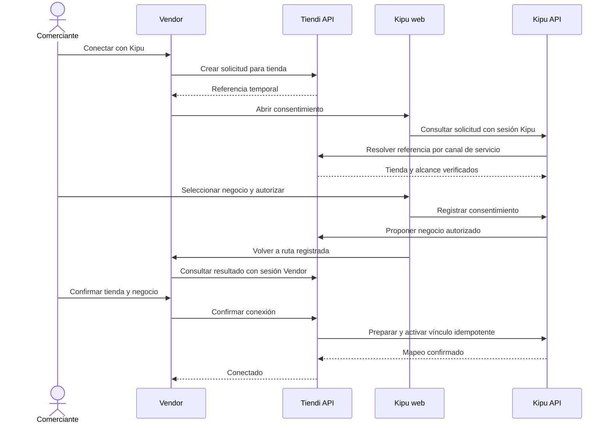

# Vinculación simple entre Kipu y Vendor — guía de implementación

Fecha: 2026-10-11. Estado: propuesta implementable; no ejecutada ni validada en producción.

## 1. Resultado esperado

El comerciante conecta una tienda de Vendor con un negocio de Kipu mediante **Conectar con Kipu**, sin cámara, sin copiar IDs internos y sin compartir contraseñas entre aplicaciones. La vinculación requiere autorización sobre ambos recursos y se realiza una sola vez.

El alcance inicial es autorizar la recepción de liquidaciones de esa tienda en ese negocio. No habilita acceso general a los gastos personales, inventario, clientes ni otras tiendas. Iniciar sesión y vincular negocios son operaciones distintas: esta entrega no requiere implantar SSO ni el launcher.

**Hay cambios en cuatro piezas:** Vendor, Tiendi API, Kipu web y Kipu API. El puente de liquidaciones se conserva donde sea compatible, tras verificar su implementación real.

## 2. Evidencia disponible y comprobaciones previas

| Evidencia local | Implicación |
|---|---|
| Vendor contiene rutas por `storeId`, `storeContextGuard` y `capabilityGuard` en `FUENTES/tiendi-vendor/src/app/vendor/vendor.routes.ts` | Integrar la pantalla en el contexto explícito de tienda y usar el catálogo de capacidades existente |
| `MULTI-TENANCY-KIPU.md` documenta `Negocio.tiendiStoreId @unique`, vinculación manual y validación de pertenencia | Es una base histórica para diseñar el mapeo; comprobar esquema y servicios actuales |
| `INTEGRACION-TIENDI.md` documenta recepción de liquidaciones, idempotencia y reintentos | Conservar los contratos financieros tras contrastarlos con las fuentes |
| Kipu no está en este checkout ni en `.gitmodules`; Tiendi API no tiene fuentes disponibles en su directorio | No se han verificado autenticación actual, implementación del QR ni rutas reales de ambas APIs |

Antes de programar:

- Obtener las fuentes y revisiones vigentes de Kipu y Tiendi API; leer sus instrucciones de desarrollo. No asumir que `tiendi-valia` reemplaza a Kipu.
- Confirmar cuentas individuales, aislamiento de datos y permisos de Kipu. Si sigue usando una cuenta compartida, resolver esto antes de habilitar la integración para múltiples comerciantes.
- Inventariar vínculos existentes, receptor de liquidaciones, cola, reintentos e identificadores de idempotencia.
- Confirmar dominios de cada ambiente y cómo se recupera una sesión después del login; revisar también la persistencia local de Kipu al cambiar de cuenta.
- Localizar el catálogo real de capacidades de Vendor y su autoridad equivalente en Tiendi API.

Los nombres de rutas, modelos y capacidades de esta guía son **propuestos**, salvo donde se señale evidencia existente. No copiar prefijos sin adaptarlos al proyecto.

## 3. Experiencia del comerciante

### Mismo dispositivo: camino principal

1. En Vendor, abrir **Tienda → Integraciones → Kipu** y pulsar **Conectar con Kipu**.
2. Tiendi API crea una solicitud para la tienda y el usuario autenticado. Vendor abre Kipu en la misma pestaña mediante una URL configurada.
3. Kipu pide login si hace falta, conservando solo la referencia temporal de la solicitud. Muestra el nombre de la tienda obtenido del servidor.
4. El usuario selecciona un negocio propio. Si solo tiene uno, aparece preseleccionado; si no tiene ninguno, puede crearlo explícitamente con el nombre sugerido de la tienda.
5. Kipu muestra el alcance: «Recibir en este negocio las liquidaciones de esta tienda». El usuario pulsa **Autorizar y volver a Vendor**.
6. Vendor muestra **Tienda A → Negocio B**, con una referencia de cuenta enmascarada que permita distinguir negocios con nombres iguales. El usuario pulsa **Confirmar conexión**.
7. Vendor muestra **Conectado** únicamente cuando ambas APIs han completado la operación.

La confirmación final evita activar silenciosamente una asociación si alguien obtiene el enlace y autoriza otro negocio. No eliminarla en el protocolo inicial. Se puede simplificar después con un flujo de autorización estándar que garantice la misma correlación de extremo a extremo.

Si cambia la tienda activa durante el recorrido, el retorno sigue mostrando la tienda original. Nunca tomar el nuevo contexto de la interfaz como destino de la solicitud.

### Dispositivos distintos: alternativa

Vendor ofrece **Usar un código**. Mostrar un código de ocho caracteres alfanuméricos legibles, separado en dos grupos, válido durante cinco minutos. En Kipu, **Conectar con Tiendi → Introducir código** abre el mismo consentimiento. Vendor espera y después exige la misma confirmación final.

El código identifica una solicitud; no concede por sí mismo acceso ni activa una conexión. Usar límite de intentos por cuenta, solicitud e IP, y una respuesta que no facilite enumeración. Valores iniciales: cinco fallos por cuenta en diez minutos, con controles adicionales por IP ajustados para redes compartidas.

QR opcional, fuera del primer entregable. Si se incorpora, transporta la misma referencia temporal; nunca credenciales persistentes.

## 4. Arquitectura y responsabilidad

| Componente | Trabajo |
|---|---|
| Vendor | Botón, estado, retorno, confirmación final, errores y desconexión |
| Tiendi API | Verificar permisos sobre tienda; coordinar solicitudes y vínculo; servir estado; controlar emisión y revocación |
| Kipu web | Recuperar solicitud tras login, elegir/crear negocio y mostrar consentimiento |
| Kipu API | Verificar permisos sobre negocio; registrar consentimiento; reservar y activar mapeo; autorizar recepción de liquidaciones |

Tiendi API es la autoridad del ciclo de vida del vínculo. Kipu conserva una copia local versionada para aplicar el acceso a su negocio. Ningún frontend escribe directamente `tiendiStoreId` ni decide si una conexión está activa.

La comunicación entre APIs usa autenticación de servicio con alcance específico, TLS y rotación. Las credenciales permanecen en servidores. No reutilizar sin revisión el token histórico del puente para todos los nuevos endpoints.

Este protocolo es una autorización bilateral propia para enlazar recursos; **no se presenta como OAuth ni emite tokens de sesión entre aplicaciones**. Si existe un proveedor OAuth adecuado, implementar el recorrido con su Authorization Code, PKCE y retornos registrados, manteniendo la autorización por recurso. No construir un servidor OAuth improvisado para este cambio. Véase [RFC 9700](https://www.rfc-editor.org/rfc/rfc9700.html).

## 5. Datos y estados

### Solicitud temporal en Tiendi API

`LinkRequest`: `id`, `storeId`, `initiatedBy`, referencia de sesión iniciadora, hash del secreto de apertura, hash del código alternativo, `expiresAt`, `status`, negocio/cuenta propuestos, alcance, tiempos de consentimiento y confirmación, `linkId` resultante y metadatos de auditoría.

- Referencia de apertura aleatoria de al menos 128 bits; hash en almacenamiento. El código humano necesita además los límites de intentos indicados antes.
- Vigencia inicial de cinco minutos según reloj de servidor. Permitir una solicitud pendiente por tienda; regenerar invalida la anterior.
- Estados: `PENDING → KIPU_APPROVED → CONFIRMING → COMPLETED`; terminales alternativos `CANCELLED`, `EXPIRED`, `FAILED`.
- Solo el iniciador autenticado, manteniendo permisos sobre la tienda, puede confirmar. Si debe volver a iniciar sesión, recuperar por identidad verificada y una nueva confirmación explícita; nunca por poseer la URL.
- Una vez que Kipu autoriza, congelar negocio, cuenta y alcance. Cambiarlos requiere una solicitud nueva. Repetir el mismo consentimiento devuelve el resultado previo; otra selección produce conflicto.
- Consumir de forma atómica al confirmar. Una confirmación ya aceptada puede terminar sus reintentos aunque después venza la solicitud; nunca aceptar una confirmación nueva vencida.

### Vínculo persistente

`KipuLink`: `id`, `storeId`, `kipuNegocioId`, referencia interna de cuenta Kipu, `version`, `status`, `scope`, actores que autorizaron, `createdAt`, `activatedAt`, `revokedAt`, `lastSyncAt` y último error operativo sanitizado.

Estados: `ACTIVATING`, `ACTIVE`, `REVOKING`, `REVOKED`, `ERROR`. Mantener historial; no sobrescribir una relación antigua con otra cuenta.

Para la primera versión: una tienda tiene como máximo un vínculo vigente y un negocio como máximo una tienda. Aplicar exclusión también a reservas `ACTIVATING`, con restricciones transaccionales o índices compatibles con la base real. Los registros revocados no impiden una nueva conexión explícita.

Kipu mantiene `linkId`, `version`, estado, `negocioId` y `tiendiStoreId`. El mapeo histórico `Negocio.tiendiStoreId` puede conservarse por compatibilidad, pero deja de ser prueba suficiente de autorización por sí solo.

## 6. Contratos de API propuestos

### Vendor → Tiendi API

Todas las rutas requieren sesión y autorización backend para la tienda. `integrations.read` e `integrations.manage` son capacidades propuestas que deben agregarse al catálogo central; no basta ocultar un botón.

| Método y ruta relativa | Resultado |
|---|---|
| `POST /stores/:storeId/integrations/kipu/requests` | Crea solicitud; devuelve `requestId`, URL de apertura, código y vencimiento. Admite clave de idempotencia |
| `GET /stores/:storeId/integrations/kipu/requests/:id` | Estado y resumen mínimo del consentimiento, accesibles solo al iniciador autorizado |
| `POST /stores/:storeId/integrations/kipu/requests/:id/confirm` | Confirma la propuesta congelada; `202` mientras activa, `200` si ya terminó |
| `DELETE /stores/:storeId/integrations/kipu/requests/:id` | Cancela una solicitud todavía no confirmada |
| `GET /stores/:storeId/integrations/kipu` | Vínculo, estado y salud de sincronización |
| `DELETE /stores/:storeId/integrations/kipu` | Inicia revocación idempotente del vínculo vigente |

### Kipu web → Kipu API

| Método y ruta relativa | Resultado |
|---|---|
| `POST /integraciones/tiendi/solicitudes/resolver` | Recibe referencia o código; exige sesión; obtiene tienda y alcance del canal servidor |
| `POST /integraciones/tiendi/solicitudes/:id/autorizar` | Recibe `negocioId`; verifica pertenencia y registra consentimiento para esa solicitud |
| `POST /integraciones/tiendi/solicitudes/:id/rechazar` | Rechaza la solicitud resuelta, sin revelar datos de otras cuentas |
| `GET /negocios/:id/integracion-tiendi` | Consulta estado local y sincronización para un negocio autorizado |
| `DELETE /negocios/:id/integracion-tiendi` | Bloquea recepción local y solicita revocación al coordinador |

Crear negocio usa el CRUD existente tras verificarlo. No crear negocios como efecto secundario de abrir enlaces o recibir liquidaciones.

### Canal servidor a servidor

Implementar operaciones internas para resolver solicitudes, proponer un negocio autorizado, preparar/activar un vínculo, consultar su resultado y revocarlo. Cada operación incluye `operationId`, `requestId`, `linkId` y versión según corresponda, autenticación de servicio y validación estricta del cuerpo. Estos endpoints no aceptan sesiones de usuario como sustituto de la credencial de servicio.

Tiendi API revalida el permiso del iniciador al confirmar. Kipu revalida el del aprobador al activar; una revocación de permisos entre consentimiento y activación debe impedir completar la asociación.

Errores: `401` sesión requerida; `403` sin permiso; `404` recurso inexistente o no visible; `409` conflicto de vínculo/versión; `410` solicitud vencida o consumida incompatible; `429` límite de intentos; `503` dependencia no disponible. No devolver datos de la cuenta que ocupa un vínculo ajeno.

## 7. Consistencia, reintentos y desconexión

No existe una transacción única entre las dos bases. Usar una operación durable con outbox y reintentos:

1. Tiendi API confirma atómicamente la solicitud, reserva tienda/vínculo y persiste la tarea de activación en su outbox.
2. Kipu prepara el mapeo reservado, verifica consentimiento y exclusividad, y activa localmente mediante una operación idempotente.
3. Tiendi API registra `ACTIVE` tras la respuesta o consulta de reconciliación. Hasta entonces no habilita emisiones nuevas para ese vínculo.
4. Si se pierde una respuesta, consultar por `operationId` y reintentar. Un timeout no significa rechazo ni justifica crear otro vínculo.
5. Si existe conflicto definitivo, marcar error y liberar únicamente las reservas de esa operación. Una activación remota ya completada requiere revocación explícita de compensación antes de liberar/reutilizar la tienda.

Un reconciliador retoma estados intermedios después de reinicios. Operaciones atrasadas con versión anterior no pueden activar un vínculo ya revocado ni sobrescribir uno nuevo.

Al desconectar desde Vendor, bloquear primero nuevas emisiones y pasar a `REVOKING`; Kipu confirma el bloqueo de recepción y luego se muestra `REVOKED`. Si Kipu está caído, mostrar «Desconexión pendiente», mantener bloqueado el envío y reintentar. Desde Kipu, bloquear primero la recepción local y notificar al coordinador mediante outbox.

Conservar movimientos importados. Serializar la revocación local y la inserción de una liquidación respecto del estado del vínculo: una operación confirmada antes del bloqueo puede haber entrado; después del bloqueo debe rechazarse. No prometer cancelación instantánea de todas las solicitudes en vuelo.

## 8. Cambios concretos por aplicación

### Vendor

- Crear una funcionalidad `features/integrations/kipu` siguiendo los patrones actuales, con cliente HTTP, estado y pantalla.
- Agregar la ruta propuesta `/vendor/:storeId/integrations/kipu` y su retorno bajo el mismo contexto de tienda; ubicar la entrada en configuración de tienda.
- Integrar capacidades con rutas, menú y botones. El servidor sigue siendo quien autoriza.
- Mostrar tienda y negocio antes de confirmar; nunca activar a partir de parámetros del retorno.
- Consultar estado cada dos segundos mientras la solicitud está pendiente y la página visible; detener al vencer, cancelar, completar o salir. Al recargar, recuperar desde servidor.
- Mostrar por separado conexión y sincronización: «Conectado, todavía sin liquidaciones», «Última sincronización…», «Sincronización pendiente» o error recuperable.
- Ofrecer regenerar solicitud vencida, continuar después de login y desconectar con explicación sobre conservación del historial.

### Kipu web

- Crear pantalla de consentimiento accesible por enlace y entrada manual de código.
- Preservar una referencia temporal al pasar por login; volver a resolverla en servidor antes de mostrar datos.
- Usar selector de negocios autorizados, con creación explícita y preselección si solo existe uno.
- Mostrar tienda, negocio, alcance y cuenta activa; permitir cambiar de cuenta sin arrastrar consentimiento o datos de la anterior.
- No encolar vinculaciones en el mecanismo offline de movimientos: requieren ambas APIs disponibles. Mostrar una indicación clara si no hay conexión.
- Para APK, entregar primero un flujo web completo en navegador. Incorporar enlaces de aplicación verificados solo después de auditar plataforma y sesión nativa; no asumir que la sesión del APK se comparte con el navegador.

### Tiendi API y Kipu API

- Implementar modelos, autorización, contratos, restricciones de exclusividad, outbox, reconciliación y auditoría descritos arriba.
- Retirar de uso público la escritura libre de `tiendiStoreId`; el antiguo endpoint manual no puede quedar como bypass de la autorización bilateral.
- Configurar orígenes y retornos por ambiente, límites de intentos, expiraciones y credenciales de servicio.
- No enviar JWT, contraseñas ni tokens del puente en URLs. Resolver la referencia temporal y retirarla de la barra de direcciones; aplicar `Referrer-Policy: no-referrer`, `Cache-Control: no-store` y excluir estas pantallas de analítica que capture URLs.
- Vincular el retorno a la solicitud iniciada y a la sesión/identidad esperada. Permitir solo retornos registrados, nunca una URL arbitraria recibida del navegador. Aplicar protección CSRF cuando se usen cookies.
- Auditar creación, consentimiento, confirmación, activación, fallo y revocación con actores y recursos. No registrar secretos, códigos ni cuerpos sensibles.

## 9. Compatibilidad con liquidaciones y vínculos existentes

Conservar importes, tipos, identificadores de origen e idempotencia del contrato financiero vigente. Una conexión exitosa no debe fabricar un ingreso de prueba ni importar automáticamente toda la historia.

Para proteger desconexión y reconexión, agregar al sobre de transporte del puente `linkId` y `linkVersion` o un identificador equivalente verificable. Kipu solo acepta emisiones para su vínculo activo y versión correspondiente. Desplegar soporte compatible antes de exigir estos campos; definir un corte para mensajes legados sin identificación de vínculo.

Cada trabajo de emisión conserva el destino/vínculo con el que fue creado. No redirigir automáticamente liquidaciones antiguas a otro negocio después de una reconexión. Las pendientes sin destino o de un vínculo revocado requieren conciliación y una decisión explícita sobre período y negocio destino antes de reemitir. Mantener la deduplicación de eventos incluso si cambia el propietario; auditar si la clave histórica basada en `userId` permite duplicados entre cuentas.

Migración:

1. Inventariar y respaldar relaciones y pendientes. Detectar conflictos y conexiones no verificables.
2. Importar vínculos históricos a un estado de revisión, sin inventar consentimiento ni mostrar «verificado».
3. Definir una ventana de transición: vínculos legados solo mantienen el comportamiento previo si su autorización fue comprobada; los demás se pausan para revisión antes de nuevas emisiones.
4. Pedir reconfirmación bilateral cuando falte evidencia; preservar los registros históricos y sus propietarios.
5. Cerrar el mecanismo manual tras migrar y verificar que nadie pueda saltarse el nuevo flujo.

Por defecto, una nueva conexión habilita futuras emisiones. La recuperación de liquidaciones anteriores es una tarea separada, con vista previa y conciliación.

## 10. Secuencia de entrega

| Etapa | Entregable | Condición de salida |
|---|---|---|
| P0 — Auditoría | Revisiones reales, mapa de permisos, contratos y vínculos existentes | Cuentas y aislamiento comprobados; decisiones de migración registradas |
| P1 — Contratos y persistencia | Esquemas de API, migraciones aditivas, estados y credenciales | Contratos acordados entre ambas APIs; exclusividad e idempotencia verificadas |
| P2 — APIs | Consentimiento bilateral, activación, revocación y reconciliación | Pruebas de autorización, concurrencia y fallos parciales aprobadas |
| P3 — Interfaces | Botón Vendor, consentimiento Kipu, retorno y estado | Recorrido completo en mismo dispositivo sin cámara |
| P4 — Alternativa | Código temporal y recuperación de sesión | Recorrido entre dispositivos con confirmación final |
| P5 — Puente y migración | Versionado, tratamiento de pendientes y vínculos legados | Sin duplicados ni cambio silencioso de destinatario |
| P6 — Piloto | Habilitación por tienda, métricas y guía operativa | E2E de conexión, liquidación real de prueba controlada y desconexión |

Desplegar primero migraciones aditivas y APIs compatibles, después interfaces detrás de una bandera por tienda. Habilitar un piloto antes de ampliar. El rollback deshabilita nuevas vinculaciones y conserva historial, operaciones durables y controles de recepción; no restaura el bypass manual ni borra vínculos.

## 11. Pruebas de aceptación

| Caso | Resultado exigido |
|---|---|
| Sesiones activas en el mismo navegador | Conectar sin cámara ni IDs copiados; nombres correctos en ambas confirmaciones |
| Sesión vencida | Login recupera solicitud válida; no cambia identidad o negocio silenciosamente |
| Un negocio / varios / ninguno | Preselección / selector / creación explícita; nunca asociar por coincidencia de nombre |
| Dispositivos distintos | Código resuelve consentimiento; solo el iniciador Vendor confirma |
| Código o enlace robado | No activa vínculo por sí solo; no expone datos financieros; propuesta congelada visible al iniciador |
| Alteración de tienda, negocio, usuario o retorno | Rechazo en servidor y ausencia de escritura no autorizada |
| Pérdida de permisos entre pasos | Revalidación impide activar |
| Código vencido, regenerado, reutilizado o adivinado | Rechazo consistente, límites efectivos y ausencia de vínculo nuevo |
| Doble clic y dos solicitudes concurrentes | Un único vínculo; respuesta idempotente o conflicto legible |
| Cambio de tienda durante el flujo | Se conserva la tienda inicial y se indica al usuario |
| Kipu cae después de aceptar / se pierde respuesta | Estado pendiente, reconciliación y una sola activación |
| Reinicio del coordinador / entrega fuera de orden | Outbox retoma; versiones antiguas no reactivan vínculos |
| Primera liquidación y reintento del mismo evento | Un movimiento, importe/origen correctos y negocio correcto |
| Desconexión con evento en vuelo | Se respeta el punto de bloqueo local; no se aceptan mensajes posteriores para la versión revocada |
| Reconexión a otro negocio o cuenta | Historial preservado; pendientes no cambian de destinatario automáticamente |
| Flujo offline / cámara denegada | Vinculación offline explicada y reintentable; cámara denegada no afecta el flujo principal |
| Endpoint manual legado | No permite eludir la autorización bilateral |
| Aislamiento de cuentas | Listas, consentimiento, estados y caché no revelan recursos ajenos |

Verificar en navegadores móviles y de escritorio soportados; añadir PWA instalada y APK solo si pertenecen al alcance de entrega real. Ejecutar pruebas de integración con bases y APIs reales de prueba, además de unitarias; mocks por sí solos no validan la coordinación distribuida.

Métricas mínimas: solicitudes iniciadas, consentimientos, conexiones completadas, abandonos/vencimientos, tiempo hasta conexión, operaciones pendientes, conflictos, reintentos, revocaciones pendientes y fallos de sincronización. Nunca incluir secretos como etiquetas o eventos.

## 12. Definición de terminado y referencias

El trabajo termina cuando el comerciante puede conectar y desconectar sin cámara, ambos servidores verifican sus recursos, los fallos se recuperan sin duplicar vínculos o movimientos y los vínculos históricos tienen un tratamiento documentado. «Conectado» y «Sincronización correcta» deben estar respaldados por hechos distintos del servidor.

- [Integración y contrato histórico de liquidaciones](INTEGRACION-TIENDI.md).
- [Modelo histórico de negocios Kipu](MULTI-TENANCY-KIPU.md).
- [Catálogo de pruebas E2E](PLAN-PRUEBAS-E2E.md).
- [OAuth 2.0 Security Best Current Practice, RFC 9700](https://www.rfc-editor.org/rfc/rfc9700.html): referencia si se adopta OAuth para autorización.
- [MDN: permisos y requisitos de getUserMedia](https://developer.mozilla.org/en-US/docs/Web/API/MediaDevices/getUserMedia): contexto del escaneo web; no es dependencia del nuevo recorrido.

## 13. Implementación final y verificación (Octubre 2026)

**Estado:** Implementado y verificado localmente en suite unitaria y E2E bilateral.

### 13.1 Contratos de API definitivos

#### Vendor <-> Tiendi API (`FUENTES/tiendi-api`)
- `POST /api/v1/stores/:storeId/integrations/kipu/requests`: Inicia solicitud temporal. Genera `requestId`, `openUrl` (con `ref`), `code` (8 caracteres alfanuméricos en formato `XXXX-XXXX`, expira en 5 min). Requiere permiso `integrations.manage`.
- `GET /api/v1/stores/:storeId/integrations/kipu`: Consulta vínculo activo y estado de conexión (`connected: boolean`, `link`). Requiere `integrations.read`.
- `GET /api/v1/stores/:storeId/integrations/kipu/requests/:id`: Consulta estado de solicitud (`PENDING`, `KIPU_APPROVED`, `EXPIRED`, etc.).
- `POST /api/v1/stores/:storeId/integrations/kipu/requests/:id/confirm`: Confirmación bilateral del comerciante en Vendor. Transiciona a `ACTIVE`, incrementa versión a 1, notifica activación a Kipu API vía M2M.
- `DELETE /api/v1/stores/:storeId/integrations/kipu`: Revocación del vínculo por el comerciante. Pasa a `REVOKED`, notifica a Kipu API y bloquea liquidaciones futuras preservando el historial.

#### Canal Servidor a Servidor (Kipu API <-> Tiendi API)
Autenticación M2M mediante header `Authorization: Bearer <KIPU_SERVICE_TOKEN>` y `KipuServiceTokenGuard` con comparación en tiempo constante (`timingSafeEqual`):
- `POST /api/v1/internal/kipu/requests/resolve`: Resuelve solicitud por `token` (hash SHA-256) o `code` (hash SHA-256). Retorna `{ requestId, storeId, storeName, scope, alreadyApproved }`.
- `POST /api/v1/internal/kipu/requests/:id/propose`: Registra negocio seleccionado en Kipu (`negocioId`, `negocioNombre`). Transiciona a `KIPU_APPROVED`.
- `POST /integraciones/tiendi/links/activate` (en Kipu API): Activa vínculo en negocio de Kipu (`tiendiLinkId`, `tiendiLinkVersion`, `tiendiLinkStatus = 'ACTIVE'`).
- `POST /integraciones/tiendi/links/revoke` (en Kipu API): Desactiva vínculo en Kipu (`tiendiLinkStatus = 'REVOKED'`, `tiendiRevokedAt`).

#### Puente de Liquidaciones
- `POST /integraciones/tiendi/liquidaciones` (en Kipu API): Valida `linkId` y `linkVersion` contra el negocio activo. Si el vínculo está revocado o no coincide, rechaza con `409 Conflict`.

#### Eliminación de Bypass Manual
- `POST /negocios/:id/tienda` en Kipu API: Retirado de uso; responde `403 Forbidden` (`Manual store linking by raw ID is deprecated`).

### 13.2 Persistencia y Migraciones
1. **Tiendi API (PostgreSQL):**
   - Migración: `20261011120000_add_kipu_store_linking`.
   - Modelos: `KipuLinkRequest`, `KipuStoreLink`, `KipuLinkEvent`.
2. **Kipu API (SQLite):**
   - Columnas añadidas a `Negocio`: `tiendiLinkId`, `tiendiLinkVersion`, `tiendiLinkStatus`, `tiendiLinkedAt`, `tiendiRevokedAt`.

### 13.3 Resultados de Verificación
- **Tiendi API:**
  - `kipu-linking.service.spec.ts`: 9 tests passing.
  - `kipu-bridge.service.spec.ts`: 13 tests passing.
  - `admin-shield.spec.ts`: 3 tests passing.
  - `kipu-linking.e2e-spec.ts`: 3 tests passing (E2E HTTP completo con PostgreSQL y Supertest).
- **Kipu API:**
  - `integraciones.service.spec.ts`: 18 tests passing.
  - `negocios.controller.spec.ts`: 3 tests passing.
- **Kipu Web:**
  - `conectar-tiendi.page.spec.ts`: 3 tests passing.
  - `negocios.page.spec.ts`: 7 tests passing.
- **Tiendi Vendor:**
  - `kipu-integration.page.spec.ts`: 4 tests passing.
- **Tiendi Admin:**
  - 5 suites Shield (25 tests passing).

